# AI Field Guides

> **Visual, magazine-grade PDF how-to handbooks for modern AI studios, coding agents, creative tools, and developer workflows.**

Every handbook in this repository is authored as a self-contained **12-page visual field manual**—complete with custom editorial illustrations, annotated UI tours, vector architecture diagrams, color-coded prompt formulas, real-world recipes, and troubleshooting cheat sheets—alongside its editable HTML/CSS source so any guide can be updated in seconds as tools evolve.

<!-- STATS:START -->

<!-- STATS:END -->

---

## Visual Bookshelf

Click any cover card or **Read / Download PDF** link below to view the full handbook directly in GitHub or download a local copy.

<!-- CATALOG:START -->
**Jump to Ecosystem:** [Google AI & Creative Studios](#google-ai--creative-studios) &bull; [Anthropic Claude & Workspace Studios](#anthropic-claude--workspace-studios) &bull; [AI Agent Engineering & Architecture](#ai-agent-engineering--architecture) &bull; [Obsidian & AI Knowledge Systems](#obsidian--ai-knowledge-systems)

### Google AI & Creative Studios
Publication-grade 12-page visual handbooks covering Google AI Ultra's creative studios, agentic coding IDEs, source-grounded research tools, and autonomous browser workflows.

<table>
  <tr>
    <td width="50%" valign="top">
      <a href="guides/google/google-flow/Google_Flow_Complete_How_To_Guide.pdf">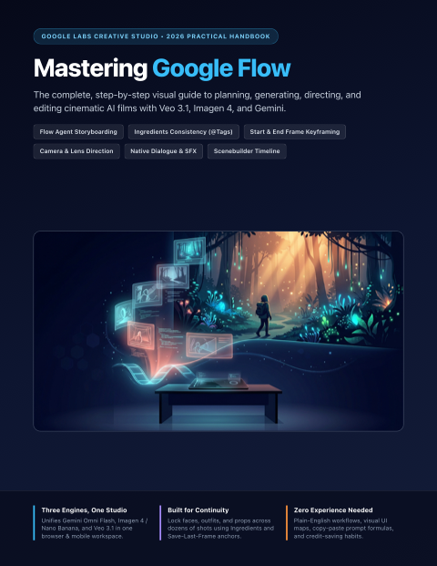</a>
      <h3><a href="guides/google/google-flow/Google_Flow_Complete_How_To_Guide.pdf">Google Flow</a></h3>
      
<strong>v1.0</strong> &bull; Updated <code>2026-11</code> &bull; 12 Pages

      
Cinematic AI filmmaking studio powered by Veo 3.1, Ingredients consistency, Frames-to-Video transitions, and Scenebuilder.

      
<code>Filmmaking</code> &middot; <code>Veo 3.1</code> &middot; <code>Creative Studio</code>

      
<a href="guides/google/google-flow/Google_Flow_Complete_How_To_Guide.pdf"><strong>&#128214; Read / Download PDF</strong></a> &nbsp;|&nbsp; <a href="guides/google/google-flow">&#128736; Editable Source</a>

    </td>
    <td width="50%" valign="top">
      <a href="guides/google/google-antigravity-and-jules/Google_Antigravity_and_Jules_Complete_How_To_Guide.pdf">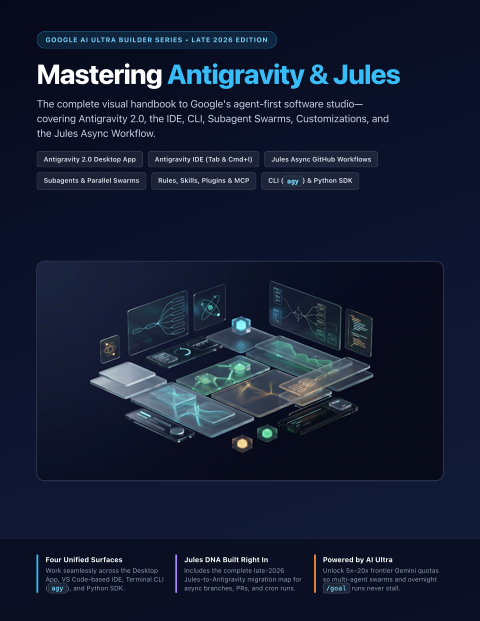</a>
      <h3><a href="guides/google/google-antigravity-and-jules/Google_Antigravity_and_Jules_Complete_How_To_Guide.pdf">Google Antigravity &amp; Jules</a></h3>
      
<strong>v1.0</strong> &bull; Updated <code>2026-11</code> &bull; 12 Pages

      
Agent-first desktop IDE, parallel subagents, skills/MCP customization, and asynchronous GitHub PR automation with Jules.

      
<code>Agentic IDE</code> &middot; <code>Coding Agents</code> &middot; <code>GitHub</code>

      
<a href="guides/google/google-antigravity-and-jules/Google_Antigravity_and_Jules_Complete_How_To_Guide.pdf"><strong>&#128214; Read / Download PDF</strong></a> &nbsp;|&nbsp; <a href="guides/google/google-antigravity-and-jules">&#128736; Editable Source</a>

    </td>
  </tr>
  <tr>
    <td width="50%" valign="top">
      <a href="guides/google/google-whisk/Google_Whisk_Complete_How_To_Guide.pdf">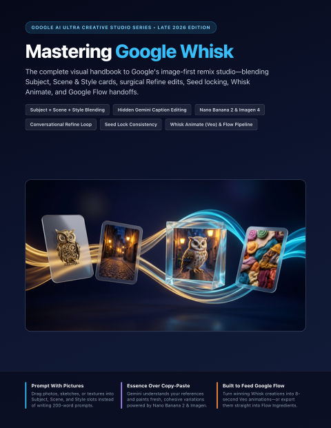</a>
      <h3><a href="guides/google/google-whisk/Google_Whisk_Complete_How_To_Guide.pdf">Google Whisk</a></h3>
      
<strong>v1.0</strong> &bull; Updated <code>2026-11</code> &bull; 12 Pages

      
Image-first visual remixing studio blending Subject, Scene &amp; Style cards, hidden Gemini captions, Seed locking, and Whisk Animate.

      
<code>Image Remix</code> &middot; <code>Nano Banana 2</code> &middot; <code>Imagen 4</code>

      
<a href="guides/google/google-whisk/Google_Whisk_Complete_How_To_Guide.pdf"><strong>&#128214; Read / Download PDF</strong></a> &nbsp;|&nbsp; <a href="guides/google/google-whisk">&#128736; Editable Source</a>

    </td>
    <td width="50%" valign="top">
      <a href="guides/google/google-vids/Google_Vids_Complete_How_To_Guide.pdf">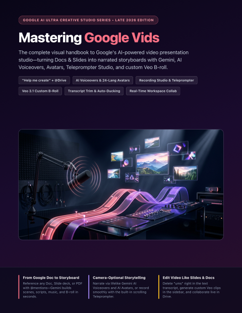</a>
      <h3><a href="guides/google/google-vids/Google_Vids_Complete_How_To_Guide.pdf">Google Vids</a></h3>
      
<strong>v1.0</strong> &bull; Updated <code>2026-11</code> &bull; 12 Pages

      
Workspace AI video presentation studio turning Docs &amp; Slides into narrated storyboards with AI voiceovers, avatars, teleprompter, and Veo B-roll.

      
<code>Video Decks</code> &middot; <code>Workspace</code> &middot; <code>Veo B-Roll</code>

      
<a href="guides/google/google-vids/Google_Vids_Complete_How_To_Guide.pdf"><strong>&#128214; Read / Download PDF</strong></a> &nbsp;|&nbsp; <a href="guides/google/google-vids">&#128736; Editable Source</a>

    </td>
  </tr>
  <tr>
    <td width="50%" valign="top">
      <a href="guides/google/google-stitch/Google_Stitch_Complete_How_To_Guide.pdf">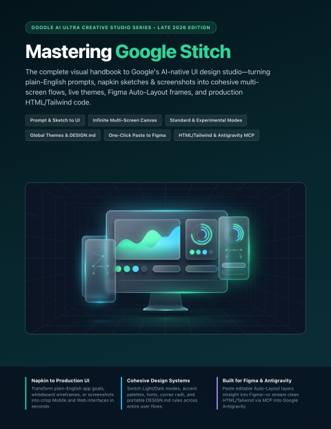</a>
      <h3><a href="guides/google/google-stitch/Google_Stitch_Complete_How_To_Guide.pdf">Google Stitch</a></h3>
      
<strong>v1.0</strong> &bull; Updated <code>2026-11</code> &bull; 12 Pages

      
AI-native UI/UX design studio turning prompts, sketches, and screenshots into multi-screen flows, Figma Auto-Layout frames, and Tailwind code.

      
<code>UI/UX Design</code> &middot; <code>Figma</code> &middot; <code>Frontend Code</code>

      
<a href="guides/google/google-stitch/Google_Stitch_Complete_How_To_Guide.pdf"><strong>&#128214; Read / Download PDF</strong></a> &nbsp;|&nbsp; <a href="guides/google/google-stitch">&#128736; Editable Source</a>

    </td>
    <td width="50%" valign="top">
      <a href="guides/google/google-opal/Google_Opal_Complete_How_To_Guide.pdf">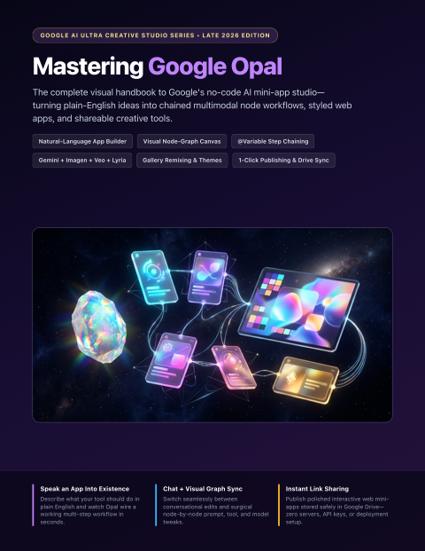</a>
      <h3><a href="guides/google/google-opal/Google_Opal_Complete_How_To_Guide.pdf">Google Opal</a></h3>
      
<strong>v1.0</strong> &bull; Updated <code>2026-11</code> &bull; 12 Pages

      
Visual no-code AI mini-app studio chaining Gemini, Imagen, Veo, Lyria, and Web Search nodes into shareable interactive apps.

      
<code>No-Code Apps</code> &middot; <code>Node Workflows</code> &middot; <code>Google Labs</code>

      
<a href="guides/google/google-opal/Google_Opal_Complete_How_To_Guide.pdf"><strong>&#128214; Read / Download PDF</strong></a> &nbsp;|&nbsp; <a href="guides/google/google-opal">&#128736; Editable Source</a>

    </td>
  </tr>
  <tr>
    <td width="50%" valign="top">
      <a href="guides/google/google-ai-studio/Google_AI_Studio_Complete_How_To_Guide.pdf">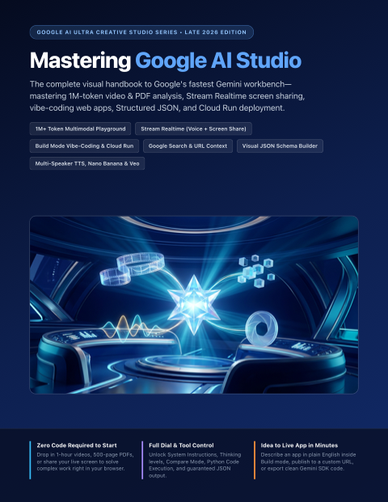</a>
      <h3><a href="guides/google/google-ai-studio/Google_AI_Studio_Complete_How_To_Guide.pdf">Google AI Studio</a></h3>
      
<strong>v1.0</strong> &bull; Updated <code>2026-11</code> &bull; 12 Pages

      
Flagship Gemini developer &amp; power-user workbench for 1M+ token video/PDF analysis, Stream Realtime screen share, Build vibe-coding, and SDKs.

      
<code>Gemini API</code> &middot; <code>Multimodal</code> &middot; <code>Vibe Coding</code>

      
<a href="guides/google/google-ai-studio/Google_AI_Studio_Complete_How_To_Guide.pdf"><strong>&#128214; Read / Download PDF</strong></a> &nbsp;|&nbsp; <a href="guides/google/google-ai-studio">&#128736; Editable Source</a>

    </td>
    <td width="50%" valign="top">
      <a href="guides/google/google-notebooklm/Google_NotebookLM_Complete_How_To_Guide.pdf">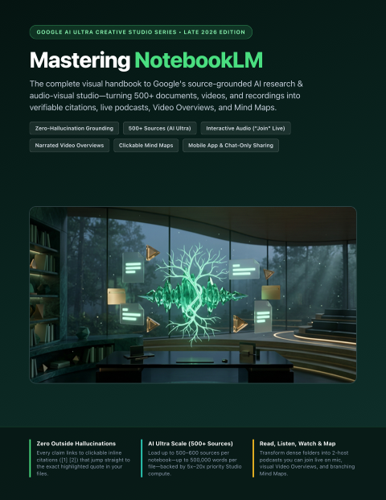</a>
      <h3><a href="guides/google/google-notebooklm/Google_NotebookLM_Complete_How_To_Guide.pdf">Google NotebookLM</a></h3>
      
<strong>v1.0</strong> &bull; Updated <code>2026-11</code> &bull; 12 Pages

      
Zero-hallucination research studio for 500+ sources, live interactive Join Audio Overviews, Video Overviews, and clickable Mind Maps.

      
<code>Research</code> &middot; <code>Audio Overviews</code> &middot; <code>Mind Maps</code>

      
<a href="guides/google/google-notebooklm/Google_NotebookLM_Complete_How_To_Guide.pdf"><strong>&#128214; Read / Download PDF</strong></a> &nbsp;|&nbsp; <a href="guides/google/google-notebooklm">&#128736; Editable Source</a>

    </td>
  </tr>
  <tr>
    <td width="50%" valign="top">
      <a href="guides/google/google-gemini-deep-research-canvas-and-gems/Google_Gemini_Deep_Research_Canvas_and_Gems_Complete_How_To_Guide.pdf">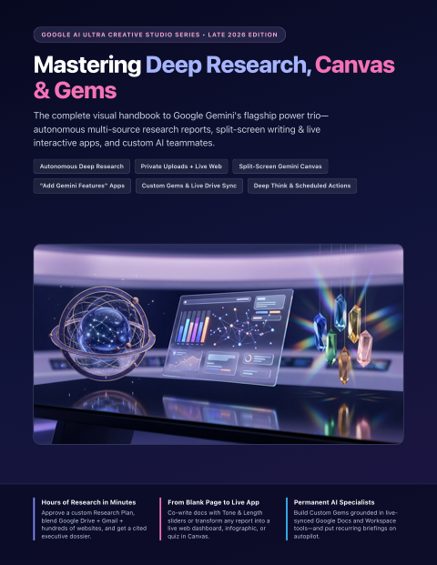</a>
      <h3><a href="guides/google/google-gemini-deep-research-canvas-and-gems/Google_Gemini_Deep_Research_Canvas_and_Gems_Complete_How_To_Guide.pdf">Gemini Deep Research, Canvas &amp; Gems</a></h3>
      
<strong>v1.0</strong> &bull; Updated <code>2026-11</code> &bull; 12 Pages

      
Autonomous multi-hundred-site research dossiers, split-screen Canvas live apps with embedded AI, and custom Drive-synced Gems.

      
<code>Deep Research</code> &middot; <code>Canvas Apps</code> &middot; <code>Custom Gems</code>

      
<a href="guides/google/google-gemini-deep-research-canvas-and-gems/Google_Gemini_Deep_Research_Canvas_and_Gems_Complete_How_To_Guide.pdf"><strong>&#128214; Read / Download PDF</strong></a> &nbsp;|&nbsp; <a href="guides/google/google-gemini-deep-research-canvas-and-gems">&#128736; Editable Source</a>

    </td>
    <td width="50%" valign="top">
      <a href="guides/google/google-project-mariner/Google_Project_Mariner_Complete_How_To_Guide.pdf">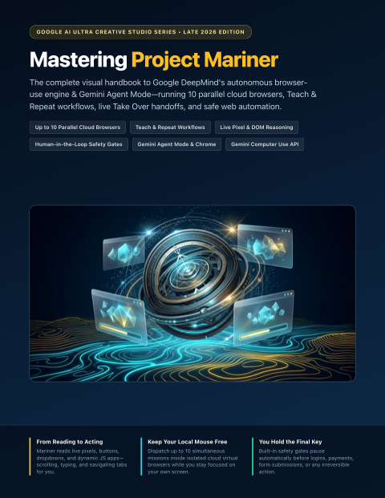</a>
      <h3><a href="guides/google/google-project-mariner/Google_Project_Mariner_Complete_How_To_Guide.pdf">Google Project Mariner</a></h3>
      
<strong>v1.0</strong> &bull; Updated <code>2026-11</code> &bull; 12 Pages

      
Autonomous browser-use agent &amp; Gemini Agent Mode running up to 10 parallel cloud browsers, Teach &amp; Repeat skills, and safety gates.

      
<code>Browser Agent</code> &middot; <code>Automation</code> &middot; <code>Computer Use</code>

      
<a href="guides/google/google-project-mariner/Google_Project_Mariner_Complete_How_To_Guide.pdf"><strong>&#128214; Read / Download PDF</strong></a> &nbsp;|&nbsp; <a href="guides/google/google-project-mariner">&#128736; Editable Source</a>

    </td>
  </tr>
</table>

### Anthropic Claude & Workspace Studios
Publication-grade 12-page visual handbooks for Anthropic's agentic coding and collaborative workspace suite—covering Claude Code Mods, multiplayer Claude Whiteboards, Claude Dashboards & Data, and cross-surface Claude Skills.

<table>
  <tr>
    <td width="50%" valign="top">
      <a href="guides/claude/claude-code-mods/Claude_Code_Mods_Complete_How_To_Guide.pdf">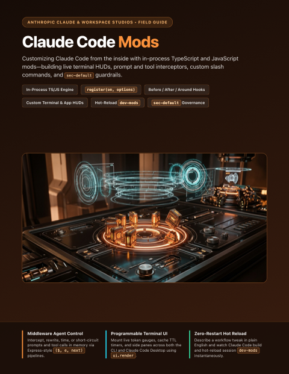</a>
      <h3><a href="guides/claude/claude-code-mods/Claude_Code_Mods_Complete_How_To_Guide.pdf">Claude Code Mods</a></h3>
      
<strong>v1.0</strong> &bull; Updated <code>2026-11</code> &bull; 12 Pages

      
Customizing Claude Code from the inside with in-process TypeScript/JavaScript mods—building live terminal HUDs, prompt/tool interceptors, custom slash commands, and sec-default guardrails.

      
<code>Claude Code</code> &middot; <code>TypeScript Mods</code> &middot; <code>Agent Hooks &amp; UI</code>

      
<a href="guides/claude/claude-code-mods/Claude_Code_Mods_Complete_How_To_Guide.pdf"><strong>&#128214; Read / Download PDF</strong></a> &nbsp;|&nbsp; <a href="guides/claude/claude-code-mods">&#128736; Editable Source</a>

    </td>
    <td width="50%" valign="top">
      <a href="guides/claude/claude-whiteboards/Claude_Whiteboards_Complete_How_To_Guide.pdf">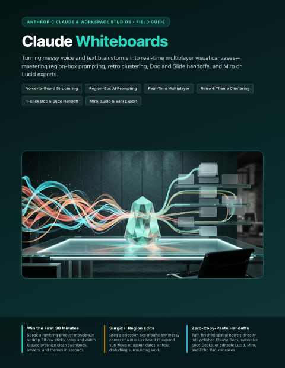</a>
      <h3><a href="guides/claude/claude-whiteboards/Claude_Whiteboards_Complete_How_To_Guide.pdf">Claude Whiteboards</a></h3>
      
<strong>v1.0</strong> &bull; Updated <code>2026-11</code> &bull; 12 Pages

      
Turning messy voice and text brainstorms into real-time multiplayer visual canvases—mastering region-box prompting, retro clustering, Doc/Slide handoffs, and Miro/Lucid exports.

      
<code>Visual Canvas</code> &middot; <code>Multiplayer Ideation</code> &middot; <code>Miro &amp; Lucid</code>

      
<a href="guides/claude/claude-whiteboards/Claude_Whiteboards_Complete_How_To_Guide.pdf"><strong>&#128214; Read / Download PDF</strong></a> &nbsp;|&nbsp; <a href="guides/claude/claude-whiteboards">&#128736; Editable Source</a>

    </td>
  </tr>
  <tr>
    <td width="50%" valign="top">
      <a href="guides/claude/claude-dashboards-and-data/Claude_Dashboards_and_Data_Complete_How_To_Guide.pdf">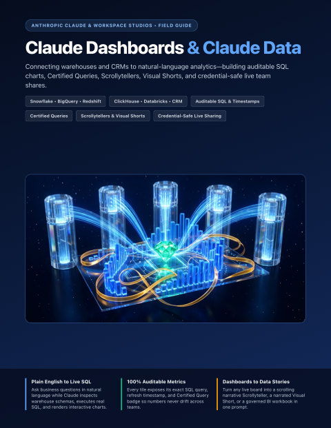</a>
      <h3><a href="guides/claude/claude-dashboards-and-data/Claude_Dashboards_and_Data_Complete_How_To_Guide.pdf">Claude Dashboards &amp; Data</a></h3>
      
<strong>v1.0</strong> &bull; Updated <code>2026-11</code> &bull; 12 Pages

      
Connecting warehouses and CRMs to natural-language analytics—building auditable SQL charts, Certified Queries, Scrollytellers, Visual Shorts, and credential-safe live team shares.

      
<code>Claude Data</code> &middot; <code>Live SQL Dashboards</code> &middot; <code>Certified Queries</code>

      
<a href="guides/claude/claude-dashboards-and-data/Claude_Dashboards_and_Data_Complete_How_To_Guide.pdf"><strong>&#128214; Read / Download PDF</strong></a> &nbsp;|&nbsp; <a href="guides/claude/claude-dashboards-and-data">&#128736; Editable Source</a>

    </td>
    <td width="50%" valign="top">
      <a href="guides/claude/claude-skills/Claude_Skills_Complete_How_To_Guide.pdf">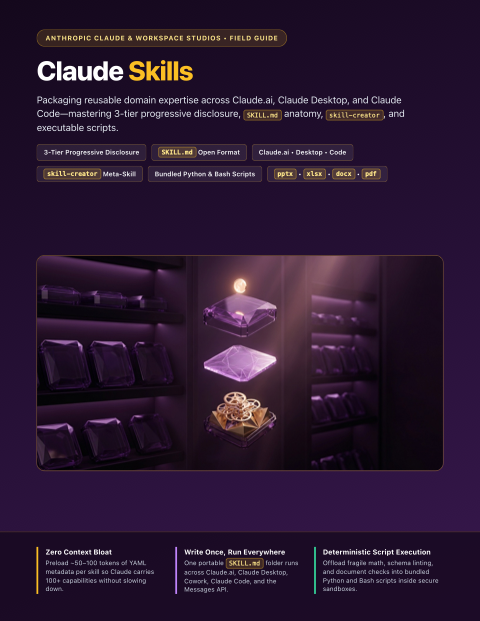</a>
      <h3><a href="guides/claude/claude-skills/Claude_Skills_Complete_How_To_Guide.pdf">Claude Skills</a></h3>
      
<strong>v1.0</strong> &bull; Updated <code>2026-11</code> &bull; 12 Pages

      
Packaging reusable domain expertise across Claude.ai, Claude Desktop, and Claude Code—mastering 3-tier progressive disclosure, SKILL.md anatomy, skill-creator, and executable scripts.

      
<code>SKILL.md</code> &middot; <code>Progressive Disclosure</code> &middot; <code>Skill Creator</code>

      
<a href="guides/claude/claude-skills/Claude_Skills_Complete_How_To_Guide.pdf"><strong>&#128214; Read / Download PDF</strong></a> &nbsp;|&nbsp; <a href="guides/claude/claude-skills">&#128736; Editable Source</a>

    </td>
  </tr>
</table>

### AI Agent Engineering & Architecture
Practical 12-page visual handbooks for context engineering, multi-agent orchestration, parallel Git worktrees, vector RAG, security, evals, System One decision models, and local on-device AI.

<table>
  <tr>
    <td width="50%" valign="top">
      <a href="guides/agent-engineering/spec-driven-context-engineering/Spec_Driven_Dev_and_Context_Engineering_Complete_How_To_Guide.pdf">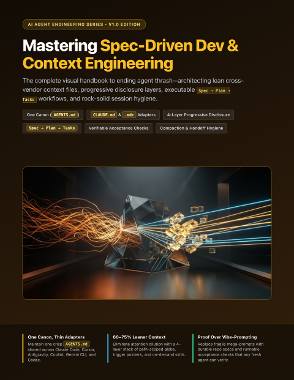</a>
      <h3><a href="guides/agent-engineering/spec-driven-context-engineering/Spec_Driven_Dev_and_Context_Engineering_Complete_How_To_Guide.pdf">Spec-Driven Dev &amp; Context Engineering</a></h3>
      
<strong>v1.0</strong> &bull; Updated <code>2026-11</code> &bull; 12 Pages

      
Cross-vendor context architecture (AGENTS.md, CLAUDE.md, Cursor rules), progressive disclosure, and Spec-to-Plan-to-Tasks agent workflows.

      
<code>Context Engineering</code> &middot; <code>AGENTS.md</code> &middot; <code>Spec-Driven Dev</code>

      
<a href="guides/agent-engineering/spec-driven-context-engineering/Spec_Driven_Dev_and_Context_Engineering_Complete_How_To_Guide.pdf"><strong>&#128214; Read / Download PDF</strong></a> &nbsp;|&nbsp; <a href="guides/agent-engineering/spec-driven-context-engineering">&#128736; Editable Source</a>

    </td>
    <td width="50%" valign="top">
      <a href="guides/agent-engineering/subagents-and-orchestration/Subagents_and_Agent_Orchestration_Complete_How_To_Guide.pdf">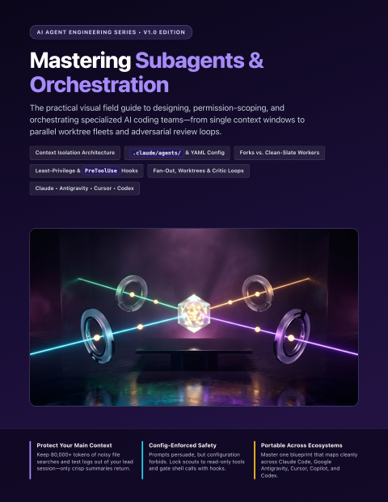</a>
      <h3><a href="guides/agent-engineering/subagents-and-orchestration/Subagents_and_Agent_Orchestration_Complete_How_To_Guide.pdf">Subagents &amp; Agent Orchestration</a></h3>
      
<strong>v1.0</strong> &bull; Updated <code>2026-11</code> &bull; 12 Pages

      
Designing specialist subagents, context forks, least-privilege tool scoping, lifecycle hooks, and multi-agent coordinator-worker swarms.

      
<code>Subagents</code> &middot; <code>Orchestration</code> &middot; <code>Least Privilege</code>

      
<a href="guides/agent-engineering/subagents-and-orchestration/Subagents_and_Agent_Orchestration_Complete_How_To_Guide.pdf"><strong>&#128214; Read / Download PDF</strong></a> &nbsp;|&nbsp; <a href="guides/agent-engineering/subagents-and-orchestration">&#128736; Editable Source</a>

    </td>
  </tr>
  <tr>
    <td width="50%" valign="top">
      <a href="guides/agent-engineering/git-worktrees-and-parallel-safety/Git_Worktrees_and_Parallel_Agent_Safety_Complete_How_To_Guide.pdf">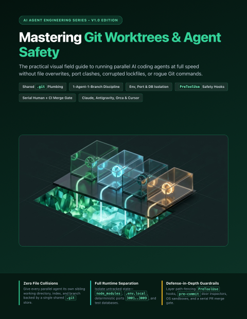</a>
      <h3><a href="guides/agent-engineering/git-worktrees-and-parallel-safety/Git_Worktrees_and_Parallel_Agent_Safety_Complete_How_To_Guide.pdf">Git Worktrees &amp; Parallel Agent Safety</a></h3>
      
<strong>v1.0</strong> &bull; Updated <code>2026-11</code> &bull; 12 Pages

      
Running parallel coding agents without file collisions—covering Git worktree fleets, isolated ports/databases, safety hooks, and teardown.

      
<code>Git Worktrees</code> &middot; <code>Parallel Agents</code> &middot; <code>Safety Hooks</code>

      
<a href="guides/agent-engineering/git-worktrees-and-parallel-safety/Git_Worktrees_and_Parallel_Agent_Safety_Complete_How_To_Guide.pdf"><strong>&#128214; Read / Download PDF</strong></a> &nbsp;|&nbsp; <a href="guides/agent-engineering/git-worktrees-and-parallel-safety">&#128736; Editable Source</a>

    </td>
    <td width="50%" valign="top">
      <a href="guides/agent-engineering/vector-memory-and-rag/Vector_Memory_and_Semantic_Search_RAG_Complete_How_To_Guide.pdf">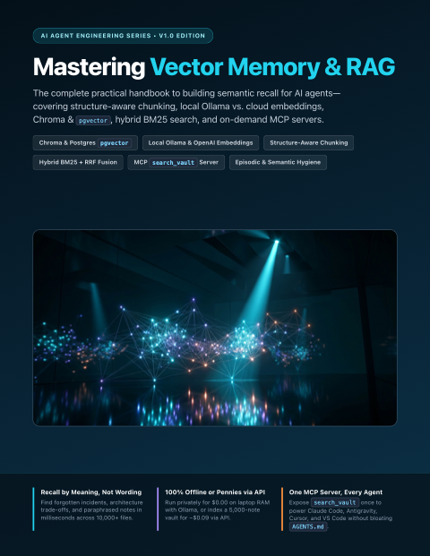</a>
      <h3><a href="guides/agent-engineering/vector-memory-and-rag/Vector_Memory_and_Semantic_Search_RAG_Complete_How_To_Guide.pdf">Vector Memory &amp; Semantic Search (RAG)</a></h3>
      
<strong>v1.0</strong> &bull; Updated <code>2026-11</code> &bull; 12 Pages

      
Building persistent semantic memory for AI agents with structure-aware chunking, Chroma, pgvector, Qdrant, local Ollama, and hybrid retrieval.

      
<code>Vector Memory</code> &middot; <code>RAG</code> &middot; <code>Embeddings</code>

      
<a href="guides/agent-engineering/vector-memory-and-rag/Vector_Memory_and_Semantic_Search_RAG_Complete_How_To_Guide.pdf"><strong>&#128214; Read / Download PDF</strong></a> &nbsp;|&nbsp; <a href="guides/agent-engineering/vector-memory-and-rag">&#128736; Editable Source</a>

    </td>
  </tr>
  <tr>
    <td width="50%" valign="top">
      <a href="guides/agent-engineering/ai-evals-and-regression-testing/AI_Evals_and_Regression_Testing_Complete_How_To_Guide.pdf">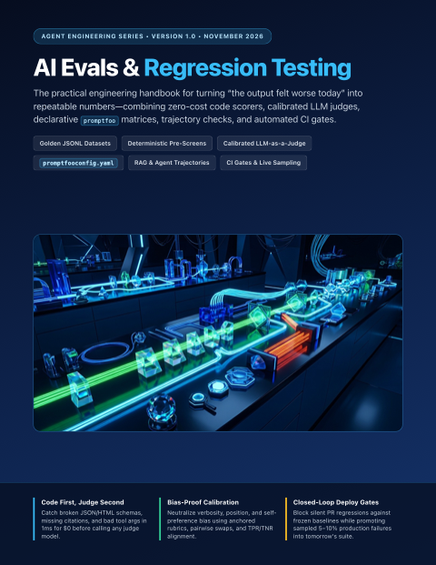</a>
      <h3><a href="guides/agent-engineering/ai-evals-and-regression-testing/AI_Evals_and_Regression_Testing_Complete_How_To_Guide.pdf">AI Evals &amp; Regression Testing</a></h3>
      
<strong>v1.0</strong> &bull; Updated <code>2026-11</code> &bull; 12 Pages

      
Turning LLM vibe-checks into deterministic CI deploy gates with golden datasets, code scorers, calibrated LLM-as-judge, and Promptfoo.

      
<code>AI Evals</code> &middot; <code>CI Gating</code> &middot; <code>Promptfoo</code>

      
<a href="guides/agent-engineering/ai-evals-and-regression-testing/AI_Evals_and_Regression_Testing_Complete_How_To_Guide.pdf"><strong>&#128214; Read / Download PDF</strong></a> &nbsp;|&nbsp; <a href="guides/agent-engineering/ai-evals-and-regression-testing">&#128736; Editable Source</a>

    </td>
    <td width="50%" valign="top">
      <a href="guides/agent-engineering/prompt-injection-and-agent-security/Prompt_Injection_and_Agent_Security_Complete_How_To_Guide.pdf">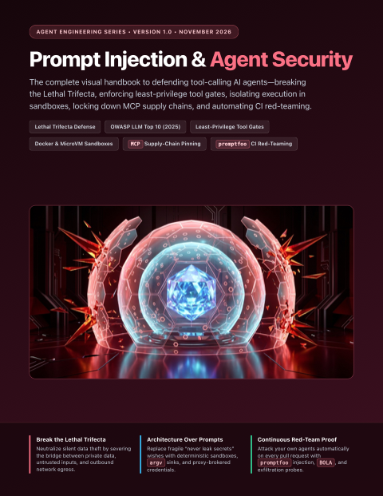</a>
      <h3><a href="guides/agent-engineering/prompt-injection-and-agent-security/Prompt_Injection_and_Agent_Security_Complete_How_To_Guide.pdf">Prompt Injection &amp; Agent Security</a></h3>
      
<strong>v1.0</strong> &bull; Updated <code>2026-11</code> &bull; 12 Pages

      
Defending tool-calling and browsing AI agents against indirect prompt injection, poisoned MCP servers, secret exfiltration, and unsafe output sinks.

      
<code>Agent Security</code> &middot; <code>Prompt Injection</code> &middot; <code>MCP Safety</code>

      
<a href="guides/agent-engineering/prompt-injection-and-agent-security/Prompt_Injection_and_Agent_Security_Complete_How_To_Guide.pdf"><strong>&#128214; Read / Download PDF</strong></a> &nbsp;|&nbsp; <a href="guides/agent-engineering/prompt-injection-and-agent-security">&#128736; Editable Source</a>

    </td>
  </tr>
  <tr>
    <td width="50%" valign="top">
      <a href="guides/agent-engineering/local-and-on-device-ai/Local_and_On_Device_AI_Stack_Complete_How_To_Guide.pdf">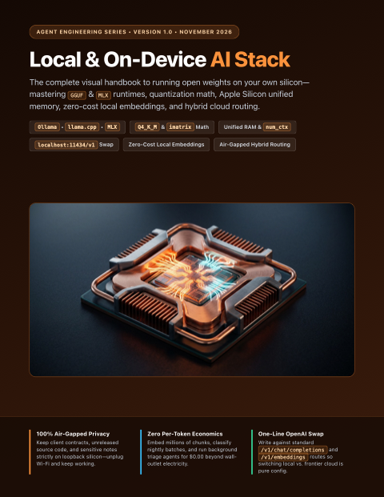</a>
      <h3><a href="guides/agent-engineering/local-and-on-device-ai/Local_and_On_Device_AI_Stack_Complete_How_To_Guide.pdf">Local &amp; On-Device AI Stack</a></h3>
      
<strong>v1.0</strong> &bull; Updated <code>2026-11</code> &bull; 12 Pages

      
Running private, zero-per-token LLMs and embeddings on your own hardware—mastering GGUF quantization, Apple Silicon memory math, Ollama, and llama.cpp.

      
<code>Local AI</code> &middot; <code>Ollama</code> &middot; <code>Apple Silicon</code>

      
<a href="guides/agent-engineering/local-and-on-device-ai/Local_and_On_Device_AI_Stack_Complete_How_To_Guide.pdf"><strong>&#128214; Read / Download PDF</strong></a> &nbsp;|&nbsp; <a href="guides/agent-engineering/local-and-on-device-ai">&#128736; Editable Source</a>

    </td>
    <td width="50%" valign="top">
      <a href="guides/agent-engineering/jev-and-system-one-decisions/Jev_and_System_One_Decisions_Complete_How_To_Guide.pdf">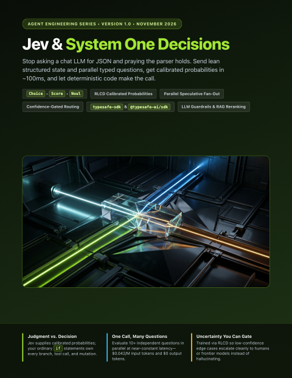</a>
      <h3><a href="guides/agent-engineering/jev-and-system-one-decisions/Jev_and_System_One_Decisions_Complete_How_To_Guide.pdf">Jev &amp; System One Decisions</a></h3>
      
<strong>v1.0</strong> &bull; Updated <code>2026-11</code> &bull; 12 Pages

      
Replacing fragile LLM JSON parsing with fast, calibrated System One decisions—mastering Choice, Score, and Noul primitives, parallel fan-out, and confidence-gated routing.

      
<code>System One</code> &middot; <code>Calibrated Decisions</code> &middot; <code>Model Routing</code>

      
<a href="guides/agent-engineering/jev-and-system-one-decisions/Jev_and_System_One_Decisions_Complete_How_To_Guide.pdf"><strong>&#128214; Read / Download PDF</strong></a> &nbsp;|&nbsp; <a href="guides/agent-engineering/jev-and-system-one-decisions">&#128736; Editable Source</a>

    </td>
  </tr>
</table>

### Obsidian & AI Knowledge Systems
Publication-grade 12-page visual handbooks for turning Obsidian vaults into AI-native Second Brains—covering Claude Desktop & Antigravity Desktop workflows, native Bases & JSON Canvas, autonomous LLM Wikis, Graphify knowledge graphs, and multi-device vault security.

<table>
  <tr>
    <td width="50%" valign="top">
      <a href="guides/obsidian/obsidian-desktop-ai-agents/Obsidian_and_Desktop_AI_Agents_Complete_How_To_Guide.pdf">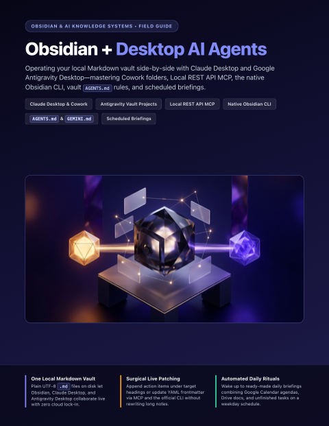</a>
      <h3><a href="guides/obsidian/obsidian-desktop-ai-agents/Obsidian_and_Desktop_AI_Agents_Complete_How_To_Guide.pdf">Obsidian + Desktop AI Agents</a></h3>
      
<strong>v1.0</strong> &bull; Updated <code>2026-11</code> &bull; 12 Pages

      
Operating your Obsidian vault side-by-side with Claude Desktop and Google Antigravity Desktop—mastering Cowork folders, Local REST API MCP, the native Obsidian CLI, vault AGENTS.md rules, and scheduled briefings.

      
<code>Claude Desktop</code> &middot; <code>Antigravity Desktop</code> &middot; <code>Obsidian MCP &amp; CLI</code>

      
<a href="guides/obsidian/obsidian-desktop-ai-agents/Obsidian_and_Desktop_AI_Agents_Complete_How_To_Guide.pdf"><strong>&#128214; Read / Download PDF</strong></a> &nbsp;|&nbsp; <a href="guides/obsidian/obsidian-desktop-ai-agents">&#128736; Editable Source</a>

    </td>
    <td width="50%" valign="top">
      <a href="guides/obsidian/obsidian-bases-and-json-canvas-agents/Obsidian_Bases_and_JSON_Canvas_with_AI_Complete_How_To_Guide.pdf">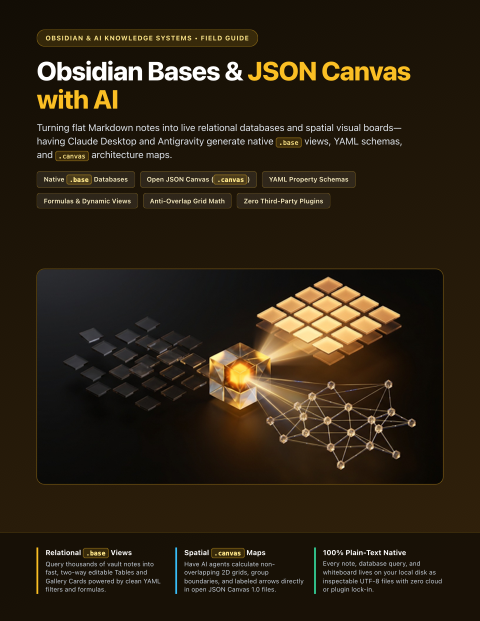</a>
      <h3><a href="guides/obsidian/obsidian-bases-and-json-canvas-agents/Obsidian_Bases_and_JSON_Canvas_with_AI_Complete_How_To_Guide.pdf">Obsidian Bases &amp; JSON Canvas with AI</a></h3>
      
<strong>v1.0</strong> &bull; Updated <code>2026-11</code> &bull; 12 Pages

      
Turning flat Markdown notes into live relational databases and spatial visual boards—having Claude Desktop and Antigravity generate native .base views, YAML schemas, and .canvas architecture maps.

      
<code>Obsidian Bases</code> &middot; <code>JSON Canvas</code> &middot; <code>Structured PKM</code>

      
<a href="guides/obsidian/obsidian-bases-and-json-canvas-agents/Obsidian_Bases_and_JSON_Canvas_with_AI_Complete_How_To_Guide.pdf"><strong>&#128214; Read / Download PDF</strong></a> &nbsp;|&nbsp; <a href="guides/obsidian/obsidian-bases-and-json-canvas-agents">&#128736; Editable Source</a>

    </td>
  </tr>
  <tr>
    <td width="50%" valign="top">
      <a href="guides/obsidian/autonomous-llm-wiki-vault/Autonomous_LLM_Wiki_and_Research_Vault_Complete_How_To_Guide.pdf">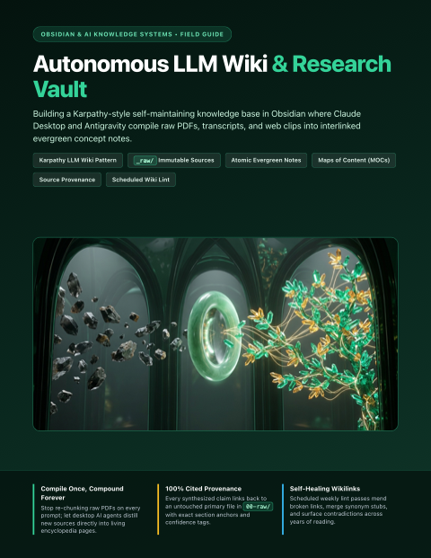</a>
      <h3><a href="guides/obsidian/autonomous-llm-wiki-vault/Autonomous_LLM_Wiki_and_Research_Vault_Complete_How_To_Guide.pdf">Autonomous LLM Wiki &amp; Research Vault</a></h3>
      
<strong>v1.0</strong> &bull; Updated <code>2026-11</code> &bull; 12 Pages

      
Building a Karpathy-style self-maintaining knowledge base in Obsidian where Claude Desktop and Antigravity compile raw PDFs, transcripts, and web clips into interlinked evergreen concept notes.

      
<code>LLM Wiki</code> &middot; <code>Deep Research</code> &middot; <code>Second Brain</code>

      
<a href="guides/obsidian/autonomous-llm-wiki-vault/Autonomous_LLM_Wiki_and_Research_Vault_Complete_How_To_Guide.pdf"><strong>&#128214; Read / Download PDF</strong></a> &nbsp;|&nbsp; <a href="guides/obsidian/autonomous-llm-wiki-vault">&#128736; Editable Source</a>

    </td>
    <td width="50%" valign="top">
      <a href="guides/obsidian/graphify-and-obsidian-knowledge-graphs/AI_Agents_Graphify_and_Obsidian_Complete_How_To_Guide.pdf">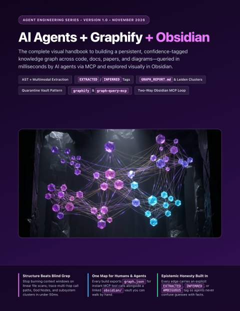</a>
      <h3><a href="guides/obsidian/graphify-and-obsidian-knowledge-graphs/AI_Agents_Graphify_and_Obsidian_Complete_How_To_Guide.pdf">AI Agents + Graphify + Obsidian</a></h3>
      
<strong>v1.0</strong> &bull; Updated <code>2026-11</code> &bull; 12 Pages

      
Building persistent, queryable knowledge graphs from codebases and notes that you explore visually in Obsidian and expose to AI agents via MCP.

      
<code>Knowledge Graphs</code> &middot; <code>Obsidian</code> &middot; <code>Graphify MCP</code>

      
<a href="guides/obsidian/graphify-and-obsidian-knowledge-graphs/AI_Agents_Graphify_and_Obsidian_Complete_How_To_Guide.pdf"><strong>&#128214; Read / Download PDF</strong></a> &nbsp;|&nbsp; <a href="guides/obsidian/graphify-and-obsidian-knowledge-graphs">&#128736; Editable Source</a>

    </td>
  </tr>
  <tr>
    <td width="50%" valign="top">
      <a href="guides/obsidian/vault-security-privacy-and-sync/Obsidian_Vault_Security_Privacy_and_Sync_Complete_How_To_Guide.pdf">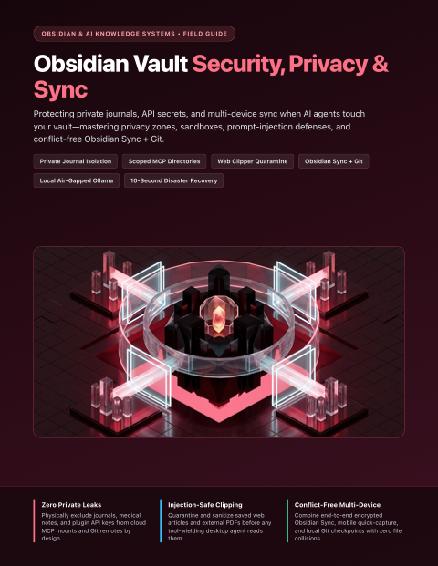</a>
      <h3><a href="guides/obsidian/vault-security-privacy-and-sync/Obsidian_Vault_Security_Privacy_and_Sync_Complete_How_To_Guide.pdf">Obsidian Vault Security, Privacy &amp; Sync</a></h3>
      
<strong>v1.0</strong> &bull; Updated <code>2026-11</code> &bull; 12 Pages

      
Protecting private journals, API secrets, and multi-device sync when AI agents touch your vault—mastering privacy zones, sandboxes, prompt-injection defenses, and conflict-free Obsidian Sync + Git.

      
<code>Vault Privacy</code> &middot; <code>Obsidian Sync &amp; Git</code> &middot; <code>Agent Governance</code>

      
<a href="guides/obsidian/vault-security-privacy-and-sync/Obsidian_Vault_Security_Privacy_and_Sync_Complete_How_To_Guide.pdf"><strong>&#128214; Read / Download PDF</strong></a> &nbsp;|&nbsp; <a href="guides/obsidian/vault-security-privacy-and-sync">&#128736; Editable Source</a>

    </td>
    <td width="50%"></td>
  </tr>
</table>

### Quick-Reference Index
| Guide | Ecosystem | Version | Updated | Pages | Direct Links |
| :--- | :--- | :---: | :---: | :---: | :--- |
| **Google Flow** — Cinematic AI filmmaking studio powered by Veo 3.1, Ingredients consistency, Frames-to-Video transitions, and Scenebuilder. | Google AI & Creative Studios | `v1.0` | `2026-11` | 12 | [PDF](guides/google/google-flow/Google_Flow_Complete_How_To_Guide.pdf) &middot; [Source](guides/google/google-flow) |
| **Google Antigravity & Jules** — Agent-first desktop IDE, parallel subagents, skills/MCP customization, and asynchronous GitHub PR automation with Jules. | Google AI & Creative Studios | `v1.0` | `2026-11` | 12 | [PDF](guides/google/google-antigravity-and-jules/Google_Antigravity_and_Jules_Complete_How_To_Guide.pdf) &middot; [Source](guides/google/google-antigravity-and-jules) |
| **Google Whisk** — Image-first visual remixing studio blending Subject, Scene & Style cards, hidden Gemini captions, Seed locking, and Whisk Animate. | Google AI & Creative Studios | `v1.0` | `2026-11` | 12 | [PDF](guides/google/google-whisk/Google_Whisk_Complete_How_To_Guide.pdf) &middot; [Source](guides/google/google-whisk) |
| **Google Vids** — Workspace AI video presentation studio turning Docs & Slides into narrated storyboards with AI voiceovers, avatars, teleprompter, and Veo B-roll. | Google AI & Creative Studios | `v1.0` | `2026-11` | 12 | [PDF](guides/google/google-vids/Google_Vids_Complete_How_To_Guide.pdf) &middot; [Source](guides/google/google-vids) |
| **Google Stitch** — AI-native UI/UX design studio turning prompts, sketches, and screenshots into multi-screen flows, Figma Auto-Layout frames, and Tailwind code. | Google AI & Creative Studios | `v1.0` | `2026-11` | 12 | [PDF](guides/google/google-stitch/Google_Stitch_Complete_How_To_Guide.pdf) &middot; [Source](guides/google/google-stitch) |
| **Google Opal** — Visual no-code AI mini-app studio chaining Gemini, Imagen, Veo, Lyria, and Web Search nodes into shareable interactive apps. | Google AI & Creative Studios | `v1.0` | `2026-11` | 12 | [PDF](guides/google/google-opal/Google_Opal_Complete_How_To_Guide.pdf) &middot; [Source](guides/google/google-opal) |
| **Google AI Studio** — Flagship Gemini developer & power-user workbench for 1M+ token video/PDF analysis, Stream Realtime screen share, Build vibe-coding, and SDKs. | Google AI & Creative Studios | `v1.0` | `2026-11` | 12 | [PDF](guides/google/google-ai-studio/Google_AI_Studio_Complete_How_To_Guide.pdf) &middot; [Source](guides/google/google-ai-studio) |
| **Google NotebookLM** — Zero-hallucination research studio for 500+ sources, live interactive Join Audio Overviews, Video Overviews, and clickable Mind Maps. | Google AI & Creative Studios | `v1.0` | `2026-11` | 12 | [PDF](guides/google/google-notebooklm/Google_NotebookLM_Complete_How_To_Guide.pdf) &middot; [Source](guides/google/google-notebooklm) |
| **Gemini Deep Research, Canvas & Gems** — Autonomous multi-hundred-site research dossiers, split-screen Canvas live apps with embedded AI, and custom Drive-synced Gems. | Google AI & Creative Studios | `v1.0` | `2026-11` | 12 | [PDF](guides/google/google-gemini-deep-research-canvas-and-gems/Google_Gemini_Deep_Research_Canvas_and_Gems_Complete_How_To_Guide.pdf) &middot; [Source](guides/google/google-gemini-deep-research-canvas-and-gems) |
| **Google Project Mariner** — Autonomous browser-use agent & Gemini Agent Mode running up to 10 parallel cloud browsers, Teach & Repeat skills, and safety gates. | Google AI & Creative Studios | `v1.0` | `2026-11` | 12 | [PDF](guides/google/google-project-mariner/Google_Project_Mariner_Complete_How_To_Guide.pdf) &middot; [Source](guides/google/google-project-mariner) |
| **Claude Code Mods** — Customizing Claude Code from the inside with in-process TypeScript/JavaScript mods—building live terminal HUDs, prompt/tool interceptors, custom slash commands, and sec-default guardrails. | Anthropic Claude & Workspace Studios | `v1.0` | `2026-11` | 12 | [PDF](guides/claude/claude-code-mods/Claude_Code_Mods_Complete_How_To_Guide.pdf) &middot; [Source](guides/claude/claude-code-mods) |
| **Claude Whiteboards** — Turning messy voice and text brainstorms into real-time multiplayer visual canvases—mastering region-box prompting, retro clustering, Doc/Slide handoffs, and Miro/Lucid exports. | Anthropic Claude & Workspace Studios | `v1.0` | `2026-11` | 12 | [PDF](guides/claude/claude-whiteboards/Claude_Whiteboards_Complete_How_To_Guide.pdf) &middot; [Source](guides/claude/claude-whiteboards) |
| **Claude Dashboards & Data** — Connecting warehouses and CRMs to natural-language analytics—building auditable SQL charts, Certified Queries, Scrollytellers, Visual Shorts, and credential-safe live team shares. | Anthropic Claude & Workspace Studios | `v1.0` | `2026-11` | 12 | [PDF](guides/claude/claude-dashboards-and-data/Claude_Dashboards_and_Data_Complete_How_To_Guide.pdf) &middot; [Source](guides/claude/claude-dashboards-and-data) |
| **Claude Skills** — Packaging reusable domain expertise across Claude.ai, Claude Desktop, and Claude Code—mastering 3-tier progressive disclosure, SKILL.md anatomy, skill-creator, and executable scripts. | Anthropic Claude & Workspace Studios | `v1.0` | `2026-11` | 12 | [PDF](guides/claude/claude-skills/Claude_Skills_Complete_How_To_Guide.pdf) &middot; [Source](guides/claude/claude-skills) |
| **Spec-Driven Dev & Context Engineering** — Cross-vendor context architecture (AGENTS.md, CLAUDE.md, Cursor rules), progressive disclosure, and Spec-to-Plan-to-Tasks agent workflows. | AI Agent Engineering & Architecture | `v1.0` | `2026-11` | 12 | [PDF](guides/agent-engineering/spec-driven-context-engineering/Spec_Driven_Dev_and_Context_Engineering_Complete_How_To_Guide.pdf) &middot; [Source](guides/agent-engineering/spec-driven-context-engineering) |
| **Subagents & Agent Orchestration** — Designing specialist subagents, context forks, least-privilege tool scoping, lifecycle hooks, and multi-agent coordinator-worker swarms. | AI Agent Engineering & Architecture | `v1.0` | `2026-11` | 12 | [PDF](guides/agent-engineering/subagents-and-orchestration/Subagents_and_Agent_Orchestration_Complete_How_To_Guide.pdf) &middot; [Source](guides/agent-engineering/subagents-and-orchestration) |
| **Git Worktrees & Parallel Agent Safety** — Running parallel coding agents without file collisions—covering Git worktree fleets, isolated ports/databases, safety hooks, and teardown. | AI Agent Engineering & Architecture | `v1.0` | `2026-11` | 12 | [PDF](guides/agent-engineering/git-worktrees-and-parallel-safety/Git_Worktrees_and_Parallel_Agent_Safety_Complete_How_To_Guide.pdf) &middot; [Source](guides/agent-engineering/git-worktrees-and-parallel-safety) |
| **Vector Memory & Semantic Search (RAG)** — Building persistent semantic memory for AI agents with structure-aware chunking, Chroma, pgvector, Qdrant, local Ollama, and hybrid retrieval. | AI Agent Engineering & Architecture | `v1.0` | `2026-11` | 12 | [PDF](guides/agent-engineering/vector-memory-and-rag/Vector_Memory_and_Semantic_Search_RAG_Complete_How_To_Guide.pdf) &middot; [Source](guides/agent-engineering/vector-memory-and-rag) |
| **AI Evals & Regression Testing** — Turning LLM vibe-checks into deterministic CI deploy gates with golden datasets, code scorers, calibrated LLM-as-judge, and Promptfoo. | AI Agent Engineering & Architecture | `v1.0` | `2026-11` | 12 | [PDF](guides/agent-engineering/ai-evals-and-regression-testing/AI_Evals_and_Regression_Testing_Complete_How_To_Guide.pdf) &middot; [Source](guides/agent-engineering/ai-evals-and-regression-testing) |
| **Prompt Injection & Agent Security** — Defending tool-calling and browsing AI agents against indirect prompt injection, poisoned MCP servers, secret exfiltration, and unsafe output sinks. | AI Agent Engineering & Architecture | `v1.0` | `2026-11` | 12 | [PDF](guides/agent-engineering/prompt-injection-and-agent-security/Prompt_Injection_and_Agent_Security_Complete_How_To_Guide.pdf) &middot; [Source](guides/agent-engineering/prompt-injection-and-agent-security) |
| **Local & On-Device AI Stack** — Running private, zero-per-token LLMs and embeddings on your own hardware—mastering GGUF quantization, Apple Silicon memory math, Ollama, and llama.cpp. | AI Agent Engineering & Architecture | `v1.0` | `2026-11` | 12 | [PDF](guides/agent-engineering/local-and-on-device-ai/Local_and_On_Device_AI_Stack_Complete_How_To_Guide.pdf) &middot; [Source](guides/agent-engineering/local-and-on-device-ai) |
| **Jev & System One Decisions** — Replacing fragile LLM JSON parsing with fast, calibrated System One decisions—mastering Choice, Score, and Noul primitives, parallel fan-out, and confidence-gated routing. | AI Agent Engineering & Architecture | `v1.0` | `2026-11` | 12 | [PDF](guides/agent-engineering/jev-and-system-one-decisions/Jev_and_System_One_Decisions_Complete_How_To_Guide.pdf) &middot; [Source](guides/agent-engineering/jev-and-system-one-decisions) |
| **Obsidian + Desktop AI Agents** — Operating your Obsidian vault side-by-side with Claude Desktop and Google Antigravity Desktop—mastering Cowork folders, Local REST API MCP, the native Obsidian CLI, vault AGENTS.md rules, and scheduled briefings. | Obsidian & AI Knowledge Systems | `v1.0` | `2026-11` | 12 | [PDF](guides/obsidian/obsidian-desktop-ai-agents/Obsidian_and_Desktop_AI_Agents_Complete_How_To_Guide.pdf) &middot; [Source](guides/obsidian/obsidian-desktop-ai-agents) |
| **Obsidian Bases & JSON Canvas with AI** — Turning flat Markdown notes into live relational databases and spatial visual boards—having Claude Desktop and Antigravity generate native .base views, YAML schemas, and .canvas architecture maps. | Obsidian & AI Knowledge Systems | `v1.0` | `2026-11` | 12 | [PDF](guides/obsidian/obsidian-bases-and-json-canvas-agents/Obsidian_Bases_and_JSON_Canvas_with_AI_Complete_How_To_Guide.pdf) &middot; [Source](guides/obsidian/obsidian-bases-and-json-canvas-agents) |
| **Autonomous LLM Wiki & Research Vault** — Building a Karpathy-style self-maintaining knowledge base in Obsidian where Claude Desktop and Antigravity compile raw PDFs, transcripts, and web clips into interlinked evergreen concept notes. | Obsidian & AI Knowledge Systems | `v1.0` | `2026-11` | 12 | [PDF](guides/obsidian/autonomous-llm-wiki-vault/Autonomous_LLM_Wiki_and_Research_Vault_Complete_How_To_Guide.pdf) &middot; [Source](guides/obsidian/autonomous-llm-wiki-vault) |
| **AI Agents + Graphify + Obsidian** — Building persistent, queryable knowledge graphs from codebases and notes that you explore visually in Obsidian and expose to AI agents via MCP. | Obsidian & AI Knowledge Systems | `v1.0` | `2026-11` | 12 | [PDF](guides/obsidian/graphify-and-obsidian-knowledge-graphs/AI_Agents_Graphify_and_Obsidian_Complete_How_To_Guide.pdf) &middot; [Source](guides/obsidian/graphify-and-obsidian-knowledge-graphs) |
| **Obsidian Vault Security, Privacy & Sync** — Protecting private journals, API secrets, and multi-device sync when AI agents touch your vault—mastering privacy zones, sandboxes, prompt-injection defenses, and conflict-free Obsidian Sync + Git. | Obsidian & AI Knowledge Systems | `v1.0` | `2026-11` | 12 | [PDF](guides/obsidian/vault-security-privacy-and-sync/Obsidian_Vault_Security_Privacy_and_Sync_Complete_How_To_Guide.pdf) &middot; [Source](guides/obsidian/vault-security-privacy-and-sync) |
<!-- CATALOG:END -->

---

## Inside Every 12-Page Handbook

Each self-contained bundle under [`guides/`](guides/) includes both the ready-to-read print PDF and its editable web source:

- **`<Title>_Complete_How_To_Guide.pdf`** — Print-verified 12-page US Letter (`8.5in × 11in`) visual handbook ready to view in GitHub, iPad/Kindle, or print.
- **`guide.html` & `style.css`** — Clean, dependency-free HTML & print CSS source for customizing, remixing, or updating any page in a browser.
- **`assets/` & `cover.png`** — Custom 16:9 editorial illustrations and bookshelf cover card.
