# Twelve Pages

> **Visual, magazine-grade 12-page handbooks for modern software, AI studios, coding agents, creative tools, and developer workflows.**

Every handbook in this repository is authored as a self-contained **12-page visual handbook**—complete with custom editorial illustrations, annotated UI tours, vector architecture diagrams, color-coded prompt formulas, real-world recipes, and troubleshooting cheat sheets—alongside its editable HTML/CSS source so any guide can be updated in seconds as tools evolve.

> **Read Online at [twelve-pages.com](https://twelve-pages.com)** — Browse all 77 handbooks in a clean, mobile-friendly web reader or download any 12-page magazine PDF in one click.

<!-- STATS:START -->

<!-- STATS:END -->

---

## Visual Bookshelf

Click any cover card or **Read / Download PDF** link below to view the full handbook directly in GitHub or download a local copy.

<!-- CATALOG:START -->
**Jump to Ecosystem:** [Google AI & Creative Studios](#google-ai--creative-studios) &bull; [Anthropic Claude & Workspace Studios](#anthropic-claude--workspace-studios) &bull; [OpenAI Codex, Agents & Realtime Studios](#openai-codex-agents--realtime-studios) &bull; [Vercel & Full-Stack AI Applications](#vercel--full-stack-ai-applications) &bull; [AI Agent Engineering & Architecture](#ai-agent-engineering--architecture) &bull; [Obsidian & AI Knowledge Systems](#obsidian--ai-knowledge-systems) &bull; [AI Music, Cinema & Presentation Studios](#ai-music-cinema--presentation-studios) &bull; [AI Search Visibility, Agentic Web & Workflows](#ai-search-visibility-agentic-web--workflows) &bull; [Open Harnesses, AI Terminals & Local Models](#open-harnesses-ai-terminals--local-models) &bull; [AI Desktop, OS Power Workflows & Personal Ops](#ai-desktop-os-power-workflows--personal-ops)

### Google AI & Creative Studios
Publication-grade 12-page visual handbooks covering Google AI Ultra's creative studios, Google ADK & Agent2Agent (A2A) protocol, Antigravity 2.0 customizations & swarms, Gemini 3.8 Live & Omni 1.2 Flash voice/video pipelines, agentic Firebase & Android CLI workflows, and autonomous browser agents.

<table>
  <tr>
    <td width="50%" valign="top">
      <a href="guides/google/google-flow/Google_Flow_Complete_How_To_Guide.pdf">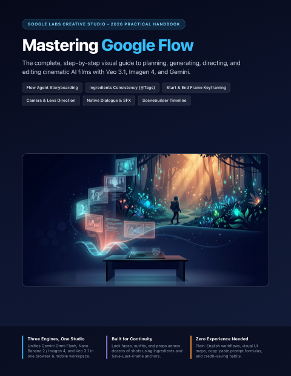</a>
      <h3><a href="guides/google/google-flow/Google_Flow_Complete_How_To_Guide.pdf">Google Flow</a></h3>
      
<strong>v1.0</strong> &bull; Updated <code>2026-11</code> &bull; 12 Pages

      
Cinematic AI filmmaking studio powered by Veo 3.1, Ingredients consistency, Frames-to-Video transitions, and Scenebuilder.

      
<code>Filmmaking</code> &middot; <code>Veo 3.1</code> &middot; <code>Creative Studio</code>

      
<a href="guides/google/google-flow/Google_Flow_Complete_How_To_Guide.pdf"><strong>&#128214; Read / Download PDF</strong></a> &nbsp;|&nbsp; <a href="guides/google/google-flow">&#128736; Editable Source</a>

    </td>
    <td width="50%" valign="top">
      <a href="guides/google/google-antigravity-and-jules/Google_Antigravity_and_Jules_Complete_How_To_Guide.pdf">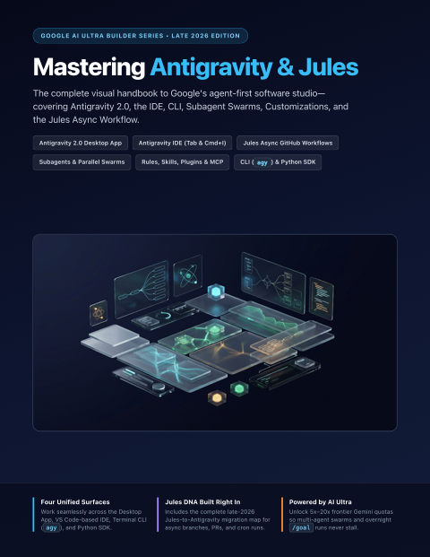</a>
      <h3><a href="guides/google/google-antigravity-and-jules/Google_Antigravity_and_Jules_Complete_How_To_Guide.pdf">Google Antigravity &amp; Jules</a></h3>
      
<strong>v1.0</strong> &bull; Updated <code>2026-11</code> &bull; 12 Pages

      
Agent-first desktop IDE, parallel subagents, skills/MCP customization, and asynchronous GitHub PR automation with Jules.

      
<code>Agentic IDE</code> &middot; <code>Coding Agents</code> &middot; <code>GitHub</code>

      
<a href="guides/google/google-antigravity-and-jules/Google_Antigravity_and_Jules_Complete_How_To_Guide.pdf"><strong>&#128214; Read / Download PDF</strong></a> &nbsp;|&nbsp; <a href="guides/google/google-antigravity-and-jules">&#128736; Editable Source</a>

    </td>
  </tr>
  <tr>
    <td width="50%" valign="top">
      <a href="guides/google/google-whisk/Google_Whisk_Complete_How_To_Guide.pdf">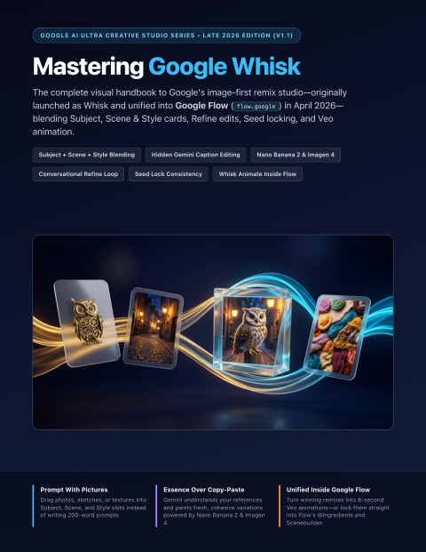</a>
      <h3><a href="guides/google/google-whisk/Google_Whisk_Complete_How_To_Guide.pdf">Google Whisk</a></h3>
      
<strong>v1.1</strong> &bull; Updated <code>2026-11</code> &bull; 12 Pages

      
Image-first visual remixing studio blending Subject, Scene &amp; Style cards, hidden Gemini captions, Seed locking, and Whisk Animate.

      
<code>Image Remix</code> &middot; <code>Nano Banana 2</code> &middot; <code>Imagen 4</code>

      
<a href="guides/google/google-whisk/Google_Whisk_Complete_How_To_Guide.pdf"><strong>&#128214; Read / Download PDF</strong></a> &nbsp;|&nbsp; <a href="guides/google/google-whisk">&#128736; Editable Source</a>

    </td>
    <td width="50%" valign="top">
      <a href="guides/google/google-vids/Google_Vids_Complete_How_To_Guide.pdf">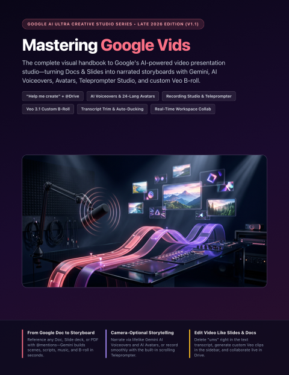</a>
      <h3><a href="guides/google/google-vids/Google_Vids_Complete_How_To_Guide.pdf">Google Vids</a></h3>
      
<strong>v1.1</strong> &bull; Updated <code>2026-11</code> &bull; 12 Pages

      
Workspace AI video presentation studio turning Docs &amp; Slides into narrated storyboards with AI voiceovers, avatars, teleprompter, and Veo B-roll.

      
<code>Video Decks</code> &middot; <code>Workspace</code> &middot; <code>Veo B-Roll</code>

      
<a href="guides/google/google-vids/Google_Vids_Complete_How_To_Guide.pdf"><strong>&#128214; Read / Download PDF</strong></a> &nbsp;|&nbsp; <a href="guides/google/google-vids">&#128736; Editable Source</a>

    </td>
  </tr>
  <tr>
    <td width="50%" valign="top">
      <a href="guides/google/google-stitch/Google_Stitch_Complete_How_To_Guide.pdf">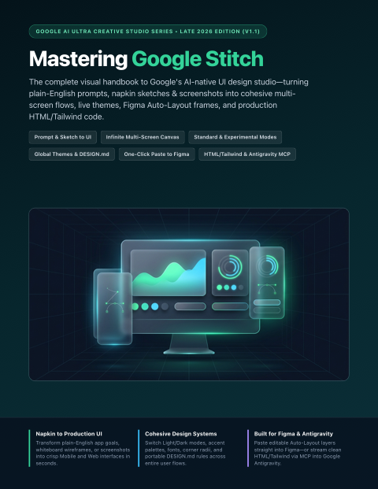</a>
      <h3><a href="guides/google/google-stitch/Google_Stitch_Complete_How_To_Guide.pdf">Google Stitch</a></h3>
      
<strong>v1.1</strong> &bull; Updated <code>2026-11</code> &bull; 12 Pages

      
AI-native UI/UX design studio turning prompts, sketches, and screenshots into multi-screen flows, Figma Auto-Layout frames, and Tailwind code.

      
<code>UI/UX Design</code> &middot; <code>Figma</code> &middot; <code>Frontend Code</code>

      
<a href="guides/google/google-stitch/Google_Stitch_Complete_How_To_Guide.pdf"><strong>&#128214; Read / Download PDF</strong></a> &nbsp;|&nbsp; <a href="guides/google/google-stitch">&#128736; Editable Source</a>

    </td>
    <td width="50%" valign="top">
      <a href="guides/google/google-opal/Google_Opal_Complete_How_To_Guide.pdf">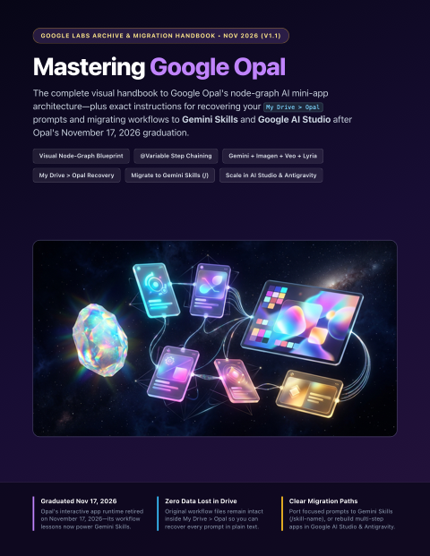</a>
      <h3><a href="guides/google/google-opal/Google_Opal_Complete_How_To_Guide.pdf">Google Opal</a></h3>
      
<strong>v1.1</strong> &bull; Updated <code>2026-11</code> &bull; 12 Pages

      
Visual no-code AI mini-app studio chaining Gemini, Imagen, Veo, Lyria, and Web Search nodes into shareable interactive apps.

      
<code>No-Code Apps</code> &middot; <code>Node Workflows</code> &middot; <code>Google Labs</code>

      
<a href="guides/google/google-opal/Google_Opal_Complete_How_To_Guide.pdf"><strong>&#128214; Read / Download PDF</strong></a> &nbsp;|&nbsp; <a href="guides/google/google-opal">&#128736; Editable Source</a>

    </td>
  </tr>
  <tr>
    <td width="50%" valign="top">
      <a href="guides/google/google-ai-studio/Google_AI_Studio_Complete_How_To_Guide.pdf">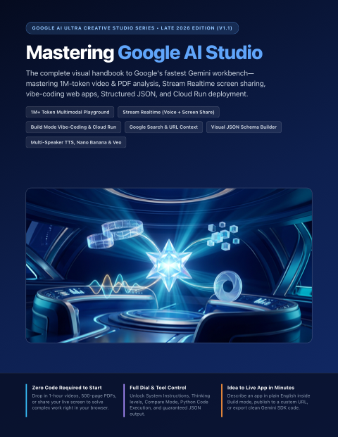</a>
      <h3><a href="guides/google/google-ai-studio/Google_AI_Studio_Complete_How_To_Guide.pdf">Google AI Studio</a></h3>
      
<strong>v1.1</strong> &bull; Updated <code>2026-11</code> &bull; 12 Pages

      
Flagship Gemini developer &amp; power-user workbench for 1M+ token video/PDF analysis, Stream Realtime screen share, Build vibe-coding, and SDKs.

      
<code>Gemini API</code> &middot; <code>Multimodal</code> &middot; <code>Vibe Coding</code>

      
<a href="guides/google/google-ai-studio/Google_AI_Studio_Complete_How_To_Guide.pdf"><strong>&#128214; Read / Download PDF</strong></a> &nbsp;|&nbsp; <a href="guides/google/google-ai-studio">&#128736; Editable Source</a>

    </td>
    <td width="50%" valign="top">
      <a href="guides/google/google-notebooklm/Google_NotebookLM_Complete_How_To_Guide.pdf">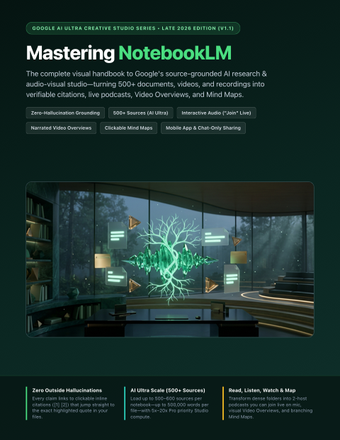</a>
      <h3><a href="guides/google/google-notebooklm/Google_NotebookLM_Complete_How_To_Guide.pdf">Google NotebookLM</a></h3>
      
<strong>v1.1</strong> &bull; Updated <code>2026-11</code> &bull; 12 Pages

      
Zero-hallucination research studio for 500+ sources, live interactive Join Audio Overviews, Video Overviews, and clickable Mind Maps.

      
<code>Research</code> &middot; <code>Audio Overviews</code> &middot; <code>Mind Maps</code>

      
<a href="guides/google/google-notebooklm/Google_NotebookLM_Complete_How_To_Guide.pdf"><strong>&#128214; Read / Download PDF</strong></a> &nbsp;|&nbsp; <a href="guides/google/google-notebooklm">&#128736; Editable Source</a>

    </td>
  </tr>
  <tr>
    <td width="50%" valign="top">
      <a href="guides/google/google-gemini-deep-research-canvas-and-gems/Google_Gemini_Deep_Research_Canvas_and_Gems_Complete_How_To_Guide.pdf">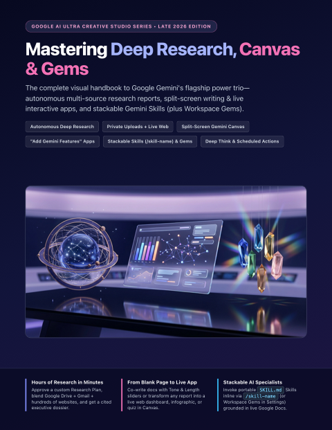</a>
      <h3><a href="guides/google/google-gemini-deep-research-canvas-and-gems/Google_Gemini_Deep_Research_Canvas_and_Gems_Complete_How_To_Guide.pdf">Gemini Deep Research, Canvas &amp; Gems</a></h3>
      
<strong>v1.1</strong> &bull; Updated <code>2026-11</code> &bull; 12 Pages

      
Autonomous multi-hundred-site research dossiers, split-screen Canvas live apps with embedded AI, and custom Drive-synced Gems.

      
<code>Deep Research</code> &middot; <code>Canvas Apps</code> &middot; <code>Custom Gems</code>

      
<a href="guides/google/google-gemini-deep-research-canvas-and-gems/Google_Gemini_Deep_Research_Canvas_and_Gems_Complete_How_To_Guide.pdf"><strong>&#128214; Read / Download PDF</strong></a> &nbsp;|&nbsp; <a href="guides/google/google-gemini-deep-research-canvas-and-gems">&#128736; Editable Source</a>

    </td>
    <td width="50%" valign="top">
      <a href="guides/google/google-project-mariner/Google_Project_Mariner_Complete_How_To_Guide.pdf">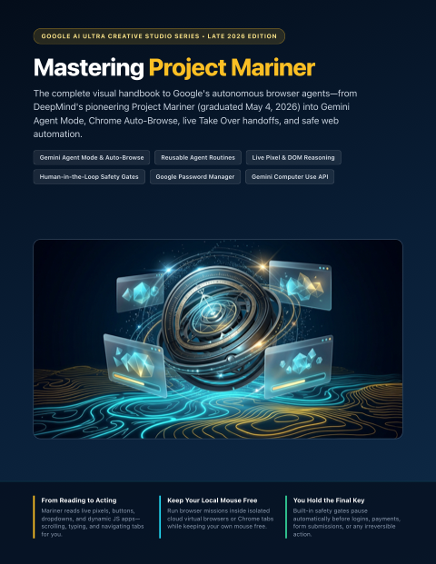</a>
      <h3><a href="guides/google/google-project-mariner/Google_Project_Mariner_Complete_How_To_Guide.pdf">Google Project Mariner</a></h3>
      
<strong>v1.1</strong> &bull; Updated <code>2026-11</code> &bull; 12 Pages

      
Autonomous browser-use agent &amp; Gemini Agent Mode running up to 10 parallel cloud browsers, Teach &amp; Repeat skills, and safety gates.

      
<code>Browser Agent</code> &middot; <code>Automation</code> &middot; <code>Computer Use</code>

      
<a href="guides/google/google-project-mariner/Google_Project_Mariner_Complete_How_To_Guide.pdf"><strong>&#128214; Read / Download PDF</strong></a> &nbsp;|&nbsp; <a href="guides/google/google-project-mariner">&#128736; Editable Source</a>

    </td>
  </tr>
  <tr>
    <td width="50%" valign="top">
      <a href="guides/google/antigravity-2-customizations-and-swarms/Antigravity_2_Customizations_and_Swarms_Complete_How_To_Guide.pdf">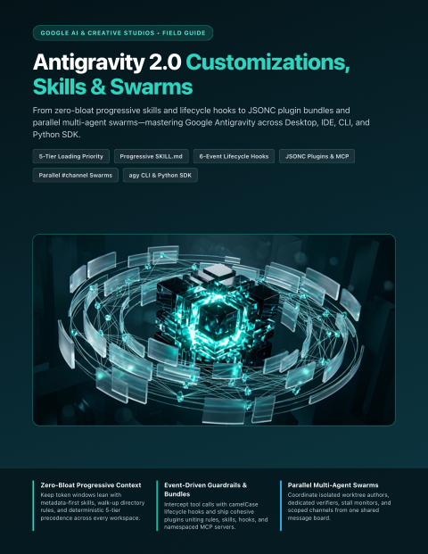</a>
      <h3><a href="guides/google/antigravity-2-customizations-and-swarms/Antigravity_2_Customizations_and_Swarms_Complete_How_To_Guide.pdf">Antigravity 2.0 Customizations, Skills &amp; Swarms</a></h3>
      
<strong>v1.0</strong> &bull; Updated <code>2026-11</code> &bull; 12 Pages

      
Tailor Google Antigravity 2.0, IDE, CLI (agy), and Python SDK with progressive SKILL.md modules, AGENTS.md rules, lifecycle hooks.json, namespaced plugins, and message-board agent swarms.

      
<code>Antigravity 2.0</code> &middot; <code>Skills &amp; Hooks</code> &middot; <code>Agent Swarms</code>

      
<a href="guides/google/antigravity-2-customizations-and-swarms/Antigravity_2_Customizations_and_Swarms_Complete_How_To_Guide.pdf"><strong>&#128214; Read / Download PDF</strong></a> &nbsp;|&nbsp; <a href="guides/google/antigravity-2-customizations-and-swarms">&#128736; Editable Source</a>

    </td>
    <td width="50%" valign="top">
      <a href="guides/google/gemini-live-and-omni-flash/Gemini_Live_and_Omni_Flash_Complete_How_To_Guide.pdf">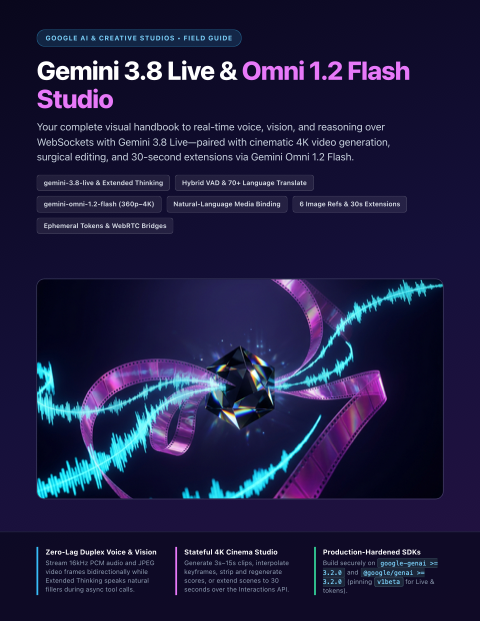</a>
      <h3><a href="guides/google/gemini-live-and-omni-flash/Gemini_Live_and_Omni_Flash_Complete_How_To_Guide.pdf">Gemini 3.8 Live &amp; Omni 1.2 Flash Studio</a></h3>
      
<strong>v1.1</strong> &bull; Updated <code>2026-11</code> &bull; 12 Pages

      
Build low-latency bidirectional voice/vision agents with Gemini 3.8 Live (Extended Thinking, NON_BLOCKING tools, Live Translate) and multi-shot 4K generative video workflows with Gemini Omni 1.2 Flash.

      
<code>Gemini 3.8 Live</code> &middot; <code>Omni 1.2 Flash</code> &middot; <code>Voice &amp; 4K Video</code>

      
<a href="guides/google/gemini-live-and-omni-flash/Gemini_Live_and_Omni_Flash_Complete_How_To_Guide.pdf"><strong>&#128214; Read / Download PDF</strong></a> &nbsp;|&nbsp; <a href="guides/google/gemini-live-and-omni-flash">&#128736; Editable Source</a>

    </td>
  </tr>
  <tr>
    <td width="50%" valign="top">
      <a href="guides/google/agentic-firebase-and-android-cli/Agentic_Firebase_and_Android_CLI_Complete_How_To_Guide.pdf">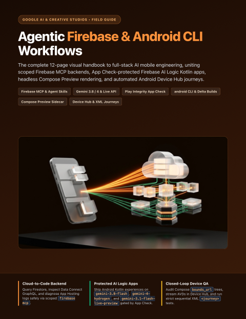</a>
      <h3><a href="guides/google/agentic-firebase-and-android-cli/Agentic_Firebase_and_Android_CLI_Complete_How_To_Guide.pdf">Agentic Firebase &amp; Android CLI Workflows</a></h3>
      
<strong>v1.1</strong> &bull; Updated <code>2026-11</code> &bull; 12 Pages

      
Ship full-stack mobile and web apps with firebase-tools MCP, Firebase AI Logic + App Check, Data Connect, Android CLI, live Device Hub mirroring, Compose Preview sidecars, and XML Journey tests.

      
<code>Firebase MCP</code> &middot; <code>Android CLI</code> &middot; <code>Device Hub &amp; Journeys</code>

      
<a href="guides/google/agentic-firebase-and-android-cli/Agentic_Firebase_and_Android_CLI_Complete_How_To_Guide.pdf"><strong>&#128214; Read / Download PDF</strong></a> &nbsp;|&nbsp; <a href="guides/google/agentic-firebase-and-android-cli">&#128736; Editable Source</a>

    </td>
    <td width="50%" valign="top">
      <a href="guides/google/google-adk-and-a2a/Google_ADK_and_A2A_Protocol_Complete_How_To_Guide.pdf">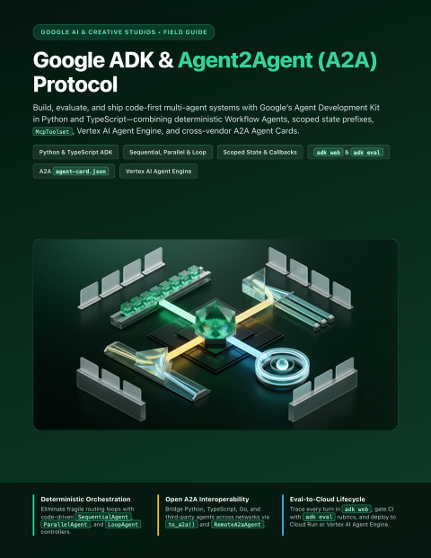</a>
      <h3><a href="guides/google/google-adk-and-a2a/Google_ADK_and_A2A_Protocol_Complete_How_To_Guide.pdf">Google ADK &amp; Agent2Agent (A2A) Protocol</a></h3>
      
<strong>v1.1</strong> &bull; Updated <code>2026-11</code> &bull; 12 Pages

      
Build, evaluate, and ship code-first multi-agent systems with Google&#x27;s Agent Development Kit in Python and TypeScript—combining deterministic Workflow Agents, scoped state prefixes, MCPToolset, Vertex AI Agent Engine, and cross-vendor A2A Agent Cards.

      
<code>Google ADK</code> &middot; <code>A2A Protocol</code> &middot; <code>Vertex Agent Engine</code>

      
<a href="guides/google/google-adk-and-a2a/Google_ADK_and_A2A_Protocol_Complete_How_To_Guide.pdf"><strong>&#128214; Read / Download PDF</strong></a> &nbsp;|&nbsp; <a href="guides/google/google-adk-and-a2a">&#128736; Editable Source</a>

    </td>
  </tr>
</table>

### Anthropic Claude & Workspace Studios
Publication-grade 12-page visual handbooks for Anthropic's agentic coding, autonomous digital coworker, security, and collaborative workspace suite—covering Claude Meetings, Duet, Design, Whiteboards, Sheets, Dashboards & Data, Cowork & Computer Use, Skills, Claude Code Mods, Autonomous Loops, Code Projects & Coordinator, Channels & Remote Control, Claude in Chrome & Persistent Memory, Security & Mythos 5.2, and Managed Agents & MCP.

<table>
  <tr>
    <td width="50%" valign="top">
      <a href="guides/claude/claude-code-mods/Claude_Code_Mods_Complete_How_To_Guide.pdf">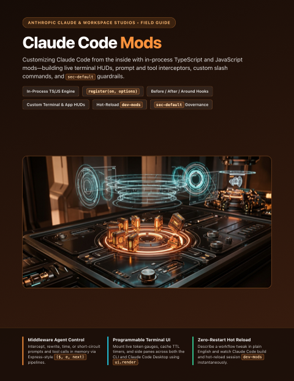</a>
      <h3><a href="guides/claude/claude-code-mods/Claude_Code_Mods_Complete_How_To_Guide.pdf">Claude Code Mods</a></h3>
      
<strong>v1.1</strong> &bull; Updated <code>2026-11</code> &bull; 12 Pages

      
Customizing Claude Code from the inside with in-process TypeScript/JavaScript mods—building live terminal HUDs, prompt/tool interceptors, custom slash commands, and sec-default guardrails.

      
<code>Claude Code</code> &middot; <code>TypeScript Mods</code> &middot; <code>Agent Hooks &amp; UI</code>

      
<a href="guides/claude/claude-code-mods/Claude_Code_Mods_Complete_How_To_Guide.pdf"><strong>&#128214; Read / Download PDF</strong></a> &nbsp;|&nbsp; <a href="guides/claude/claude-code-mods">&#128736; Editable Source</a>

    </td>
    <td width="50%" valign="top">
      <a href="guides/claude/claude-whiteboards/Claude_Whiteboards_Complete_How_To_Guide.pdf">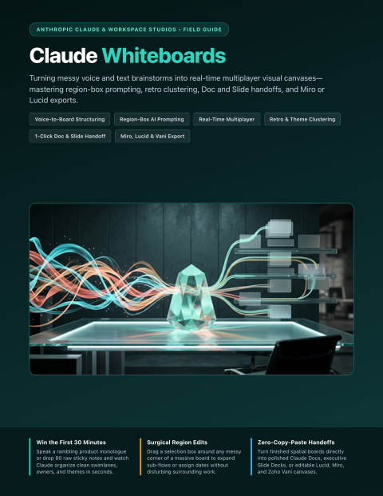</a>
      <h3><a href="guides/claude/claude-whiteboards/Claude_Whiteboards_Complete_How_To_Guide.pdf">Claude Whiteboards</a></h3>
      
<strong>v1.0</strong> &bull; Updated <code>2026-11</code> &bull; 12 Pages

      
Turning messy voice and text brainstorms into real-time multiplayer visual canvases—mastering region-box prompting, retro clustering, Doc/Slide handoffs, and Miro/Lucid exports.

      
<code>Visual Canvas</code> &middot; <code>Multiplayer Ideation</code> &middot; <code>Miro &amp; Lucid</code>

      
<a href="guides/claude/claude-whiteboards/Claude_Whiteboards_Complete_How_To_Guide.pdf"><strong>&#128214; Read / Download PDF</strong></a> &nbsp;|&nbsp; <a href="guides/claude/claude-whiteboards">&#128736; Editable Source</a>

    </td>
  </tr>
  <tr>
    <td width="50%" valign="top">
      <a href="guides/claude/claude-dashboards-and-data/Claude_Dashboards_and_Data_Complete_How_To_Guide.pdf">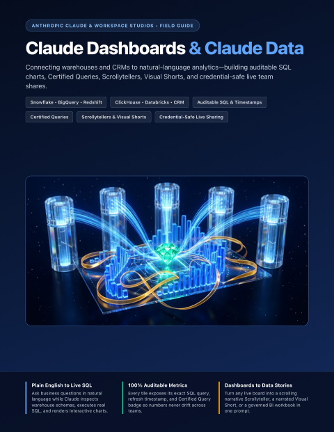</a>
      <h3><a href="guides/claude/claude-dashboards-and-data/Claude_Dashboards_and_Data_Complete_How_To_Guide.pdf">Claude Dashboards &amp; Data</a></h3>
      
<strong>v1.0</strong> &bull; Updated <code>2026-11</code> &bull; 12 Pages

      
Connecting warehouses and CRMs to natural-language analytics—building auditable SQL charts, Certified Queries, Scrollytellers, Visual Shorts, and credential-safe live team shares.

      
<code>Claude Data</code> &middot; <code>Live SQL Dashboards</code> &middot; <code>Certified Queries</code>

      
<a href="guides/claude/claude-dashboards-and-data/Claude_Dashboards_and_Data_Complete_How_To_Guide.pdf"><strong>&#128214; Read / Download PDF</strong></a> &nbsp;|&nbsp; <a href="guides/claude/claude-dashboards-and-data">&#128736; Editable Source</a>

    </td>
    <td width="50%" valign="top">
      <a href="guides/claude/claude-skills/Claude_Skills_Complete_How_To_Guide.pdf">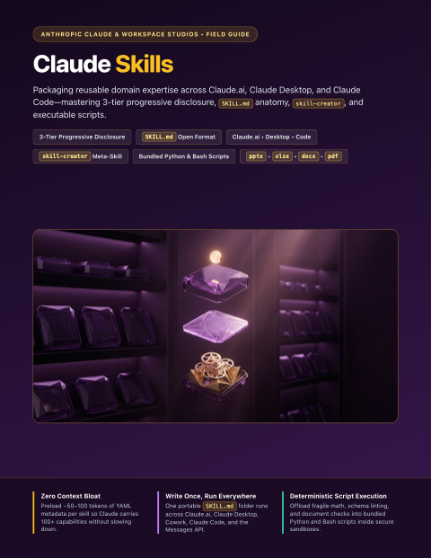</a>
      <h3><a href="guides/claude/claude-skills/Claude_Skills_Complete_How_To_Guide.pdf">Claude Skills</a></h3>
      
<strong>v1.1</strong> &bull; Updated <code>2026-11</code> &bull; 12 Pages

      
Packaging reusable domain expertise across Claude.ai, Claude Desktop, and Claude Code—mastering 3-tier progressive disclosure, SKILL.md anatomy, skill-creator, and executable scripts.

      
<code>SKILL.md</code> &middot; <code>Progressive Disclosure</code> &middot; <code>Skill Creator</code>

      
<a href="guides/claude/claude-skills/Claude_Skills_Complete_How_To_Guide.pdf"><strong>&#128214; Read / Download PDF</strong></a> &nbsp;|&nbsp; <a href="guides/claude/claude-skills">&#128736; Editable Source</a>

    </td>
  </tr>
  <tr>
    <td width="50%" valign="top">
      <a href="guides/claude/claude-cowork-and-computer-use/Claude_Cowork_and_Computer_Use_Complete_How_To_Guide.pdf">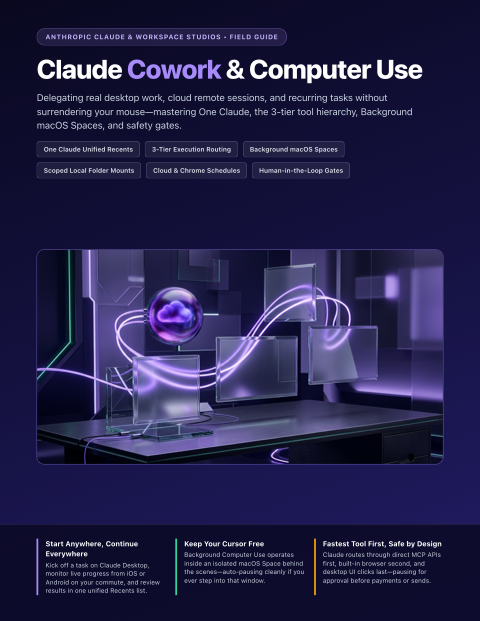</a>
      <h3><a href="guides/claude/claude-cowork-and-computer-use/Claude_Cowork_and_Computer_Use_Complete_How_To_Guide.pdf">Claude Cowork &amp; Computer Use</a></h3>
      
<strong>v1.0</strong> &bull; Updated <code>2026-11</code> &bull; 12 Pages

      
Automating multi-step knowledge work across Desktop, Web, and Mobile—mastering background macOS Computer Use, built-in browser tasks, recurring /schedule runs, and SaaS connectors.

      
<code>Claude Cowork</code> &middot; <code>Computer Use</code> &middot; <code>Scheduled Agents</code>

      
<a href="guides/claude/claude-cowork-and-computer-use/Claude_Cowork_and_Computer_Use_Complete_How_To_Guide.pdf"><strong>&#128214; Read / Download PDF</strong></a> &nbsp;|&nbsp; <a href="guides/claude/claude-cowork-and-computer-use">&#128736; Editable Source</a>

    </td>
    <td width="50%" valign="top">
      <a href="guides/claude/claude-sheets-and-artifacts/Claude_Sheets_and_Artifacts_Complete_How_To_Guide.pdf">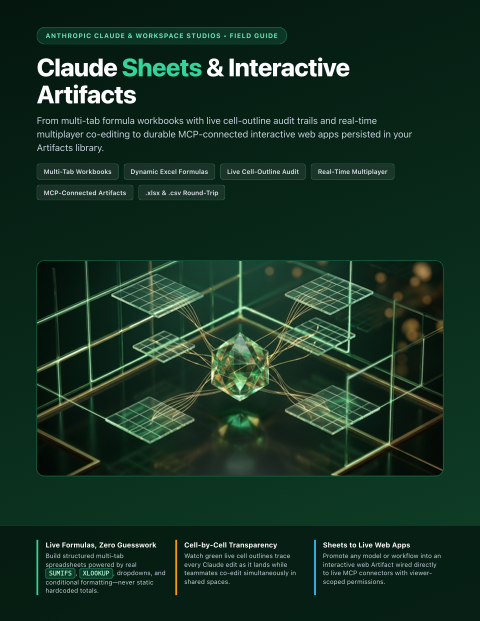</a>
      <h3><a href="guides/claude/claude-sheets-and-artifacts/Claude_Sheets_and_Artifacts_Complete_How_To_Guide.pdf">Claude Sheets &amp; Interactive Artifacts</a></h3>
      
<strong>v1.0</strong> &bull; Updated <code>2026-11</code> &bull; 12 Pages

      
Building live multi-tab spreadsheets with cross-sheet formulas, dropdowns, charts, multiplayer edits, and .xlsx round-tripping alongside interactive MCP-connected Artifacts.

      
<code>Claude Sheets</code> &middot; <code>Interactive Artifacts</code> &middot; <code>Live Formulas &amp; .xlsx</code>

      
<a href="guides/claude/claude-sheets-and-artifacts/Claude_Sheets_and_Artifacts_Complete_How_To_Guide.pdf"><strong>&#128214; Read / Download PDF</strong></a> &nbsp;|&nbsp; <a href="guides/claude/claude-sheets-and-artifacts">&#128736; Editable Source</a>

    </td>
  </tr>
  <tr>
    <td width="50%" valign="top">
      <a href="guides/claude/claude-code-autonomous-loops/Claude_Code_Autonomous_Loops_Complete_How_To_Guide.pdf">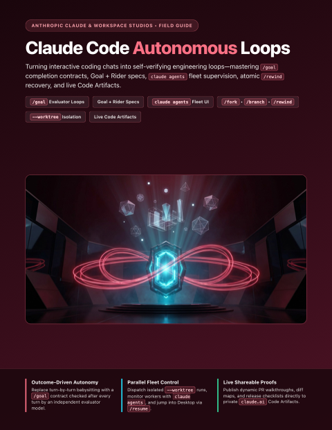</a>
      <h3><a href="guides/claude/claude-code-autonomous-loops/Claude_Code_Autonomous_Loops_Complete_How_To_Guide.pdf">Claude Code Autonomous Loops &amp; Code Artifacts</a></h3>
      
<strong>v1.1</strong> &bull; Updated <code>2026-11</code> &bull; 12 Pages

      
Running unattended multi-turn /goal completion contracts, supervising parallel sessions in claude agents, CLI-to-Desktop /resume, and publishing live PR walkthrough Artifacts.

      
<code>/goal Loops</code> &middot; <code>claude agents</code> &middot; <code>Code Artifacts</code>

      
<a href="guides/claude/claude-code-autonomous-loops/Claude_Code_Autonomous_Loops_Complete_How_To_Guide.pdf"><strong>&#128214; Read / Download PDF</strong></a> &nbsp;|&nbsp; <a href="guides/claude/claude-code-autonomous-loops">&#128736; Editable Source</a>

    </td>
    <td width="50%" valign="top">
      <a href="guides/claude/claude-managed-agents-and-mcp/Claude_Managed_Agents_and_MCP_Complete_How_To_Guide.pdf">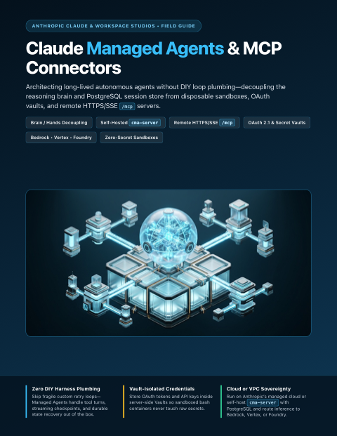</a>
      <h3><a href="guides/claude/claude-managed-agents-and-mcp/Claude_Managed_Agents_and_MCP_Complete_How_To_Guide.pdf">Claude Managed Agents &amp; MCP Connectors</a></h3>
      
<strong>v1.1</strong> &bull; Updated <code>2026-11</code> &bull; 12 Pages

      
Connecting Remote HTTPS/SSE and local stdio MCP servers across Claude surfaces and self-hosting cma-server agent sandboxes with scoped OAuth and Bedrock/Vertex routing.

      
<code>Managed Agents</code> &middot; <code>Remote MCP</code> &middot; <code>cma-server</code>

      
<a href="guides/claude/claude-managed-agents-and-mcp/Claude_Managed_Agents_and_MCP_Complete_How_To_Guide.pdf"><strong>&#128214; Read / Download PDF</strong></a> &nbsp;|&nbsp; <a href="guides/claude/claude-managed-agents-and-mcp">&#128736; Editable Source</a>

    </td>
  </tr>
  <tr>
    <td width="50%" valign="top">
      <a href="guides/claude/claude-meetings/Claude_Meetings_Complete_How_To_Guide.pdf">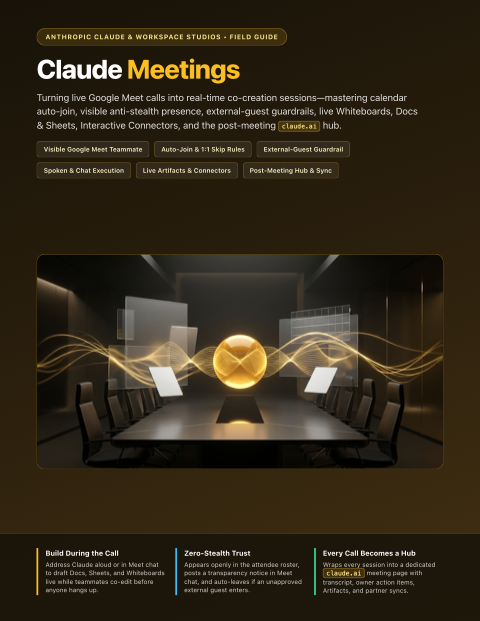</a>
      <h3><a href="guides/claude/claude-meetings/Claude_Meetings_Complete_How_To_Guide.pdf">Claude Meetings</a></h3>
      
<strong>v1.1</strong> &bull; Updated <code>2026-11</code> &bull; 12 Pages

      
Turning live Google Meet calls into visible co-creation sessions—mastering calendar auto-join, external-guest guardrails, live Whiteboards, Docs &amp; Sheets, Interactive Connectors, and the post-meeting claude.ai hub.

      
<code>Claude Meetings</code> &middot; <code>Google Meet</code> &middot; <code>Live Artifacts</code>

      
<a href="guides/claude/claude-meetings/Claude_Meetings_Complete_How_To_Guide.pdf"><strong>&#128214; Read / Download PDF</strong></a> &nbsp;|&nbsp; <a href="guides/claude/claude-meetings">&#128736; Editable Source</a>

    </td>
    <td width="50%" valign="top">
      <a href="guides/claude/claude-duet/Claude_Duet_Complete_How_To_Guide.pdf">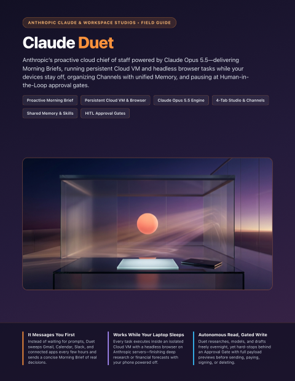</a>
      <h3><a href="guides/claude/claude-duet/Claude_Duet_Complete_How_To_Guide.pdf">Claude Duet</a></h3>
      
<strong>v1.1</strong> &bull; Updated <code>2026-11</code> &bull; 12 Pages

      
Operating Anthropic&#x27;s proactive Opus 5.5 cloud chief of staff—delivering Morning Briefs, persistent Cloud VM and headless browser sweeps, topic Channels, and Human-in-the-Loop approval gates.

      
<code>Claude Duet</code> &middot; <code>Proactive Cloud VM</code> &middot; <code>Morning Briefs</code>

      
<a href="guides/claude/claude-duet/Claude_Duet_Complete_How_To_Guide.pdf"><strong>&#128214; Read / Download PDF</strong></a> &nbsp;|&nbsp; <a href="guides/claude/claude-duet">&#128736; Editable Source</a>

    </td>
  </tr>
  <tr>
    <td width="50%" valign="top">
      <a href="guides/claude/claude-design/Claude_Design_Complete_How_To_Guide.pdf">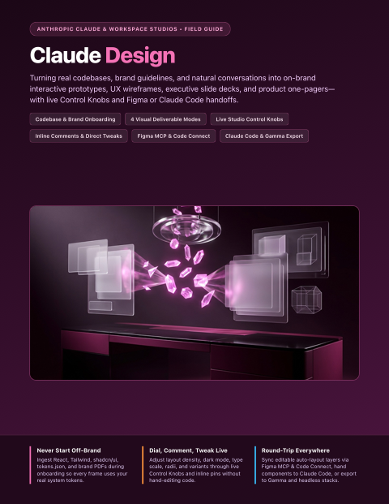</a>
      <h3><a href="guides/claude/claude-design/Claude_Design_Complete_How_To_Guide.pdf">Claude Design</a></h3>
      
<strong>v1.1</strong> &bull; Updated <code>2026-11</code> &bull; 12 Pages

      
Turning real codebases and brand guidelines into on-brand interactive prototypes, wireframes, decks, and product one-pagers—with live Control Knobs, inline comments, and Figma MCP or Claude Code handoffs.

      
<code>Claude Design</code> &middot; <code>Design Systems</code> &middot; <code>Figma &amp; Prototypes</code>

      
<a href="guides/claude/claude-design/Claude_Design_Complete_How_To_Guide.pdf"><strong>&#128214; Read / Download PDF</strong></a> &nbsp;|&nbsp; <a href="guides/claude/claude-design">&#128736; Editable Source</a>

    </td>
    <td width="50%" valign="top">
      <a href="guides/claude/claude-code-projects-and-coordinator/Claude_Code_Projects_and_Coordinator_Complete_How_To_Guide.pdf">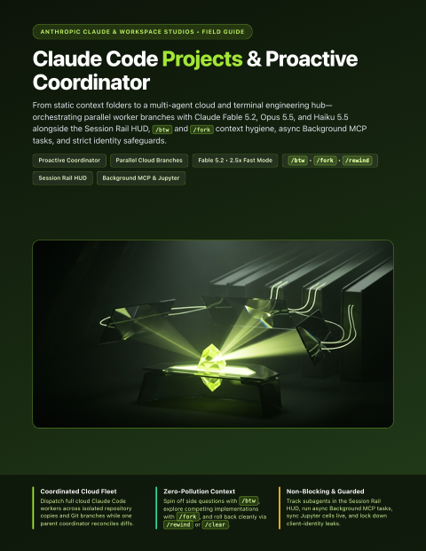</a>
      <h3><a href="guides/claude/claude-code-projects-and-coordinator/Claude_Code_Projects_and_Coordinator_Complete_How_To_Guide.pdf">Claude Code Projects &amp; Proactive Coordinator</a></h3>
      
<strong>v1.1</strong> &bull; Updated <code>2026-11</code> &bull; 12 Pages

      
Orchestrating parallel cloud worker branches with Claude Fable 5.2, Opus 5.5, and Haiku 5.5 alongside the Session Rail HUD, /btw and /fork context hygiene, Background MCP tasks, and identity safeguards.

      
<code>Claude Code Projects</code> &middot; <code>Proactive Coordinator</code> &middot; <code>/btw &amp; /fork</code>

      
<a href="guides/claude/claude-code-projects-and-coordinator/Claude_Code_Projects_and_Coordinator_Complete_How_To_Guide.pdf"><strong>&#128214; Read / Download PDF</strong></a> &nbsp;|&nbsp; <a href="guides/claude/claude-code-projects-and-coordinator">&#128736; Editable Source</a>

    </td>
  </tr>
  <tr>
    <td width="50%" valign="top">
      <a href="guides/claude/claude-security-and-mythos/Claude_Security_and_Mythos_Complete_How_To_Guide.pdf">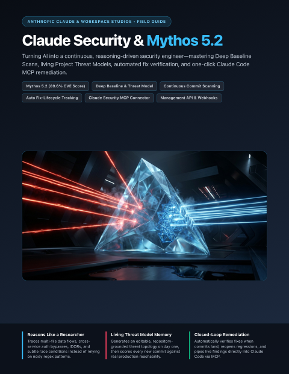</a>
      <h3><a href="guides/claude/claude-security-and-mythos/Claude_Security_and_Mythos_Complete_How_To_Guide.pdf">Claude Security &amp; Mythos 5.2</a></h3>
      
<strong>v1.0</strong> &bull; Updated <code>2026-11</code> &bull; 12 Pages

      
Deploying continuous, reasoning-driven application security with Claude Mythos 5.2—mastering Deep Baseline Scans, living Threat Models, automated fix verification, and Claude Code MCP remediation.

      
<code>Claude Security</code> &middot; <code>Mythos 5.2</code> &middot; <code>Continuous AppSec</code>

      
<a href="guides/claude/claude-security-and-mythos/Claude_Security_and_Mythos_Complete_How_To_Guide.pdf"><strong>&#128214; Read / Download PDF</strong></a> &nbsp;|&nbsp; <a href="guides/claude/claude-security-and-mythos">&#128736; Editable Source</a>

    </td>
    <td width="50%" valign="top">
      <a href="guides/claude/claude-code-channels-and-remote-control/Claude_Code_Channels_and_Remote_Control_Complete_How_To_Guide.pdf">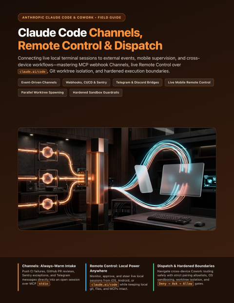</a>
      <h3><a href="guides/claude/claude-code-channels-and-remote-control/Claude_Code_Channels_and_Remote_Control_Complete_How_To_Guide.pdf">Claude Code Channels, Remote Control &amp; Dispatch</a></h3>
      
<strong>v1.1</strong> &bull; Updated <code>2026-11</code> &bull; 12 Pages

      
Connect live local terminal sessions to webhooks, CI/CD, Sentry, and chat bridges with Channels, steer active repos from mobile via Remote Control, and isolate cross-device Dispatch runs.

      
<code>Code Channels</code> &middot; <code>Remote Control</code> &middot; <code>Dispatch &amp; MCP</code>

      
<a href="guides/claude/claude-code-channels-and-remote-control/Claude_Code_Channels_and_Remote_Control_Complete_How_To_Guide.pdf"><strong>&#128214; Read / Download PDF</strong></a> &nbsp;|&nbsp; <a href="guides/claude/claude-code-channels-and-remote-control">&#128736; Editable Source</a>

    </td>
  </tr>
  <tr>
    <td width="50%" valign="top">
      <a href="guides/claude/claude-in-chrome-and-persistent-memory/Claude_in_Chrome_and_Persistent_Memory_Complete_How_To_Guide.pdf">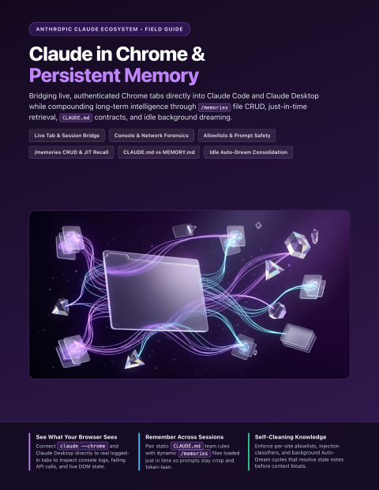</a>
      <h3><a href="guides/claude/claude-in-chrome-and-persistent-memory/Claude_in_Chrome_and_Persistent_Memory_Complete_How_To_Guide.pdf">Claude in Chrome &amp; Persistent Memory</a></h3>
      
<strong>v1.1</strong> &bull; Updated <code>2026-11</code> &bull; 12 Pages

      
Bridge authenticated Chrome tabs to Claude Code and Claude Desktop for live console and DOM forensics while compounding knowledge via /memories CRUD, CLAUDE.md, and Auto-Dream consolidation.

      
<code>Claude in Chrome</code> &middot; <code>Persistent Memory</code> &middot; <code>Auto-Dream</code>

      
<a href="guides/claude/claude-in-chrome-and-persistent-memory/Claude_in_Chrome_and_Persistent_Memory_Complete_How_To_Guide.pdf"><strong>&#128214; Read / Download PDF</strong></a> &nbsp;|&nbsp; <a href="guides/claude/claude-in-chrome-and-persistent-memory">&#128736; Editable Source</a>

    </td>
    <td width="50%"></td>
  </tr>
</table>

### OpenAI Codex, Agents & Realtime Studios
Publication-grade 12-page visual handbooks for OpenAI's agentic developer and workspace platform—covering Codex CLI & Codex Cloud, the OpenAI Agents API & SDK, ChatGPT Projects, Memory & Deep Research, ChatGPT Canvas, Spaces & Computer Use, and low-latency Realtime Voice & Vision agents.

<table>
  <tr>
    <td width="50%" valign="top">
      <a href="guides/openai/codex-cli-and-cloud/OpenAI_Codex_CLI_and_Cloud_Complete_How_To_Guide.pdf">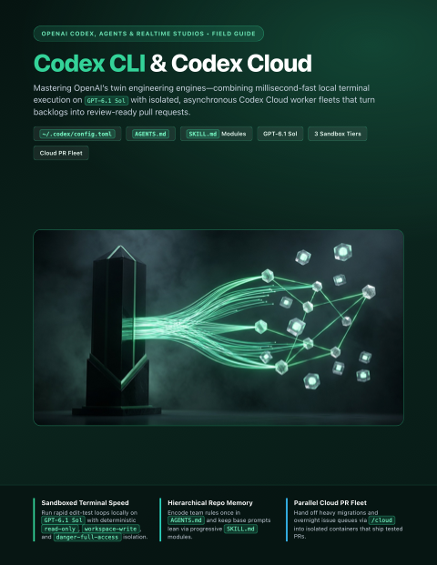</a>
      <h3><a href="guides/openai/codex-cli-and-cloud/OpenAI_Codex_CLI_and_Cloud_Complete_How_To_Guide.pdf">OpenAI Codex CLI &amp; Codex Cloud</a></h3>
      
<strong>v1.1</strong> &bull; Updated <code>2026-11</code> &bull; 12 Pages

      
Configure TOML sandboxes, AGENTS.md constitutions, on-demand SKILL.md modules, GPT-6.1 Sol tiers, and parallel Codex Cloud PR containers.

      
<code>Codex CLI</code> &middot; <code>Codex Cloud</code> &middot; <code>GPT-6.1 Sol</code>

      
<a href="guides/openai/codex-cli-and-cloud/OpenAI_Codex_CLI_and_Cloud_Complete_How_To_Guide.pdf"><strong>&#128214; Read / Download PDF</strong></a> &nbsp;|&nbsp; <a href="guides/openai/codex-cli-and-cloud">&#128736; Editable Source</a>

    </td>
    <td width="50%" valign="top">
      <a href="guides/openai/agents-api-and-sdk/OpenAI_Agents_API_and_SDK_Complete_How_To_Guide.pdf">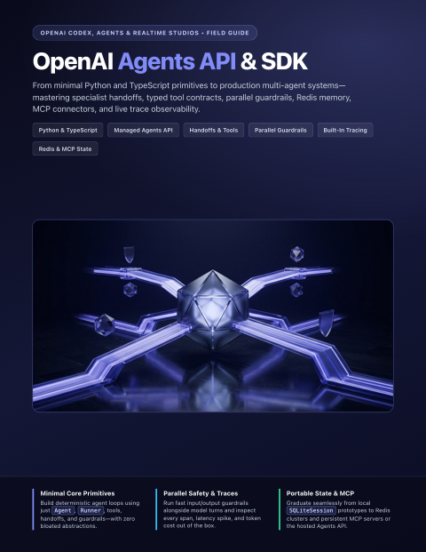</a>
      <h3><a href="guides/openai/agents-api-and-sdk/OpenAI_Agents_API_and_SDK_Complete_How_To_Guide.pdf">OpenAI Agents API &amp; SDK</a></h3>
      
<strong>v1.1</strong> &bull; Updated <code>2026-11</code> &bull; 12 Pages

      
Architect production multi-agent systems with handoffs, Agents-as-Tools, parallel input/output guardrails, built-in tracing, and stateful MCP sessions.

      
<code>Agents SDK</code> &middot; <code>Agents API</code> &middot; <code>Guardrails &amp; Handoffs</code>

      
<a href="guides/openai/agents-api-and-sdk/OpenAI_Agents_API_and_SDK_Complete_How_To_Guide.pdf"><strong>&#128214; Read / Download PDF</strong></a> &nbsp;|&nbsp; <a href="guides/openai/agents-api-and-sdk">&#128736; Editable Source</a>

    </td>
  </tr>
  <tr>
    <td width="50%" valign="top">
      <a href="guides/openai/chatgpt-canvas-and-spaces/ChatGPT_Canvas_Spaces_and_Computer_Use_Complete_How_To_Guide.pdf">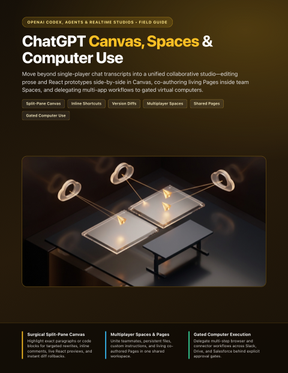</a>
      <h3><a href="guides/openai/chatgpt-canvas-and-spaces/ChatGPT_Canvas_Spaces_and_Computer_Use_Complete_How_To_Guide.pdf">ChatGPT Canvas, Spaces &amp; Computer Use</a></h3>
      
<strong>v1.1</strong> &bull; Updated <code>2026-11</code> &bull; 12 Pages

      
Master surgical split-pane Canvas diffs, multiplayer Spaces and Pages, and gated Agent Mode browser and desktop workflows.

      
<code>ChatGPT Canvas</code> &middot; <code>Spaces &amp; Pages</code> &middot; <code>Computer Use</code>

      
<a href="guides/openai/chatgpt-canvas-and-spaces/ChatGPT_Canvas_Spaces_and_Computer_Use_Complete_How_To_Guide.pdf"><strong>&#128214; Read / Download PDF</strong></a> &nbsp;|&nbsp; <a href="guides/openai/chatgpt-canvas-and-spaces">&#128736; Editable Source</a>

    </td>
    <td width="50%" valign="top">
      <a href="guides/openai/realtime-voice-and-vision/OpenAI_Realtime_Voice_and_Vision_Complete_How_To_Guide.pdf">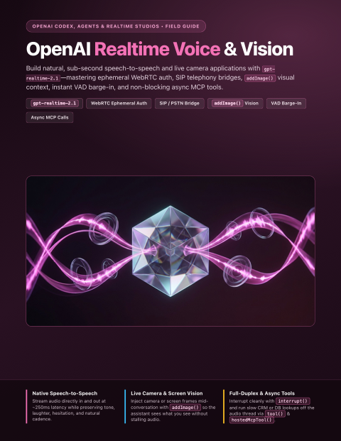</a>
      <h3><a href="guides/openai/realtime-voice-and-vision/OpenAI_Realtime_Voice_and_Vision_Complete_How_To_Guide.pdf">OpenAI Realtime Voice &amp; Vision</a></h3>
      
<strong>v1.1</strong> &bull; Updated <code>2026-11</code> &bull; 12 Pages

      
Build sub-second speech-to-speech and live vision agents across WebRTC, WebSockets, and SIP telephony with native VAD barge-in and async MCP.

      
<code>Realtime API</code> &middot; <code>WebRTC &amp; SIP</code> &middot; <code>Voice &amp; Vision</code>

      
<a href="guides/openai/realtime-voice-and-vision/OpenAI_Realtime_Voice_and_Vision_Complete_How_To_Guide.pdf"><strong>&#128214; Read / Download PDF</strong></a> &nbsp;|&nbsp; <a href="guides/openai/realtime-voice-and-vision">&#128736; Editable Source</a>

    </td>
  </tr>
  <tr>
    <td width="50%" valign="top">
      <a href="guides/openai/chatgpt-projects-memory-and-deep-research/ChatGPT_Projects_Memory_and_Deep_Research_Complete_How_To_Guide.pdf">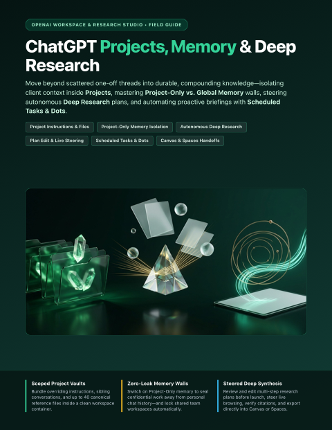</a>
      <h3><a href="guides/openai/chatgpt-projects-memory-and-deep-research/ChatGPT_Projects_Memory_and_Deep_Research_Complete_How_To_Guide.pdf">ChatGPT Projects, Memory &amp; Deep Research</a></h3>
      
<strong>v1.0</strong> &bull; Updated <code>2026-11</code> &bull; 12 Pages

      
Organize durable workspaces inside ChatGPT Projects, seal confidential work behind Project-Only Memory walls, steer autonomous Deep Research plans, and schedule proactive Tasks &amp; Dots briefings.

      
<code>ChatGPT Projects</code> &middot; <code>Project Memory</code> &middot; <code>Deep Research</code>

      
<a href="guides/openai/chatgpt-projects-memory-and-deep-research/ChatGPT_Projects_Memory_and_Deep_Research_Complete_How_To_Guide.pdf"><strong>&#128214; Read / Download PDF</strong></a> &nbsp;|&nbsp; <a href="guides/openai/chatgpt-projects-memory-and-deep-research">&#128736; Editable Source</a>

    </td>
    <td width="50%"></td>
  </tr>
</table>

### Vercel & Full-Stack AI Applications
Publication-grade 12-page visual handbooks for building production full-stack AI applications on Vercel—covering AI SDK 7 & AI Gateway, Durable Agents with eve, Workflow 5 & Queues, Next.js 16.3+ Cache Components & Partial Prefetching, and multi-platform bots with the Vercel Chat SDK.

<table>
  <tr>
    <td width="50%" valign="top">
      <a href="guides/vercel/ai-sdk-and-gateway/Vercel_AI_SDK_and_Gateway_Complete_How_To_Guide.pdf">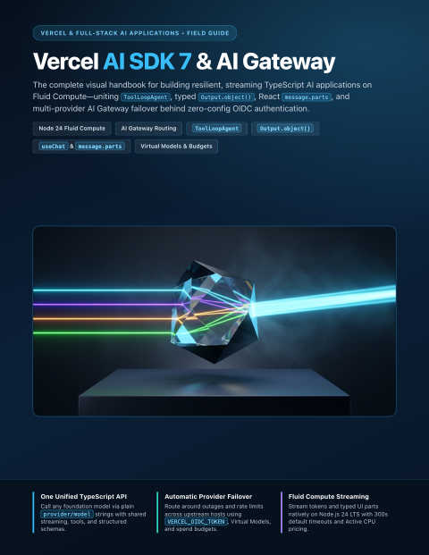</a>
      <h3><a href="guides/vercel/ai-sdk-and-gateway/Vercel_AI_SDK_and_Gateway_Complete_How_To_Guide.pdf">Vercel AI SDK 7 &amp; AI Gateway</a></h3>
      
<strong>v1.1</strong> &bull; Updated <code>2026-11</code> &bull; 12 Pages

      
Stream typed UI messages, ToolLoopAgent runs, and structured Output.object() calls through Vercel AI Gateway with OIDC auth, virtual models, budgets, and automatic provider failover.

      
<code>AI SDK 7</code> &middot; <code>AI Gateway</code> &middot; <code>Fluid Compute</code>

      
<a href="guides/vercel/ai-sdk-and-gateway/Vercel_AI_SDK_and_Gateway_Complete_How_To_Guide.pdf"><strong>&#128214; Read / Download PDF</strong></a> &nbsp;|&nbsp; <a href="guides/vercel/ai-sdk-and-gateway">&#128736; Editable Source</a>

    </td>
    <td width="50%" valign="top">
      <a href="guides/vercel/durable-agents-and-workflows/Vercel_Durable_Agents_and_Workflows_Complete_How_To_Guide.pdf">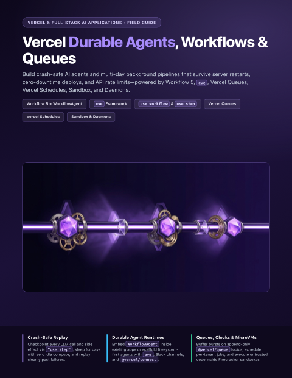</a>
      <h3><a href="guides/vercel/durable-agents-and-workflows/Vercel_Durable_Agents_and_Workflows_Complete_How_To_Guide.pdf">Vercel Durable Agents, Workflows &amp; Queues</a></h3>
      
<strong>v1.0</strong> &bull; Updated <code>2026-11</code> &bull; 12 Pages

      
Build crash-safe agents and long-running pipelines using eve, Workflow 5 (WorkflowAgent, use workflow &amp; use step), Vercel Queues, and Vercel Schedules.

      
<code>Workflow 5</code> &middot; <code>eve Agents</code> &middot; <code>Queues &amp; Schedules</code>

      
<a href="guides/vercel/durable-agents-and-workflows/Vercel_Durable_Agents_and_Workflows_Complete_How_To_Guide.pdf"><strong>&#128214; Read / Download PDF</strong></a> &nbsp;|&nbsp; <a href="guides/vercel/durable-agents-and-workflows">&#128736; Editable Source</a>

    </td>
  </tr>
  <tr>
    <td width="50%" valign="top">
      <a href="guides/vercel/nextjs-cache-components/Nextjs_Cache_Components_and_Prefetching_Complete_How_To_Guide.pdf">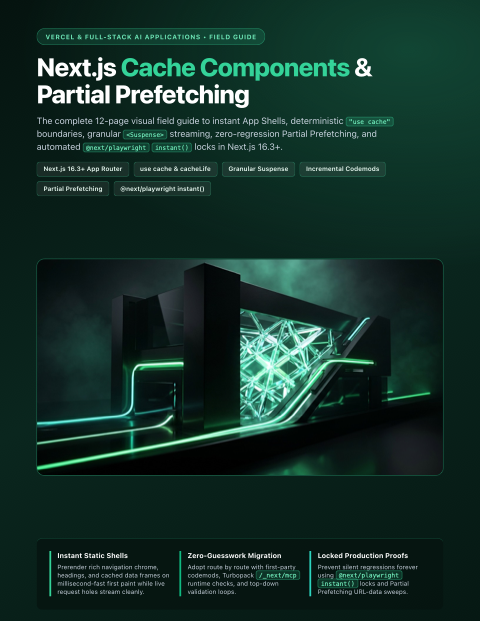</a>
      <h3><a href="guides/vercel/nextjs-cache-components/Nextjs_Cache_Components_and_Prefetching_Complete_How_To_Guide.pdf">Next.js Cache Components &amp; Partial Prefetching</a></h3>
      
<strong>v1.0</strong> &bull; Updated <code>2026-11</code> &bull; 12 Pages

      
Adopt cacheComponents and partialPrefetching in Next.js 16.3+, grow instant static App Shells with use cache and Suspense, and lock regressions with @next/playwright instant().

      
<code>Next.js 16.3+</code> &middot; <code>Cache Components</code> &middot; <code>Partial Prefetching</code>

      
<a href="guides/vercel/nextjs-cache-components/Nextjs_Cache_Components_and_Prefetching_Complete_How_To_Guide.pdf"><strong>&#128214; Read / Download PDF</strong></a> &nbsp;|&nbsp; <a href="guides/vercel/nextjs-cache-components">&#128736; Editable Source</a>

    </td>
    <td width="50%" valign="top">
      <a href="guides/vercel/multi-platform-chat-sdk/Vercel_Multi_Platform_Chat_SDK_Complete_How_To_Guide.pdf">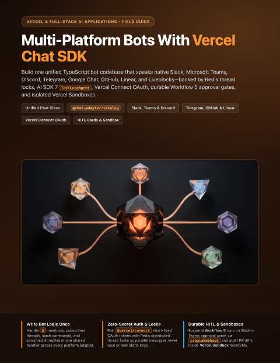</a>
      <h3><a href="guides/vercel/multi-platform-chat-sdk/Vercel_Multi_Platform_Chat_SDK_Complete_How_To_Guide.pdf">Multi-Platform Bots with Vercel Chat SDK</a></h3>
      
<strong>v1.1</strong> &bull; Updated <code>2026-11</code> &bull; 12 Pages

      
Ship one TypeScript bot codebase across Slack, Teams, Discord, Telegram, GitHub, and Linear with @chat-adapter/*, Vercel Connect OAuth, Sandbox PR reviews, and Workflow approval cards.

      
<code>Chat SDK</code> &middot; <code>@chat-adapter</code> &middot; <code>Vercel Connect</code>

      
<a href="guides/vercel/multi-platform-chat-sdk/Vercel_Multi_Platform_Chat_SDK_Complete_How_To_Guide.pdf"><strong>&#128214; Read / Download PDF</strong></a> &nbsp;|&nbsp; <a href="guides/vercel/multi-platform-chat-sdk">&#128736; Editable Source</a>

    </td>
  </tr>
</table>

### AI Agent Engineering & Architecture
Practical 12-page visual handbooks for context engineering, multi-agent orchestration, Orca workspaces & parallel Git worktrees, production MCP servers, Chrome DevTools & Playwright browser agents, document & web scraping pipelines (Docling, Crawl4AI & Firecrawl), OpenTelemetry & prompt caching, structured outputs & state machines, voice-first coding, vector RAG, security, evals, System One decisions, and local on-device AI.

<table>
  <tr>
    <td width="50%" valign="top">
      <a href="guides/agent-engineering/spec-driven-context-engineering/Spec_Driven_Dev_and_Context_Engineering_Complete_How_To_Guide.pdf">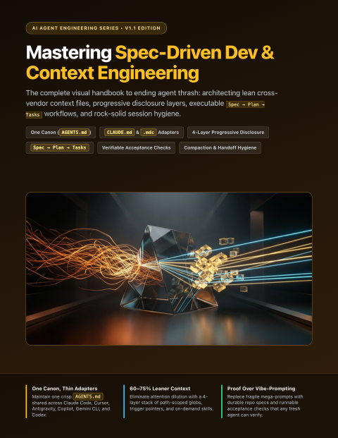</a>
      <h3><a href="guides/agent-engineering/spec-driven-context-engineering/Spec_Driven_Dev_and_Context_Engineering_Complete_How_To_Guide.pdf">Spec-Driven Dev &amp; Context Engineering</a></h3>
      
<strong>v1.1</strong> &bull; Updated <code>2026-11</code> &bull; 12 Pages

      
Cross-vendor context architecture (AGENTS.md, CLAUDE.md, Cursor rules), progressive disclosure, and Spec-to-Plan-to-Tasks agent workflows.

      
<code>Context Engineering</code> &middot; <code>AGENTS.md</code> &middot; <code>Spec-Driven Dev</code>

      
<a href="guides/agent-engineering/spec-driven-context-engineering/Spec_Driven_Dev_and_Context_Engineering_Complete_How_To_Guide.pdf"><strong>&#128214; Read / Download PDF</strong></a> &nbsp;|&nbsp; <a href="guides/agent-engineering/spec-driven-context-engineering">&#128736; Editable Source</a>

    </td>
    <td width="50%" valign="top">
      <a href="guides/agent-engineering/subagents-and-orchestration/Subagents_and_Agent_Orchestration_Complete_How_To_Guide.pdf">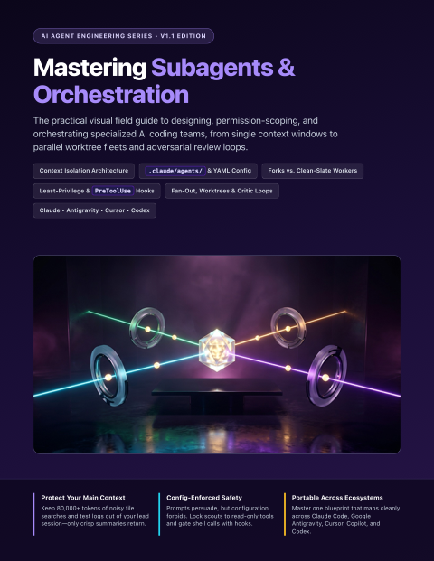</a>
      <h3><a href="guides/agent-engineering/subagents-and-orchestration/Subagents_and_Agent_Orchestration_Complete_How_To_Guide.pdf">Subagents &amp; Agent Orchestration</a></h3>
      
<strong>v1.0</strong> &bull; Updated <code>2026-11</code> &bull; 12 Pages

      
Designing specialist subagents, context forks, least-privilege tool scoping, lifecycle hooks, and multi-agent coordinator-worker swarms.

      
<code>Subagents</code> &middot; <code>Orchestration</code> &middot; <code>Least Privilege</code>

      
<a href="guides/agent-engineering/subagents-and-orchestration/Subagents_and_Agent_Orchestration_Complete_How_To_Guide.pdf"><strong>&#128214; Read / Download PDF</strong></a> &nbsp;|&nbsp; <a href="guides/agent-engineering/subagents-and-orchestration">&#128736; Editable Source</a>

    </td>
  </tr>
  <tr>
    <td width="50%" valign="top">
      <a href="guides/agent-engineering/git-worktrees-and-parallel-safety/Git_Worktrees_and_Parallel_Agent_Safety_Complete_How_To_Guide.pdf">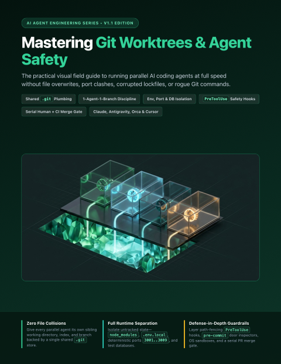</a>
      <h3><a href="guides/agent-engineering/git-worktrees-and-parallel-safety/Git_Worktrees_and_Parallel_Agent_Safety_Complete_How_To_Guide.pdf">Git Worktrees &amp; Parallel Agent Safety</a></h3>
      
<strong>v1.0</strong> &bull; Updated <code>2026-11</code> &bull; 12 Pages

      
Running parallel coding agents without file collisions—covering Git worktree fleets, isolated ports/databases, safety hooks, and teardown.

      
<code>Git Worktrees</code> &middot; <code>Parallel Agents</code> &middot; <code>Safety Hooks</code>

      
<a href="guides/agent-engineering/git-worktrees-and-parallel-safety/Git_Worktrees_and_Parallel_Agent_Safety_Complete_How_To_Guide.pdf"><strong>&#128214; Read / Download PDF</strong></a> &nbsp;|&nbsp; <a href="guides/agent-engineering/git-worktrees-and-parallel-safety">&#128736; Editable Source</a>

    </td>
    <td width="50%" valign="top">
      <a href="guides/agent-engineering/vector-memory-and-rag/Vector_Memory_and_Semantic_Search_RAG_Complete_How_To_Guide.pdf">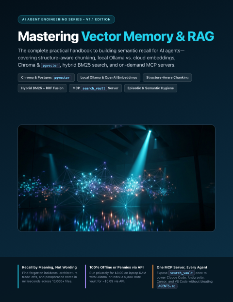</a>
      <h3><a href="guides/agent-engineering/vector-memory-and-rag/Vector_Memory_and_Semantic_Search_RAG_Complete_How_To_Guide.pdf">Vector Memory &amp; Semantic Search (RAG)</a></h3>
      
<strong>v1.0</strong> &bull; Updated <code>2026-11</code> &bull; 12 Pages

      
Building persistent semantic memory for AI agents with structure-aware chunking, Chroma, pgvector, Qdrant, local Ollama, and hybrid retrieval.

      
<code>Vector Memory</code> &middot; <code>RAG</code> &middot; <code>Embeddings</code>

      
<a href="guides/agent-engineering/vector-memory-and-rag/Vector_Memory_and_Semantic_Search_RAG_Complete_How_To_Guide.pdf"><strong>&#128214; Read / Download PDF</strong></a> &nbsp;|&nbsp; <a href="guides/agent-engineering/vector-memory-and-rag">&#128736; Editable Source</a>

    </td>
  </tr>
  <tr>
    <td width="50%" valign="top">
      <a href="guides/agent-engineering/ai-evals-and-regression-testing/AI_Evals_and_Regression_Testing_Complete_How_To_Guide.pdf">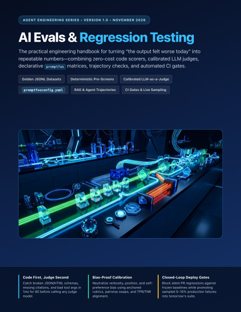</a>
      <h3><a href="guides/agent-engineering/ai-evals-and-regression-testing/AI_Evals_and_Regression_Testing_Complete_How_To_Guide.pdf">AI Evals &amp; Regression Testing</a></h3>
      
<strong>v1.0</strong> &bull; Updated <code>2026-11</code> &bull; 12 Pages

      
Turning LLM vibe-checks into deterministic CI deploy gates with golden datasets, code scorers, calibrated LLM-as-judge, and Promptfoo.

      
<code>AI Evals</code> &middot; <code>CI Gating</code> &middot; <code>Promptfoo</code>

      
<a href="guides/agent-engineering/ai-evals-and-regression-testing/AI_Evals_and_Regression_Testing_Complete_How_To_Guide.pdf"><strong>&#128214; Read / Download PDF</strong></a> &nbsp;|&nbsp; <a href="guides/agent-engineering/ai-evals-and-regression-testing">&#128736; Editable Source</a>

    </td>
    <td width="50%" valign="top">
      <a href="guides/agent-engineering/prompt-injection-and-agent-security/Prompt_Injection_and_Agent_Security_Complete_How_To_Guide.pdf">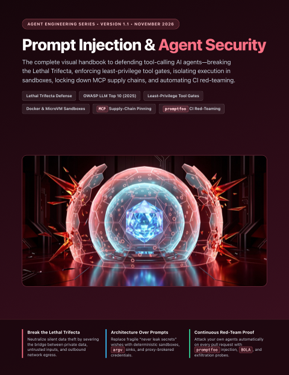</a>
      <h3><a href="guides/agent-engineering/prompt-injection-and-agent-security/Prompt_Injection_and_Agent_Security_Complete_How_To_Guide.pdf">Prompt Injection &amp; Agent Security</a></h3>
      
<strong>v1.0</strong> &bull; Updated <code>2026-11</code> &bull; 12 Pages

      
Defending tool-calling and browsing AI agents against indirect prompt injection, poisoned MCP servers, secret exfiltration, and unsafe output sinks.

      
<code>Agent Security</code> &middot; <code>Prompt Injection</code> &middot; <code>MCP Safety</code>

      
<a href="guides/agent-engineering/prompt-injection-and-agent-security/Prompt_Injection_and_Agent_Security_Complete_How_To_Guide.pdf"><strong>&#128214; Read / Download PDF</strong></a> &nbsp;|&nbsp; <a href="guides/agent-engineering/prompt-injection-and-agent-security">&#128736; Editable Source</a>

    </td>
  </tr>
  <tr>
    <td width="50%" valign="top">
      <a href="guides/agent-engineering/local-and-on-device-ai/Local_and_On_Device_AI_Stack_Complete_How_To_Guide.pdf">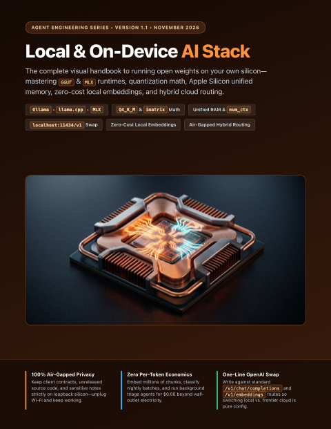</a>
      <h3><a href="guides/agent-engineering/local-and-on-device-ai/Local_and_On_Device_AI_Stack_Complete_How_To_Guide.pdf">Local &amp; On-Device AI Stack</a></h3>
      
<strong>v1.0</strong> &bull; Updated <code>2026-11</code> &bull; 12 Pages

      
Running private, zero-per-token LLMs and embeddings on your own hardware—mastering GGUF quantization, Apple Silicon memory math, Ollama, and llama.cpp.

      
<code>Local AI</code> &middot; <code>Ollama</code> &middot; <code>Apple Silicon</code>

      
<a href="guides/agent-engineering/local-and-on-device-ai/Local_and_On_Device_AI_Stack_Complete_How_To_Guide.pdf"><strong>&#128214; Read / Download PDF</strong></a> &nbsp;|&nbsp; <a href="guides/agent-engineering/local-and-on-device-ai">&#128736; Editable Source</a>

    </td>
    <td width="50%" valign="top">
      <a href="guides/agent-engineering/jev-and-system-one-decisions/Jev_and_System_One_Decisions_Complete_How_To_Guide.pdf">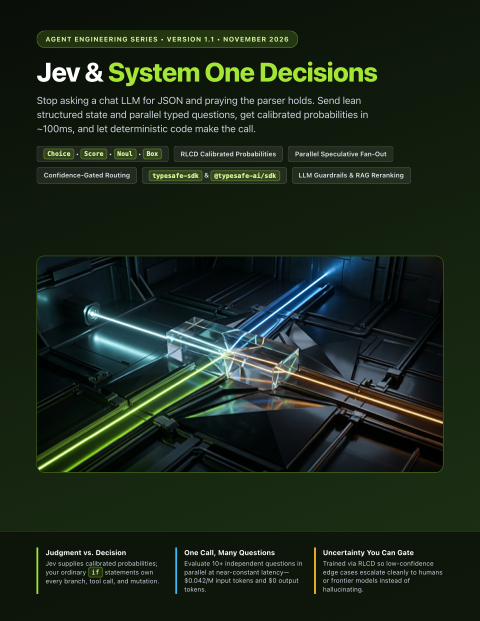</a>
      <h3><a href="guides/agent-engineering/jev-and-system-one-decisions/Jev_and_System_One_Decisions_Complete_How_To_Guide.pdf">Jev &amp; System One Decisions</a></h3>
      
<strong>v1.0</strong> &bull; Updated <code>2026-11</code> &bull; 12 Pages

      
Replacing fragile LLM JSON parsing with fast, calibrated System One decisions—mastering Choice, Score, and Noul primitives, parallel fan-out, and confidence-gated routing.

      
<code>System One</code> &middot; <code>Calibrated Decisions</code> &middot; <code>Model Routing</code>

      
<a href="guides/agent-engineering/jev-and-system-one-decisions/Jev_and_System_One_Decisions_Complete_How_To_Guide.pdf"><strong>&#128214; Read / Download PDF</strong></a> &nbsp;|&nbsp; <a href="guides/agent-engineering/jev-and-system-one-decisions">&#128736; Editable Source</a>

    </td>
  </tr>
  <tr>
    <td width="50%" valign="top">
      <a href="guides/agent-engineering/building-production-mcp-servers/Building_Production_MCP_Servers_Complete_How_To_Guide.pdf">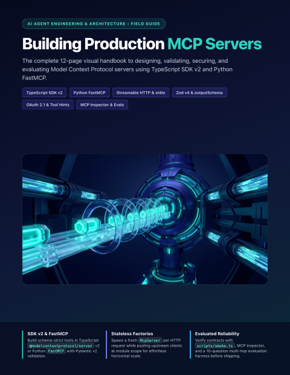</a>
      <h3><a href="guides/agent-engineering/building-production-mcp-servers/Building_Production_MCP_Servers_Complete_How_To_Guide.pdf">Building Production MCP Servers</a></h3>
      
<strong>v1.0</strong> &bull; Updated <code>2026-11</code> &bull; 12 Pages

      
Architect, test, and ship high-reliability Model Context Protocol servers in TypeScript (SDK v2) and Python (FastMCP)—mastering stateless Streamable HTTP factories, Zod v4 &amp; outputSchema, OAuth 2.1, MCP Inspector, and 10-question evals.

      
<code>MCP SDK v2</code> &middot; <code>FastMCP</code> &middot; <code>Streamable HTTP</code>

      
<a href="guides/agent-engineering/building-production-mcp-servers/Building_Production_MCP_Servers_Complete_How_To_Guide.pdf"><strong>&#128214; Read / Download PDF</strong></a> &nbsp;|&nbsp; <a href="guides/agent-engineering/building-production-mcp-servers">&#128736; Editable Source</a>

    </td>
    <td width="50%" valign="top">
      <a href="guides/agent-engineering/chrome-devtools-and-playwright-agents/Chrome_DevTools_and_Playwright_Agents_Complete_How_To_Guide.pdf">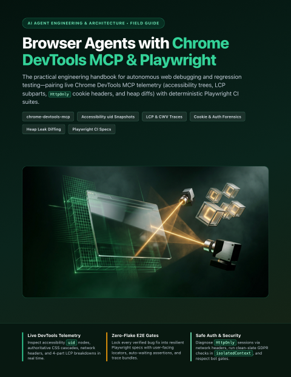</a>
      <h3><a href="guides/agent-engineering/chrome-devtools-and-playwright-agents/Chrome_DevTools_and_Playwright_Agents_Complete_How_To_Guide.pdf">Browser Agents with Chrome DevTools MCP &amp; Playwright</a></h3>
      
<strong>v1.0</strong> &bull; Updated <code>2026-11</code> &bull; 12 Pages

      
Pair live Chrome DevTools MCP diagnostics (accessibility uid snapshots, LCP subpart traces, HttpOnly cookie forensics, and heap leak diffs) with deterministic Playwright E2E regression gates.

      
<code>Chrome DevTools MCP</code> &middot; <code>Playwright</code> &middot; <code>CWV &amp; A11y</code>

      
<a href="guides/agent-engineering/chrome-devtools-and-playwright-agents/Chrome_DevTools_and_Playwright_Agents_Complete_How_To_Guide.pdf"><strong>&#128214; Read / Download PDF</strong></a> &nbsp;|&nbsp; <a href="guides/agent-engineering/chrome-devtools-and-playwright-agents">&#128736; Editable Source</a>

    </td>
  </tr>
  <tr>
    <td width="50%" valign="top">
      <a href="guides/agent-engineering/sandboxes-and-isolated-execution/Sandboxes_and_Isolated_Execution_for_AI_Agents_Complete_How_To_Guide.pdf">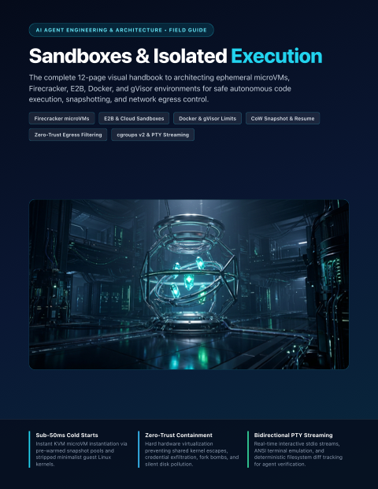</a>
      <h3><a href="guides/agent-engineering/sandboxes-and-isolated-execution/Sandboxes_and_Isolated_Execution_for_AI_Agents_Complete_How_To_Guide.pdf">Sandboxes &amp; Isolated Execution for AI Agents</a></h3>
      
<strong>v1.0</strong> &bull; Updated <code>2026-11</code> &bull; 12 Pages

      
Architecting ephemeral microVMs, Firecracker, E2B, Docker, and gVisor environments for safe autonomous code execution, snapshotting, and network egress control.

      
<code>Firecracker microVMs</code> &middot; <code>E2B Sandboxes</code> &middot; <code>Egress Security</code>

      
<a href="guides/agent-engineering/sandboxes-and-isolated-execution/Sandboxes_and_Isolated_Execution_for_AI_Agents_Complete_How_To_Guide.pdf"><strong>&#128214; Read / Download PDF</strong></a> &nbsp;|&nbsp; <a href="guides/agent-engineering/sandboxes-and-isolated-execution">&#128736; Editable Source</a>

    </td>
    <td width="50%" valign="top">
      <a href="guides/agent-engineering/orca-multi-agent-workspace-and-cli/Orca_Multi_Agent_Workspace_and_CLI_Complete_How_To_Guide.pdf">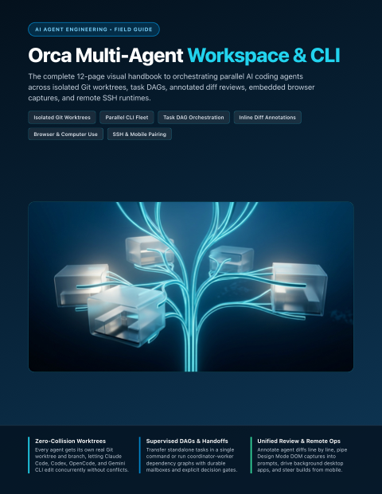</a>
      <h3><a href="guides/agent-engineering/orca-multi-agent-workspace-and-cli/Orca_Multi_Agent_Workspace_and_CLI_Complete_How_To_Guide.pdf">Orca Multi-Agent Workspace &amp; CLI</a></h3>
      
<strong>v1.0</strong> &bull; Updated <code>2026-11</code> &bull; 12 Pages

      
Orchestrate parallel AI coding agents across isolated Git worktrees, coordinator-worker task DAGs, inline diff annotations, embedded browser captures, and remote SSH or mobile runtimes.

      
<code>Orca ADE</code> &middot; <code>Git Worktrees</code> &middot; <code>Task DAGs</code>

      
<a href="guides/agent-engineering/orca-multi-agent-workspace-and-cli/Orca_Multi_Agent_Workspace_and_CLI_Complete_How_To_Guide.pdf"><strong>&#128214; Read / Download PDF</strong></a> &nbsp;|&nbsp; <a href="guides/agent-engineering/orca-multi-agent-workspace-and-cli">&#128736; Editable Source</a>

    </td>
  </tr>
  <tr>
    <td width="50%" valign="top">
      
      <h3><a href="guides/agent-engineering/agentic-observability-and-prompt-caching/Agentic_Observability_and_Prompt_Caching_Complete_How_To_Guide.pdf">Agentic Observability &amp; Prompt Caching</a></h3>
      
<strong>v1.0</strong> &bull; Updated <code>2026-11</code> &bull; 12 Pages

      
Instrument multi-agent workflows with OpenTelemetry GenAI trace trees, maximize static-first KV cache hit rates, compact historical tool outputs, and route models for predictable token FinOps.

      
<code>OpenTelemetry</code> &middot; <code>Prompt Caching</code> &middot; <code>Token FinOps</code>

      
<a href="guides/agent-engineering/agentic-observability-and-prompt-caching/Agentic_Observability_and_Prompt_Caching_Complete_How_To_Guide.pdf"><strong>&#128214; Read / Download PDF</strong></a> &nbsp;|&nbsp; <a href="guides/agent-engineering/agentic-observability-and-prompt-caching">&#128736; Editable Source</a>

    </td>
    <td width="50%" valign="top">
      
      <h3><a href="guides/agent-engineering/structured-outputs-and-state-machines/Structured_Outputs_and_State_Machines_Complete_How_To_Guide.pdf">Structured Outputs &amp; State Machines</a></h3>
      
<strong>v1.0</strong> &bull; Updated <code>2026-11</code> &bull; 12 Pages

      
Eliminate fragile regex loops with CFG/FSM constrained decoding, Pydantic v2 and Zod v4 contracts, streaming partial objects, explicit transition tables, idempotency, and HITL approval gates.

      
<code>Constrained Decoding</code> &middot; <code>State Machines</code> &middot; <code>Pydantic &amp; Zod</code>

      
<a href="guides/agent-engineering/structured-outputs-and-state-machines/Structured_Outputs_and_State_Machines_Complete_How_To_Guide.pdf"><strong>&#128214; Read / Download PDF</strong></a> &nbsp;|&nbsp; <a href="guides/agent-engineering/structured-outputs-and-state-machines">&#128736; Editable Source</a>

    </td>
  </tr>
  <tr>
    <td width="50%" valign="top">
      
      <h3><a href="guides/agent-engineering/voice-first-coding-and-capture-workflows/Voice_First_Coding_and_Capture_Workflows_Complete_How_To_Guide.pdf">Voice-First Coding &amp; Capture Workflows</a></h3>
      
<strong>v1.0</strong> &bull; Updated <code>2026-11</code> &bull; 12 Pages

      
Turn spoken architectural intent into code and notes with mlx-whisper and Superwhisper, codebase symbol glossaries, voice PR diff triage, and automated Obsidian _inbox/ capture pipelines.

      
<code>Voice Coding</code> &middot; <code>Whisper &amp; VAD</code> &middot; <code>Capture Pipelines</code>

      
<a href="guides/agent-engineering/voice-first-coding-and-capture-workflows/Voice_First_Coding_and_Capture_Workflows_Complete_How_To_Guide.pdf"><strong>&#128214; Read / Download PDF</strong></a> &nbsp;|&nbsp; <a href="guides/agent-engineering/voice-first-coding-and-capture-workflows">&#128736; Editable Source</a>

    </td>
    <td width="50%" valign="top">
      
      <h3><a href="guides/agent-engineering/ai-document-and-web-scraping-pipelines/AI_Document_and_Web_Scraping_Pipelines_Complete_How_To_Guide.pdf">AI Document &amp; Web Scraping Pipelines</a></h3>
      
<strong>v1.0</strong> &bull; Updated <code>2026-11</code> &bull; 12 Pages

      
Transform messy PDFs, Office suites, and JS-heavy websites into clean, chunked, citation-ready Markdown using Docling, Granite-Docling VLM, Crawl4AI fit_markdown, Firecrawl v2, and SHA-256 deduplication.

      
<code>Docling</code> &middot; <code>Crawl4AI</code> &middot; <code>Firecrawl</code>

      
<a href="guides/agent-engineering/ai-document-and-web-scraping-pipelines/AI_Document_and_Web_Scraping_Pipelines_Complete_How_To_Guide.pdf"><strong>&#128214; Read / Download PDF</strong></a> &nbsp;|&nbsp; <a href="guides/agent-engineering/ai-document-and-web-scraping-pipelines">&#128736; Editable Source</a>

    </td>
  </tr>
</table>

### Obsidian & AI Knowledge Systems
Publication-grade 12-page visual handbooks for turning Obsidian vaults into AI-native Second Brains—covering Claude Desktop & Antigravity Desktop workflows, multimodal Web Clipper/PDF/voice capture pipelines, native Bases & JSON Canvas, autonomous LLM Wikis, Graphify knowledge graphs, and multi-device vault security.

<table>
  <tr>
    <td width="50%" valign="top">
      
      <h3><a href="guides/obsidian/obsidian-desktop-ai-agents/Obsidian_and_Desktop_AI_Agents_Complete_How_To_Guide.pdf">Obsidian + Desktop AI Agents</a></h3>
      
<strong>v1.0</strong> &bull; Updated <code>2026-11</code> &bull; 12 Pages

      
Operating your Obsidian vault side-by-side with Claude Desktop and Google Antigravity Desktop—mastering Cowork folders, Local REST API MCP, the native Obsidian CLI, vault AGENTS.md rules, and scheduled briefings.

      
<code>Claude Desktop</code> &middot; <code>Antigravity Desktop</code> &middot; <code>Obsidian MCP &amp; CLI</code>

      
<a href="guides/obsidian/obsidian-desktop-ai-agents/Obsidian_and_Desktop_AI_Agents_Complete_How_To_Guide.pdf"><strong>&#128214; Read / Download PDF</strong></a> &nbsp;|&nbsp; <a href="guides/obsidian/obsidian-desktop-ai-agents">&#128736; Editable Source</a>

    </td>
    <td width="50%" valign="top">
      
      <h3><a href="guides/obsidian/obsidian-bases-and-json-canvas-agents/Obsidian_Bases_and_JSON_Canvas_with_AI_Complete_How_To_Guide.pdf">Obsidian Bases &amp; JSON Canvas with AI</a></h3>
      
<strong>v1.0</strong> &bull; Updated <code>2026-11</code> &bull; 12 Pages

      
Turning flat Markdown notes into live relational databases and spatial visual boards—having Claude Desktop and Antigravity generate native .base views, YAML schemas, and .canvas architecture maps.

      
<code>Obsidian Bases</code> &middot; <code>JSON Canvas</code> &middot; <code>Structured PKM</code>

      
<a href="guides/obsidian/obsidian-bases-and-json-canvas-agents/Obsidian_Bases_and_JSON_Canvas_with_AI_Complete_How_To_Guide.pdf"><strong>&#128214; Read / Download PDF</strong></a> &nbsp;|&nbsp; <a href="guides/obsidian/obsidian-bases-and-json-canvas-agents">&#128736; Editable Source</a>

    </td>
  </tr>
  <tr>
    <td width="50%" valign="top">
      
      <h3><a href="guides/obsidian/autonomous-llm-wiki-vault/Autonomous_LLM_Wiki_and_Research_Vault_Complete_How_To_Guide.pdf">Autonomous LLM Wiki &amp; Research Vault</a></h3>
      
<strong>v1.0</strong> &bull; Updated <code>2026-11</code> &bull; 12 Pages

      
Building a Karpathy-style self-maintaining knowledge base in Obsidian where Claude Desktop and Antigravity compile raw PDFs, transcripts, and web clips into interlinked evergreen concept notes.

      
<code>LLM Wiki</code> &middot; <code>Deep Research</code> &middot; <code>Second Brain</code>

      
<a href="guides/obsidian/autonomous-llm-wiki-vault/Autonomous_LLM_Wiki_and_Research_Vault_Complete_How_To_Guide.pdf"><strong>&#128214; Read / Download PDF</strong></a> &nbsp;|&nbsp; <a href="guides/obsidian/autonomous-llm-wiki-vault">&#128736; Editable Source</a>

    </td>
    <td width="50%" valign="top">
      
      <h3><a href="guides/obsidian/graphify-and-obsidian-knowledge-graphs/AI_Agents_Graphify_and_Obsidian_Complete_How_To_Guide.pdf">AI Agents + Graphify + Obsidian</a></h3>
      
<strong>v1.0</strong> &bull; Updated <code>2026-11</code> &bull; 12 Pages

      
Building persistent, queryable knowledge graphs from codebases and notes that you explore visually in Obsidian and expose to AI agents via MCP.

      
<code>Knowledge Graphs</code> &middot; <code>Obsidian</code> &middot; <code>Graphify MCP</code>

      
<a href="guides/obsidian/graphify-and-obsidian-knowledge-graphs/AI_Agents_Graphify_and_Obsidian_Complete_How_To_Guide.pdf"><strong>&#128214; Read / Download PDF</strong></a> &nbsp;|&nbsp; <a href="guides/obsidian/graphify-and-obsidian-knowledge-graphs">&#128736; Editable Source</a>

    </td>
  </tr>
  <tr>
    <td width="50%" valign="top">
      
      <h3><a href="guides/obsidian/vault-security-privacy-and-sync/Obsidian_Vault_Security_Privacy_and_Sync_Complete_How_To_Guide.pdf">Obsidian Vault Security, Privacy &amp; Sync</a></h3>
      
<strong>v1.0</strong> &bull; Updated <code>2026-11</code> &bull; 12 Pages

      
Protecting private journals, API secrets, and multi-device sync when AI agents touch your vault—mastering privacy zones, sandboxes, prompt-injection defenses, and conflict-free Obsidian Sync + Git.

      
<code>Vault Privacy</code> &middot; <code>Obsidian Sync &amp; Git</code> &middot; <code>Agent Governance</code>

      
<a href="guides/obsidian/vault-security-privacy-and-sync/Obsidian_Vault_Security_Privacy_and_Sync_Complete_How_To_Guide.pdf"><strong>&#128214; Read / Download PDF</strong></a> &nbsp;|&nbsp; <a href="guides/obsidian/vault-security-privacy-and-sync">&#128736; Editable Source</a>

    </td>
    <td width="50%" valign="top">
      
      <h3><a href="guides/obsidian/obsidian-capture-and-multimodal-pipelines/Obsidian_Capture_and_Multimodal_Pipelines_Complete_How_To_Guide.pdf">Obsidian Multimodal Capture &amp; Pipelines</a></h3>
      
<strong>v1.0</strong> &bull; Updated <code>2026-11</code> &bull; 12 Pages

      
Turn web articles, academic PDFs, voice memos, and whiteboard photos into structured vault notes—mastering Obsidian Web Clipper templates, Interpreter {{&quot;...&quot;}} prompts, Knap filters, PDF++ citations, and quarantine-safe _inbox/ routing.

      
<code>Web Clipper</code> &middot; <code>Interpreter AI</code> &middot; <code>PDF &amp; Voice Pipelines</code>

      
<a href="guides/obsidian/obsidian-capture-and-multimodal-pipelines/Obsidian_Capture_and_Multimodal_Pipelines_Complete_How_To_Guide.pdf"><strong>&#128214; Read / Download PDF</strong></a> &nbsp;|&nbsp; <a href="guides/obsidian/obsidian-capture-and-multimodal-pipelines">&#128736; Editable Source</a>

    </td>
  </tr>
</table>

### AI Music, Cinema & Presentation Studios
Publication-grade 12-page visual handbooks for generative music, studio voice/avatar localization, interactive 3D world-building & AI cinema, and rapid visual pitch decks—covering Suno, ElevenLabs, Lyria 3.5, HeyGen, Project Genie, Runway, Kling, and Gamma.

<table>
  <tr>
    <td width="50%" valign="top">
      
      <h3><a href="guides/creative-media/ai-music-production-and-soundtracks/AI_Music_Production_and_Soundtracks_Complete_How_To_Guide.pdf">AI Music Production &amp; Soundtracks</a></h3>
      
<strong>v1.0</strong> &bull; Updated <code>2026-11</code> &bull; 12 Pages

      
Compose songs, brand beds, and looping SFX using Suno v6 meta-tags, Personas, and 12-stem WAV/MIDI exports alongside ElevenLabs Music, Google Lyria 3.5, and 2026 commercial clearance rules.

      
<code>Suno v6</code> &middot; <code>ElevenLabs Music</code> &middot; <code>Lyria 3.5</code>

      
<a href="guides/creative-media/ai-music-production-and-soundtracks/AI_Music_Production_and_Soundtracks_Complete_How_To_Guide.pdf"><strong>&#128214; Read / Download PDF</strong></a> &nbsp;|&nbsp; <a href="guides/creative-media/ai-music-production-and-soundtracks">&#128736; Editable Source</a>

    </td>
    <td width="50%" valign="top">
      
      <h3><a href="guides/creative-media/ai-voices-dubbing-and-avatars/AI_Voices_Multilingual_Dubbing_and_Avatars_Complete_How_To_Guide.pdf">AI Voices, Multilingual Dubbing &amp; Avatars</a></h3>
      
<strong>v1.0</strong> &bull; Updated <code>2026-11</code> &bull; 12 Pages

      
Produce studio voice clones, W3C PLS phoneme lexicons, multi-speaker Gemini TTS dialogues, 175-language HeyGen lip-sync dubbing, and real-time WebRTC LiveAvatars with C2PA provenance.

      
<code>ElevenLabs</code> &middot; <code>HeyGen Avatars</code> &middot; <code>Voice Dubbing</code>

      
<a href="guides/creative-media/ai-voices-dubbing-and-avatars/AI_Voices_Multilingual_Dubbing_and_Avatars_Complete_How_To_Guide.pdf"><strong>&#128214; Read / Download PDF</strong></a> &nbsp;|&nbsp; <a href="guides/creative-media/ai-voices-dubbing-and-avatars">&#128736; Editable Source</a>

    </td>
  </tr>
  <tr>
    <td width="50%" valign="top">
      
      <h3><a href="guides/creative-media/interactive-worlds-and-ai-cinema/Interactive_Worlds_and_AI_Cinema_Complete_How_To_Guide.pdf">Interactive Worlds &amp; AI Cinema</a></h3>
      
<strong>v1.0</strong> &bull; Updated <code>2026-11</code> &bull; 12 Pages

      
Generate navigable 3D sets in Google Project Genie, direct camera paths and Act-One facial performances in Runway Gen-4.5, lock characters with Kling Elements, and finish in 4K at 24fps.

      
<code>Project Genie</code> &middot; <code>Runway Gen-4.5</code> &middot; <code>Kling AI</code>

      
<a href="guides/creative-media/interactive-worlds-and-ai-cinema/Interactive_Worlds_and_AI_Cinema_Complete_How_To_Guide.pdf"><strong>&#128214; Read / Download PDF</strong></a> &nbsp;|&nbsp; <a href="guides/creative-media/interactive-worlds-and-ai-cinema">&#128736; Editable Source</a>

    </td>
    <td width="50%" valign="top">
      
      <h3><a href="guides/creative-media/ai-pitch-decks-and-visual-storytelling/AI_Pitch_Decks_and_Visual_Storytelling_Complete_How_To_Guide.pdf">AI Pitch Decks &amp; Visual Storytelling</a></h3>
      
<strong>v1.0</strong> &bull; Updated <code>2026-11</code> &bull; 12 Pages

      
Turn rough briefs into investor-grade stories using Gamma fluid cards, Studio Mode, Theme Builder brand locks, Spotlight viewer analytics, API/MCP automation, and PowerPoint or Google Slides round-trips.

      
<code>Gamma Decks</code> &middot; <code>Visual Storytelling</code> &middot; <code>Brand Themes</code>

      
<a href="guides/creative-media/ai-pitch-decks-and-visual-storytelling/AI_Pitch_Decks_and_Visual_Storytelling_Complete_How_To_Guide.pdf"><strong>&#128214; Read / Download PDF</strong></a> &nbsp;|&nbsp; <a href="guides/creative-media/ai-pitch-decks-and-visual-storytelling">&#128736; Editable Source</a>

    </td>
  </tr>
</table>

### AI Search Visibility, Agentic Web & Workflows
Publication-grade 12-page visual handbooks for Generative Engine Optimization (GEO), AI search citations, agent-ready websites with is-agentic, llms.txt & WebMCP, and bot-free meeting capture pipelines with Granola.

<table>
  <tr>
    <td width="50%" valign="top">
      
      <h3><a href="guides/visibility-and-workflows/geo-and-ai-search-visibility/Generative_Engine_Optimization_and_AI_Visibility_Complete_How_To_Guide.pdf">GEO &amp; AI Search Visibility</a></h3>
      
<strong>v1.0</strong> &bull; Updated <code>2026-11</code> &bull; 12 Pages

      
Win inline citations across ChatGPT Search, Perplexity, Google AI Overviews, Claude, and Gemini using Answer-First prose capsules, entity corroboration, JSON-LD schema, SSR parity, and Share-of-Voice KPIs.

      
<code>GEO</code> &middot; <code>AI Search</code> &middot; <code>JSON-LD &amp; SSR</code>

      
<a href="guides/visibility-and-workflows/geo-and-ai-search-visibility/Generative_Engine_Optimization_and_AI_Visibility_Complete_How_To_Guide.pdf"><strong>&#128214; Read / Download PDF</strong></a> &nbsp;|&nbsp; <a href="guides/visibility-and-workflows/geo-and-ai-search-visibility">&#128736; Editable Source</a>

    </td>
    <td width="50%" valign="top">
      
      <h3><a href="guides/visibility-and-workflows/agent-ready-websites-and-webmcp/Agent_Ready_Websites_is_agentic_and_WebMCP_Complete_How_To_Guide.pdf">Agent-Ready Websites &amp; WebMCP</a></h3>
      
<strong>v1.0</strong> &bull; Updated <code>2026-11</code> &bull; 12 Pages

      
Audit sites 0-100 with is-agentic, publish /llms.txt maps and Accept: text/markdown content negotiation, expose browser-native WebMCP tools, and enforce human-in-the-loop safety gates.

      
<code>is-agentic</code> &middot; <code>llms.txt</code> &middot; <code>WebMCP</code>

      
<a href="guides/visibility-and-workflows/agent-ready-websites-and-webmcp/Agent_Ready_Websites_is_agentic_and_WebMCP_Complete_How_To_Guide.pdf"><strong>&#128214; Read / Download PDF</strong></a> &nbsp;|&nbsp; <a href="guides/visibility-and-workflows/agent-ready-websites-and-webmcp">&#128736; Editable Source</a>

    </td>
  </tr>
  <tr>
    <td width="50%" valign="top">
      
      <h3><a href="guides/visibility-and-workflows/granola-bot-free-meetings-and-pipelines/Bot_Free_Meeting_Notes_and_Action_Pipelines_Complete_How_To_Guide.pdf">Bot-Free Meeting Notes &amp; Action Pipelines</a></h3>
      
<strong>v1.0</strong> &bull; Updated <code>2026-11</code> &bull; 12 Pages

      
Capture meetings silently without call bots in Granola—merging rough human bullets with local transcripts, custom templates, Ask Granola folder Q&amp;A, Recipes, and Slack, Linear, MCP, and Obsidian _inbox/ sync.

      
<code>Granola</code> &middot; <code>Meeting Pipelines</code> &middot; <code>Ask Granola</code>

      
<a href="guides/visibility-and-workflows/granola-bot-free-meetings-and-pipelines/Bot_Free_Meeting_Notes_and_Action_Pipelines_Complete_How_To_Guide.pdf"><strong>&#128214; Read / Download PDF</strong></a> &nbsp;|&nbsp; <a href="guides/visibility-and-workflows/granola-bot-free-meetings-and-pipelines">&#128736; Editable Source</a>

    </td>
    <td width="50%"></td>
  </tr>
</table>

### Open Harnesses, AI Terminals & Local Models
Publication-grade 12-page visual handbooks for vendor-agnostic terminal harnesses, AI command lines, and local coding models—covering OpenCode TUI, Plan/Build routing, plugins & CI, Aider & Block Goose, Warp AI Terminal & Drive, and Ollama Modelfiles, tool calling & private LAN harnesses.

<table>
  <tr>
    <td width="50%" valign="top">
      
      <h3><a href="guides/open-harnesses/opencode-tui-agents-and-routing/OpenCode_TUI_Agents_and_Routing_Complete_How_To_Guide.pdf">OpenCode TUI, Plan/Build Agents &amp; Multi-Model Routing</a></h3>
      
<strong>v1.0</strong> &bull; Updated <code>2026-11</code> &bull; 12 Pages

      
Master the open-source, provider-agnostic terminal coding harness—switching between read-only Plan and Build modes with Tab, routing 75+ cloud and local models in opencode.json, closing compiler loops via native LSP, and rewinding edits with /undo snapshots.

      
<code>OpenCode TUI</code> &middot; <code>Plan &amp; Build</code> &middot; <code>Multi-Model Routing</code>

      
<a href="guides/open-harnesses/opencode-tui-agents-and-routing/OpenCode_TUI_Agents_and_Routing_Complete_How_To_Guide.pdf"><strong>&#128214; Read / Download PDF</strong></a> &nbsp;|&nbsp; <a href="guides/open-harnesses/opencode-tui-agents-and-routing">&#128736; Editable Source</a>

    </td>
    <td width="50%" valign="top">
      
      <h3><a href="guides/open-harnesses/opencode-plugins-tools-and-ci/OpenCode_Plugins_Tools_and_CI_Complete_How_To_Guide.pdf">OpenCode Plugins, Custom Tools, Servers &amp; CI</a></h3>
      
<strong>v1.0</strong> &bull; Updated <code>2026-11</code> &bull; 12 Pages

      
Extend OpenCode into a programmable engineering platform—authoring Zod-typed .opencode/tools/ modules, intercepting calls via @opencode-ai/plugin hooks, enforcing permission firewalls, running headless opencode serve daemons, and automating PRs in GitHub Actions.

      
<code>OpenCode Plugins</code> &middot; <code>opencode serve</code> &middot; <code>GitHub Actions CI</code>

      
<a href="guides/open-harnesses/opencode-plugins-tools-and-ci/OpenCode_Plugins_Tools_and_CI_Complete_How_To_Guide.pdf"><strong>&#128214; Read / Download PDF</strong></a> &nbsp;|&nbsp; <a href="guides/open-harnesses/opencode-plugins-tools-and-ci">&#128736; Editable Source</a>

    </td>
  </tr>
  <tr>
    <td width="50%" valign="top">
      
      <h3><a href="guides/open-harnesses/aider-and-goose-terminal-harnesses/Aider_and_Block_Goose_Terminal_Harnesses_Complete_How_To_Guide.pdf">Aider &amp; Block Goose Terminal Harnesses</a></h3>
      
<strong>v1.0</strong> &bull; Updated <code>2026-11</code> &bull; 12 Pages

      
Master two flagship open-source terminal harnesses—pairing Aider&#x27;s tree-sitter PageRank Repo Map, /architect dual-model splits, and atomic Git commits with Block Goose&#x27;s native MCP extensions, Lead/Worker routing, and reusable YAML Recipes.

      
<code>Aider Repo Map</code> &middot; <code>Block Goose</code> &middot; <code>MCP Recipes</code>

      
<a href="guides/open-harnesses/aider-and-goose-terminal-harnesses/Aider_and_Block_Goose_Terminal_Harnesses_Complete_How_To_Guide.pdf"><strong>&#128214; Read / Download PDF</strong></a> &nbsp;|&nbsp; <a href="guides/open-harnesses/aider-and-goose-terminal-harnesses">&#128736; Editable Source</a>

    </td>
    <td width="50%" valign="top">
      
      <h3><a href="guides/open-harnesses/warp-ai-terminal-agents-and-drive/Warp_AI_Terminal_Agents_and_Drive_Complete_How_To_Guide.pdf">Warp AI Terminal, Agent Mode &amp; Drive</a></h3>
      
<strong>v1.0</strong> &bull; Updated <code>2026-11</code> &bull; 12 Pages

      
Upgrade the command line into an agentic development environment—combining filterable Command Blocks, autonomous Agent Mode with allowlist safety gates, parameterized {{arg}} Workflows, team Notebooks, WARP.md Rules, and Zero Data Retention.

      
<code>Warp Terminal</code> &middot; <code>Agent Mode</code> &middot; <code>Warp Drive</code>

      
<a href="guides/open-harnesses/warp-ai-terminal-agents-and-drive/Warp_AI_Terminal_Agents_and_Drive_Complete_How_To_Guide.pdf"><strong>&#128214; Read / Download PDF</strong></a> &nbsp;|&nbsp; <a href="guides/open-harnesses/warp-ai-terminal-agents-and-drive">&#128736; Editable Source</a>

    </td>
  </tr>
  <tr>
    <td width="50%" valign="top">
      
      <h3><a href="guides/open-harnesses/ollama-modelfiles-tools-and-vision/Ollama_Modelfiles_Tools_and_Vision_Complete_How_To_Guide.pdf">Ollama Modelfiles, Tool Calling &amp; Vision</a></h3>
      
<strong>v1.0</strong> &bull; Updated <code>2026-11</code> &bull; 12 Pages

      
Go beyond basic ollama run prompts—author deterministic Modelfile blueprints with LoRA adapters, orchestrate native multi-turn tools loops, lock JSON Schema format outputs, extract structured data from images, and tune VRAM concurrency.

      
<code>Modelfile &amp; LoRA</code> &middot; <code>Ollama Tools</code> &middot; <code>Vision &amp; VRAM</code>

      
<a href="guides/open-harnesses/ollama-modelfiles-tools-and-vision/Ollama_Modelfiles_Tools_and_Vision_Complete_How_To_Guide.pdf"><strong>&#128214; Read / Download PDF</strong></a> &nbsp;|&nbsp; <a href="guides/open-harnesses/ollama-modelfiles-tools-and-vision">&#128736; Editable Source</a>

    </td>
    <td width="50%" valign="top">
      
      <h3><a href="guides/open-harnesses/ollama-local-coding-and-harnesses/Ollama_Local_Coding_and_Harnesses_Complete_How_To_Guide.pdf">Ollama Local Coding &amp; Hybrid Harnesses</a></h3>
      
<strong>v1.0</strong> &bull; Updated <code>2026-11</code> &bull; 12 Pages

      
Wire local Ollama weights (localhost:11434/v1) into OpenCode, Aider, Continue, Raycast, Obsidian, and n8n—pairing cloud planners with zero-cost local coders, defeating the silent num_ctx repo-map trap, and securing LAN serving over Tailscale.

      
<code>Local Coding</code> &middot; <code>num_ctx Tuning</code> &middot; <code>Tailscale LAN</code>

      
<a href="guides/open-harnesses/ollama-local-coding-and-harnesses/Ollama_Local_Coding_and_Harnesses_Complete_How_To_Guide.pdf"><strong>&#128214; Read / Download PDF</strong></a> &nbsp;|&nbsp; <a href="guides/open-harnesses/ollama-local-coding-and-harnesses">&#128736; Editable Source</a>

    </td>
  </tr>
</table>

### AI Desktop, OS Power Workflows & Personal Ops
Publication-grade 12-page visual handbooks for cross-platform desktop AI, inbox & schedule defense, safe digital decluttering, and visual workflow automation—covering macOS vs. Windows Copilot+ PCs, AI Inbox Zero & Calendar Defense, File System Cleanup, and n8n & Make.

<table>
  <tr>
    <td width="50%" valign="top">
      
      <h3><a href="guides/desktop-and-os/mac-vs-windows-ai-power-playbook/Mac_vs_Windows_AI_Power_User_Playbook_Complete_How_To_Guide.pdf">Mac vs. Windows AI Power-User Playbook</a></h3>
      
<strong>v1.0</strong> &bull; Updated <code>2026-11</code> &bull; 12 Pages

      
Master both sides of modern desktop AI—comparing Apple Silicon unified memory, Apple Intelligence, Shortcuts, and Raycast against Windows 11 Copilot+ PCs, Click to Do, opt-in Recall, PowerToys Command Palette, MLX, ONNX NPUs, and WSL2 CUDA.

      
<code>Apple Intelligence</code> &middot; <code>Copilot+ &amp; WSL2</code> &middot; <code>Raycast &amp; PowerToys</code>

      
<a href="guides/desktop-and-os/mac-vs-windows-ai-power-playbook/Mac_vs_Windows_AI_Power_User_Playbook_Complete_How_To_Guide.pdf"><strong>&#128214; Read / Download PDF</strong></a> &nbsp;|&nbsp; <a href="guides/desktop-and-os/mac-vs-windows-ai-power-playbook">&#128736; Editable Source</a>

    </td>
    <td width="50%" valign="top">
      
      <h3><a href="guides/desktop-and-os/ai-inbox-zero-and-calendar-defense/AI_Inbox_Zero_and_Calendar_Defense_Complete_How_To_Guide.pdf">AI Inbox Zero &amp; Calendar Defense</a></h3>
      
<strong>v1.0</strong> &bull; Updated <code>2026-11</code> &bull; 12 Pages

      
Turn a flooded mailbox and fragmented schedule into a calm, draft-only operating system—combining 5-bucket triage, Gmail Gemini, Shortwave, Superhuman, Workspace CLI &amp; MCP pipelines, prompt-injection shields, and automated focus-block protection.

      
<code>Inbox Zero</code> &middot; <code>Calendar Defense</code> &middot; <code>Workspace MCP</code>

      
<a href="guides/desktop-and-os/ai-inbox-zero-and-calendar-defense/AI_Inbox_Zero_and_Calendar_Defense_Complete_How_To_Guide.pdf"><strong>&#128214; Read / Download PDF</strong></a> &nbsp;|&nbsp; <a href="guides/desktop-and-os/ai-inbox-zero-and-calendar-defense">&#128736; Editable Source</a>

    </td>
  </tr>
  <tr>
    <td width="50%" valign="top">
      
      <h3><a href="guides/desktop-and-os/ai-file-system-cleanup-and-declutter/AI_File_System_Cleanup_and_Declutter_Complete_How_To_Guide.pdf">AI File System Cleanup &amp; Digital Declutter</a></h3>
      
<strong>v1.0</strong> &bull; Updated <code>2026-11</code> &bull; 12 Pages

      
Reclaim chaotic Downloads/ and Desktop folders without losing irreplaceable files—combining dry-run manifests, SHA-256 duplicate sweeps, VLM/OCR receipt renaming, 30-day quarantine staging, and native macOS + Windows automation.

      
<code>Dry-Run Cleanup</code> &middot; <code>SHA-256 Dedup</code> &middot; <code>VLM Receipt OCR</code>

      
<a href="guides/desktop-and-os/ai-file-system-cleanup-and-declutter/AI_File_System_Cleanup_and_Declutter_Complete_How_To_Guide.pdf"><strong>&#128214; Read / Download PDF</strong></a> &nbsp;|&nbsp; <a href="guides/desktop-and-os/ai-file-system-cleanup-and-declutter">&#128736; Editable Source</a>

    </td>
    <td width="50%" valign="top">
      
      <h3><a href="guides/desktop-and-os/visual-ai-workflows-n8n-and-make/Visual_AI_Workflows_with_n8n_and_Make_Complete_How_To_Guide.pdf">Visual AI Workflows with n8n &amp; Make</a></h3>
      
<strong>v1.0</strong> &bull; Updated <code>2026-11</code> &bull; 12 Pages

      
Design reliable, production-grade AI automations on a visual node canvas—combining deterministic pre-LLM routers, stateful Postgres &amp; Data Store memory, MCP tool bridges, Slack/email approval pauses, and runaway spend circuit breakers.

      
<code>n8n AI Agents</code> &middot; <code>Make Scenarios</code> &middot; <code>MCP &amp; Queue Mode</code>

      
<a href="guides/desktop-and-os/visual-ai-workflows-n8n-and-make/Visual_AI_Workflows_with_n8n_and_Make_Complete_How_To_Guide.pdf"><strong>&#128214; Read / Download PDF</strong></a> &nbsp;|&nbsp; <a href="guides/desktop-and-os/visual-ai-workflows-n8n-and-make">&#128736; Editable Source</a>

    </td>
  </tr>
</table>

### Quick-Reference Index
| Guide | Ecosystem | Version | Updated | Pages | Direct Links |
| :--- | :--- | :---: | :---: | :---: | :--- |
| **Google Flow** — Cinematic AI filmmaking studio powered by Veo 3.1, Ingredients consistency, Frames-to-Video transitions, and Scenebuilder. | Google AI & Creative Studios | `v1.0` | `2026-11` | 12 | [PDF](guides/google/google-flow/Google_Flow_Complete_How_To_Guide.pdf) &middot; [Source](guides/google/google-flow) |
| **Google Antigravity & Jules** — Agent-first desktop IDE, parallel subagents, skills/MCP customization, and asynchronous GitHub PR automation with Jules. | Google AI & Creative Studios | `v1.0` | `2026-11` | 12 | [PDF](guides/google/google-antigravity-and-jules/Google_Antigravity_and_Jules_Complete_How_To_Guide.pdf) &middot; [Source](guides/google/google-antigravity-and-jules) |
| **Google Whisk** — Image-first visual remixing studio blending Subject, Scene & Style cards, hidden Gemini captions, Seed locking, and Whisk Animate. | Google AI & Creative Studios | `v1.1` | `2026-11` | 12 | [PDF](guides/google/google-whisk/Google_Whisk_Complete_How_To_Guide.pdf) &middot; [Source](guides/google/google-whisk) |
| **Google Vids** — Workspace AI video presentation studio turning Docs & Slides into narrated storyboards with AI voiceovers, avatars, teleprompter, and Veo B-roll. | Google AI & Creative Studios | `v1.1` | `2026-11` | 12 | [PDF](guides/google/google-vids/Google_Vids_Complete_How_To_Guide.pdf) &middot; [Source](guides/google/google-vids) |
| **Google Stitch** — AI-native UI/UX design studio turning prompts, sketches, and screenshots into multi-screen flows, Figma Auto-Layout frames, and Tailwind code. | Google AI & Creative Studios | `v1.1` | `2026-11` | 12 | [PDF](guides/google/google-stitch/Google_Stitch_Complete_How_To_Guide.pdf) &middot; [Source](guides/google/google-stitch) |
| **Google Opal** — Visual no-code AI mini-app studio chaining Gemini, Imagen, Veo, Lyria, and Web Search nodes into shareable interactive apps. | Google AI & Creative Studios | `v1.1` | `2026-11` | 12 | [PDF](guides/google/google-opal/Google_Opal_Complete_How_To_Guide.pdf) &middot; [Source](guides/google/google-opal) |
| **Google AI Studio** — Flagship Gemini developer & power-user workbench for 1M+ token video/PDF analysis, Stream Realtime screen share, Build vibe-coding, and SDKs. | Google AI & Creative Studios | `v1.1` | `2026-11` | 12 | [PDF](guides/google/google-ai-studio/Google_AI_Studio_Complete_How_To_Guide.pdf) &middot; [Source](guides/google/google-ai-studio) |
| **Google NotebookLM** — Zero-hallucination research studio for 500+ sources, live interactive Join Audio Overviews, Video Overviews, and clickable Mind Maps. | Google AI & Creative Studios | `v1.1` | `2026-11` | 12 | [PDF](guides/google/google-notebooklm/Google_NotebookLM_Complete_How_To_Guide.pdf) &middot; [Source](guides/google/google-notebooklm) |
| **Gemini Deep Research, Canvas & Gems** — Autonomous multi-hundred-site research dossiers, split-screen Canvas live apps with embedded AI, and custom Drive-synced Gems. | Google AI & Creative Studios | `v1.1` | `2026-11` | 12 | [PDF](guides/google/google-gemini-deep-research-canvas-and-gems/Google_Gemini_Deep_Research_Canvas_and_Gems_Complete_How_To_Guide.pdf) &middot; [Source](guides/google/google-gemini-deep-research-canvas-and-gems) |
| **Google Project Mariner** — Autonomous browser-use agent & Gemini Agent Mode running up to 10 parallel cloud browsers, Teach & Repeat skills, and safety gates. | Google AI & Creative Studios | `v1.1` | `2026-11` | 12 | [PDF](guides/google/google-project-mariner/Google_Project_Mariner_Complete_How_To_Guide.pdf) &middot; [Source](guides/google/google-project-mariner) |
| **Antigravity 2.0 Customizations, Skills & Swarms** — Tailor Google Antigravity 2.0, IDE, CLI (agy), and Python SDK with progressive SKILL.md modules, AGENTS.md rules, lifecycle hooks.json, namespaced plugins, and message-board agent swarms. | Google AI & Creative Studios | `v1.0` | `2026-11` | 12 | [PDF](guides/google/antigravity-2-customizations-and-swarms/Antigravity_2_Customizations_and_Swarms_Complete_How_To_Guide.pdf) &middot; [Source](guides/google/antigravity-2-customizations-and-swarms) |
| **Gemini 3.8 Live & Omni 1.2 Flash Studio** — Build low-latency bidirectional voice/vision agents with Gemini 3.8 Live (Extended Thinking, NON_BLOCKING tools, Live Translate) and multi-shot 4K generative video workflows with Gemini Omni 1.2 Flash. | Google AI & Creative Studios | `v1.1` | `2026-11` | 12 | [PDF](guides/google/gemini-live-and-omni-flash/Gemini_Live_and_Omni_Flash_Complete_How_To_Guide.pdf) &middot; [Source](guides/google/gemini-live-and-omni-flash) |
| **Agentic Firebase & Android CLI Workflows** — Ship full-stack mobile and web apps with firebase-tools MCP, Firebase AI Logic + App Check, Data Connect, Android CLI, live Device Hub mirroring, Compose Preview sidecars, and XML Journey tests. | Google AI & Creative Studios | `v1.1` | `2026-11` | 12 | [PDF](guides/google/agentic-firebase-and-android-cli/Agentic_Firebase_and_Android_CLI_Complete_How_To_Guide.pdf) &middot; [Source](guides/google/agentic-firebase-and-android-cli) |
| **Google ADK & Agent2Agent (A2A) Protocol** — Build, evaluate, and ship code-first multi-agent systems with Google's Agent Development Kit in Python and TypeScript—combining deterministic Workflow Agents, scoped state prefixes, MCPToolset, Vertex AI Agent Engine, and cross-vendor A2A Agent Cards. | Google AI & Creative Studios | `v1.1` | `2026-11` | 12 | [PDF](guides/google/google-adk-and-a2a/Google_ADK_and_A2A_Protocol_Complete_How_To_Guide.pdf) &middot; [Source](guides/google/google-adk-and-a2a) |
| **Claude Code Mods** — Customizing Claude Code from the inside with in-process TypeScript/JavaScript mods—building live terminal HUDs, prompt/tool interceptors, custom slash commands, and sec-default guardrails. | Anthropic Claude & Workspace Studios | `v1.1` | `2026-11` | 12 | [PDF](guides/claude/claude-code-mods/Claude_Code_Mods_Complete_How_To_Guide.pdf) &middot; [Source](guides/claude/claude-code-mods) |
| **Claude Whiteboards** — Turning messy voice and text brainstorms into real-time multiplayer visual canvases—mastering region-box prompting, retro clustering, Doc/Slide handoffs, and Miro/Lucid exports. | Anthropic Claude & Workspace Studios | `v1.0` | `2026-11` | 12 | [PDF](guides/claude/claude-whiteboards/Claude_Whiteboards_Complete_How_To_Guide.pdf) &middot; [Source](guides/claude/claude-whiteboards) |
| **Claude Dashboards & Data** — Connecting warehouses and CRMs to natural-language analytics—building auditable SQL charts, Certified Queries, Scrollytellers, Visual Shorts, and credential-safe live team shares. | Anthropic Claude & Workspace Studios | `v1.0` | `2026-11` | 12 | [PDF](guides/claude/claude-dashboards-and-data/Claude_Dashboards_and_Data_Complete_How_To_Guide.pdf) &middot; [Source](guides/claude/claude-dashboards-and-data) |
| **Claude Skills** — Packaging reusable domain expertise across Claude.ai, Claude Desktop, and Claude Code—mastering 3-tier progressive disclosure, SKILL.md anatomy, skill-creator, and executable scripts. | Anthropic Claude & Workspace Studios | `v1.1` | `2026-11` | 12 | [PDF](guides/claude/claude-skills/Claude_Skills_Complete_How_To_Guide.pdf) &middot; [Source](guides/claude/claude-skills) |
| **Claude Cowork & Computer Use** — Automating multi-step knowledge work across Desktop, Web, and Mobile—mastering background macOS Computer Use, built-in browser tasks, recurring /schedule runs, and SaaS connectors. | Anthropic Claude & Workspace Studios | `v1.0` | `2026-11` | 12 | [PDF](guides/claude/claude-cowork-and-computer-use/Claude_Cowork_and_Computer_Use_Complete_How_To_Guide.pdf) &middot; [Source](guides/claude/claude-cowork-and-computer-use) |
| **Claude Sheets & Interactive Artifacts** — Building live multi-tab spreadsheets with cross-sheet formulas, dropdowns, charts, multiplayer edits, and .xlsx round-tripping alongside interactive MCP-connected Artifacts. | Anthropic Claude & Workspace Studios | `v1.0` | `2026-11` | 12 | [PDF](guides/claude/claude-sheets-and-artifacts/Claude_Sheets_and_Artifacts_Complete_How_To_Guide.pdf) &middot; [Source](guides/claude/claude-sheets-and-artifacts) |
| **Claude Code Autonomous Loops & Code Artifacts** — Running unattended multi-turn /goal completion contracts, supervising parallel sessions in claude agents, CLI-to-Desktop /resume, and publishing live PR walkthrough Artifacts. | Anthropic Claude & Workspace Studios | `v1.1` | `2026-11` | 12 | [PDF](guides/claude/claude-code-autonomous-loops/Claude_Code_Autonomous_Loops_Complete_How_To_Guide.pdf) &middot; [Source](guides/claude/claude-code-autonomous-loops) |
| **Claude Managed Agents & MCP Connectors** — Connecting Remote HTTPS/SSE and local stdio MCP servers across Claude surfaces and self-hosting cma-server agent sandboxes with scoped OAuth and Bedrock/Vertex routing. | Anthropic Claude & Workspace Studios | `v1.1` | `2026-11` | 12 | [PDF](guides/claude/claude-managed-agents-and-mcp/Claude_Managed_Agents_and_MCP_Complete_How_To_Guide.pdf) &middot; [Source](guides/claude/claude-managed-agents-and-mcp) |
| **Claude Meetings** — Turning live Google Meet calls into visible co-creation sessions—mastering calendar auto-join, external-guest guardrails, live Whiteboards, Docs & Sheets, Interactive Connectors, and the post-meeting claude.ai hub. | Anthropic Claude & Workspace Studios | `v1.1` | `2026-11` | 12 | [PDF](guides/claude/claude-meetings/Claude_Meetings_Complete_How_To_Guide.pdf) &middot; [Source](guides/claude/claude-meetings) |
| **Claude Duet** — Operating Anthropic's proactive Opus 5.5 cloud chief of staff—delivering Morning Briefs, persistent Cloud VM and headless browser sweeps, topic Channels, and Human-in-the-Loop approval gates. | Anthropic Claude & Workspace Studios | `v1.1` | `2026-11` | 12 | [PDF](guides/claude/claude-duet/Claude_Duet_Complete_How_To_Guide.pdf) &middot; [Source](guides/claude/claude-duet) |
| **Claude Design** — Turning real codebases and brand guidelines into on-brand interactive prototypes, wireframes, decks, and product one-pagers—with live Control Knobs, inline comments, and Figma MCP or Claude Code handoffs. | Anthropic Claude & Workspace Studios | `v1.1` | `2026-11` | 12 | [PDF](guides/claude/claude-design/Claude_Design_Complete_How_To_Guide.pdf) &middot; [Source](guides/claude/claude-design) |
| **Claude Code Projects & Proactive Coordinator** — Orchestrating parallel cloud worker branches with Claude Fable 5.2, Opus 5.5, and Haiku 5.5 alongside the Session Rail HUD, /btw and /fork context hygiene, Background MCP tasks, and identity safeguards. | Anthropic Claude & Workspace Studios | `v1.1` | `2026-11` | 12 | [PDF](guides/claude/claude-code-projects-and-coordinator/Claude_Code_Projects_and_Coordinator_Complete_How_To_Guide.pdf) &middot; [Source](guides/claude/claude-code-projects-and-coordinator) |
| **Claude Security & Mythos 5.2** — Deploying continuous, reasoning-driven application security with Claude Mythos 5.2—mastering Deep Baseline Scans, living Threat Models, automated fix verification, and Claude Code MCP remediation. | Anthropic Claude & Workspace Studios | `v1.0` | `2026-11` | 12 | [PDF](guides/claude/claude-security-and-mythos/Claude_Security_and_Mythos_Complete_How_To_Guide.pdf) &middot; [Source](guides/claude/claude-security-and-mythos) |
| **Claude Code Channels, Remote Control & Dispatch** — Connect live local terminal sessions to webhooks, CI/CD, Sentry, and chat bridges with Channels, steer active repos from mobile via Remote Control, and isolate cross-device Dispatch runs. | Anthropic Claude & Workspace Studios | `v1.1` | `2026-11` | 12 | [PDF](guides/claude/claude-code-channels-and-remote-control/Claude_Code_Channels_and_Remote_Control_Complete_How_To_Guide.pdf) &middot; [Source](guides/claude/claude-code-channels-and-remote-control) |
| **Claude in Chrome & Persistent Memory** — Bridge authenticated Chrome tabs to Claude Code and Claude Desktop for live console and DOM forensics while compounding knowledge via /memories CRUD, CLAUDE.md, and Auto-Dream consolidation. | Anthropic Claude & Workspace Studios | `v1.1` | `2026-11` | 12 | [PDF](guides/claude/claude-in-chrome-and-persistent-memory/Claude_in_Chrome_and_Persistent_Memory_Complete_How_To_Guide.pdf) &middot; [Source](guides/claude/claude-in-chrome-and-persistent-memory) |
| **OpenAI Codex CLI & Codex Cloud** — Configure TOML sandboxes, AGENTS.md constitutions, on-demand SKILL.md modules, GPT-6.1 Sol tiers, and parallel Codex Cloud PR containers. | OpenAI Codex, Agents & Realtime Studios | `v1.1` | `2026-11` | 12 | [PDF](guides/openai/codex-cli-and-cloud/OpenAI_Codex_CLI_and_Cloud_Complete_How_To_Guide.pdf) &middot; [Source](guides/openai/codex-cli-and-cloud) |
| **OpenAI Agents API & SDK** — Architect production multi-agent systems with handoffs, Agents-as-Tools, parallel input/output guardrails, built-in tracing, and stateful MCP sessions. | OpenAI Codex, Agents & Realtime Studios | `v1.1` | `2026-11` | 12 | [PDF](guides/openai/agents-api-and-sdk/OpenAI_Agents_API_and_SDK_Complete_How_To_Guide.pdf) &middot; [Source](guides/openai/agents-api-and-sdk) |
| **ChatGPT Canvas, Spaces & Computer Use** — Master surgical split-pane Canvas diffs, multiplayer Spaces and Pages, and gated Agent Mode browser and desktop workflows. | OpenAI Codex, Agents & Realtime Studios | `v1.1` | `2026-11` | 12 | [PDF](guides/openai/chatgpt-canvas-and-spaces/ChatGPT_Canvas_Spaces_and_Computer_Use_Complete_How_To_Guide.pdf) &middot; [Source](guides/openai/chatgpt-canvas-and-spaces) |
| **OpenAI Realtime Voice & Vision** — Build sub-second speech-to-speech and live vision agents across WebRTC, WebSockets, and SIP telephony with native VAD barge-in and async MCP. | OpenAI Codex, Agents & Realtime Studios | `v1.1` | `2026-11` | 12 | [PDF](guides/openai/realtime-voice-and-vision/OpenAI_Realtime_Voice_and_Vision_Complete_How_To_Guide.pdf) &middot; [Source](guides/openai/realtime-voice-and-vision) |
| **ChatGPT Projects, Memory & Deep Research** — Organize durable workspaces inside ChatGPT Projects, seal confidential work behind Project-Only Memory walls, steer autonomous Deep Research plans, and schedule proactive Tasks & Dots briefings. | OpenAI Codex, Agents & Realtime Studios | `v1.0` | `2026-11` | 12 | [PDF](guides/openai/chatgpt-projects-memory-and-deep-research/ChatGPT_Projects_Memory_and_Deep_Research_Complete_How_To_Guide.pdf) &middot; [Source](guides/openai/chatgpt-projects-memory-and-deep-research) |
| **Vercel AI SDK 7 & AI Gateway** — Stream typed UI messages, ToolLoopAgent runs, and structured Output.object() calls through Vercel AI Gateway with OIDC auth, virtual models, budgets, and automatic provider failover. | Vercel & Full-Stack AI Applications | `v1.1` | `2026-11` | 12 | [PDF](guides/vercel/ai-sdk-and-gateway/Vercel_AI_SDK_and_Gateway_Complete_How_To_Guide.pdf) &middot; [Source](guides/vercel/ai-sdk-and-gateway) |
| **Vercel Durable Agents, Workflows & Queues** — Build crash-safe agents and long-running pipelines using eve, Workflow 5 (WorkflowAgent, use workflow & use step), Vercel Queues, and Vercel Schedules. | Vercel & Full-Stack AI Applications | `v1.0` | `2026-11` | 12 | [PDF](guides/vercel/durable-agents-and-workflows/Vercel_Durable_Agents_and_Workflows_Complete_How_To_Guide.pdf) &middot; [Source](guides/vercel/durable-agents-and-workflows) |
| **Next.js Cache Components & Partial Prefetching** — Adopt cacheComponents and partialPrefetching in Next.js 16.3+, grow instant static App Shells with use cache and Suspense, and lock regressions with @next/playwright instant(). | Vercel & Full-Stack AI Applications | `v1.0` | `2026-11` | 12 | [PDF](guides/vercel/nextjs-cache-components/Nextjs_Cache_Components_and_Prefetching_Complete_How_To_Guide.pdf) &middot; [Source](guides/vercel/nextjs-cache-components) |
| **Multi-Platform Bots with Vercel Chat SDK** — Ship one TypeScript bot codebase across Slack, Teams, Discord, Telegram, GitHub, and Linear with @chat-adapter/*, Vercel Connect OAuth, Sandbox PR reviews, and Workflow approval cards. | Vercel & Full-Stack AI Applications | `v1.1` | `2026-11` | 12 | [PDF](guides/vercel/multi-platform-chat-sdk/Vercel_Multi_Platform_Chat_SDK_Complete_How_To_Guide.pdf) &middot; [Source](guides/vercel/multi-platform-chat-sdk) |
| **Spec-Driven Dev & Context Engineering** — Cross-vendor context architecture (AGENTS.md, CLAUDE.md, Cursor rules), progressive disclosure, and Spec-to-Plan-to-Tasks agent workflows. | AI Agent Engineering & Architecture | `v1.1` | `2026-11` | 12 | [PDF](guides/agent-engineering/spec-driven-context-engineering/Spec_Driven_Dev_and_Context_Engineering_Complete_How_To_Guide.pdf) &middot; [Source](guides/agent-engineering/spec-driven-context-engineering) |
| **Subagents & Agent Orchestration** — Designing specialist subagents, context forks, least-privilege tool scoping, lifecycle hooks, and multi-agent coordinator-worker swarms. | AI Agent Engineering & Architecture | `v1.0` | `2026-11` | 12 | [PDF](guides/agent-engineering/subagents-and-orchestration/Subagents_and_Agent_Orchestration_Complete_How_To_Guide.pdf) &middot; [Source](guides/agent-engineering/subagents-and-orchestration) |
| **Git Worktrees & Parallel Agent Safety** — Running parallel coding agents without file collisions—covering Git worktree fleets, isolated ports/databases, safety hooks, and teardown. | AI Agent Engineering & Architecture | `v1.0` | `2026-11` | 12 | [PDF](guides/agent-engineering/git-worktrees-and-parallel-safety/Git_Worktrees_and_Parallel_Agent_Safety_Complete_How_To_Guide.pdf) &middot; [Source](guides/agent-engineering/git-worktrees-and-parallel-safety) |
| **Vector Memory & Semantic Search (RAG)** — Building persistent semantic memory for AI agents with structure-aware chunking, Chroma, pgvector, Qdrant, local Ollama, and hybrid retrieval. | AI Agent Engineering & Architecture | `v1.0` | `2026-11` | 12 | [PDF](guides/agent-engineering/vector-memory-and-rag/Vector_Memory_and_Semantic_Search_RAG_Complete_How_To_Guide.pdf) &middot; [Source](guides/agent-engineering/vector-memory-and-rag) |
| **AI Evals & Regression Testing** — Turning LLM vibe-checks into deterministic CI deploy gates with golden datasets, code scorers, calibrated LLM-as-judge, and Promptfoo. | AI Agent Engineering & Architecture | `v1.0` | `2026-11` | 12 | [PDF](guides/agent-engineering/ai-evals-and-regression-testing/AI_Evals_and_Regression_Testing_Complete_How_To_Guide.pdf) &middot; [Source](guides/agent-engineering/ai-evals-and-regression-testing) |
| **Prompt Injection & Agent Security** — Defending tool-calling and browsing AI agents against indirect prompt injection, poisoned MCP servers, secret exfiltration, and unsafe output sinks. | AI Agent Engineering & Architecture | `v1.0` | `2026-11` | 12 | [PDF](guides/agent-engineering/prompt-injection-and-agent-security/Prompt_Injection_and_Agent_Security_Complete_How_To_Guide.pdf) &middot; [Source](guides/agent-engineering/prompt-injection-and-agent-security) |
| **Local & On-Device AI Stack** — Running private, zero-per-token LLMs and embeddings on your own hardware—mastering GGUF quantization, Apple Silicon memory math, Ollama, and llama.cpp. | AI Agent Engineering & Architecture | `v1.0` | `2026-11` | 12 | [PDF](guides/agent-engineering/local-and-on-device-ai/Local_and_On_Device_AI_Stack_Complete_How_To_Guide.pdf) &middot; [Source](guides/agent-engineering/local-and-on-device-ai) |
| **Jev & System One Decisions** — Replacing fragile LLM JSON parsing with fast, calibrated System One decisions—mastering Choice, Score, and Noul primitives, parallel fan-out, and confidence-gated routing. | AI Agent Engineering & Architecture | `v1.0` | `2026-11` | 12 | [PDF](guides/agent-engineering/jev-and-system-one-decisions/Jev_and_System_One_Decisions_Complete_How_To_Guide.pdf) &middot; [Source](guides/agent-engineering/jev-and-system-one-decisions) |
| **Building Production MCP Servers** — Architect, test, and ship high-reliability Model Context Protocol servers in TypeScript (SDK v2) and Python (FastMCP)—mastering stateless Streamable HTTP factories, Zod v4 & outputSchema, OAuth 2.1, MCP Inspector, and 10-question evals. | AI Agent Engineering & Architecture | `v1.0` | `2026-11` | 12 | [PDF](guides/agent-engineering/building-production-mcp-servers/Building_Production_MCP_Servers_Complete_How_To_Guide.pdf) &middot; [Source](guides/agent-engineering/building-production-mcp-servers) |
| **Browser Agents with Chrome DevTools MCP & Playwright** — Pair live Chrome DevTools MCP diagnostics (accessibility uid snapshots, LCP subpart traces, HttpOnly cookie forensics, and heap leak diffs) with deterministic Playwright E2E regression gates. | AI Agent Engineering & Architecture | `v1.0` | `2026-11` | 12 | [PDF](guides/agent-engineering/chrome-devtools-and-playwright-agents/Chrome_DevTools_and_Playwright_Agents_Complete_How_To_Guide.pdf) &middot; [Source](guides/agent-engineering/chrome-devtools-and-playwright-agents) |
| **Sandboxes & Isolated Execution for AI Agents** — Architecting ephemeral microVMs, Firecracker, E2B, Docker, and gVisor environments for safe autonomous code execution, snapshotting, and network egress control. | AI Agent Engineering & Architecture | `v1.0` | `2026-11` | 12 | [PDF](guides/agent-engineering/sandboxes-and-isolated-execution/Sandboxes_and_Isolated_Execution_for_AI_Agents_Complete_How_To_Guide.pdf) &middot; [Source](guides/agent-engineering/sandboxes-and-isolated-execution) |
| **Orca Multi-Agent Workspace & CLI** — Orchestrate parallel AI coding agents across isolated Git worktrees, coordinator-worker task DAGs, inline diff annotations, embedded browser captures, and remote SSH or mobile runtimes. | AI Agent Engineering & Architecture | `v1.0` | `2026-11` | 12 | [PDF](guides/agent-engineering/orca-multi-agent-workspace-and-cli/Orca_Multi_Agent_Workspace_and_CLI_Complete_How_To_Guide.pdf) &middot; [Source](guides/agent-engineering/orca-multi-agent-workspace-and-cli) |
| **Agentic Observability & Prompt Caching** — Instrument multi-agent workflows with OpenTelemetry GenAI trace trees, maximize static-first KV cache hit rates, compact historical tool outputs, and route models for predictable token FinOps. | AI Agent Engineering & Architecture | `v1.0` | `2026-11` | 12 | [PDF](guides/agent-engineering/agentic-observability-and-prompt-caching/Agentic_Observability_and_Prompt_Caching_Complete_How_To_Guide.pdf) &middot; [Source](guides/agent-engineering/agentic-observability-and-prompt-caching) |
| **Structured Outputs & State Machines** — Eliminate fragile regex loops with CFG/FSM constrained decoding, Pydantic v2 and Zod v4 contracts, streaming partial objects, explicit transition tables, idempotency, and HITL approval gates. | AI Agent Engineering & Architecture | `v1.0` | `2026-11` | 12 | [PDF](guides/agent-engineering/structured-outputs-and-state-machines/Structured_Outputs_and_State_Machines_Complete_How_To_Guide.pdf) &middot; [Source](guides/agent-engineering/structured-outputs-and-state-machines) |
| **Voice-First Coding & Capture Workflows** — Turn spoken architectural intent into code and notes with mlx-whisper and Superwhisper, codebase symbol glossaries, voice PR diff triage, and automated Obsidian _inbox/ capture pipelines. | AI Agent Engineering & Architecture | `v1.0` | `2026-11` | 12 | [PDF](guides/agent-engineering/voice-first-coding-and-capture-workflows/Voice_First_Coding_and_Capture_Workflows_Complete_How_To_Guide.pdf) &middot; [Source](guides/agent-engineering/voice-first-coding-and-capture-workflows) |
| **AI Document & Web Scraping Pipelines** — Transform messy PDFs, Office suites, and JS-heavy websites into clean, chunked, citation-ready Markdown using Docling, Granite-Docling VLM, Crawl4AI fit_markdown, Firecrawl v2, and SHA-256 deduplication. | AI Agent Engineering & Architecture | `v1.0` | `2026-11` | 12 | [PDF](guides/agent-engineering/ai-document-and-web-scraping-pipelines/AI_Document_and_Web_Scraping_Pipelines_Complete_How_To_Guide.pdf) &middot; [Source](guides/agent-engineering/ai-document-and-web-scraping-pipelines) |
| **Obsidian + Desktop AI Agents** — Operating your Obsidian vault side-by-side with Claude Desktop and Google Antigravity Desktop—mastering Cowork folders, Local REST API MCP, the native Obsidian CLI, vault AGENTS.md rules, and scheduled briefings. | Obsidian & AI Knowledge Systems | `v1.0` | `2026-11` | 12 | [PDF](guides/obsidian/obsidian-desktop-ai-agents/Obsidian_and_Desktop_AI_Agents_Complete_How_To_Guide.pdf) &middot; [Source](guides/obsidian/obsidian-desktop-ai-agents) |
| **Obsidian Bases & JSON Canvas with AI** — Turning flat Markdown notes into live relational databases and spatial visual boards—having Claude Desktop and Antigravity generate native .base views, YAML schemas, and .canvas architecture maps. | Obsidian & AI Knowledge Systems | `v1.0` | `2026-11` | 12 | [PDF](guides/obsidian/obsidian-bases-and-json-canvas-agents/Obsidian_Bases_and_JSON_Canvas_with_AI_Complete_How_To_Guide.pdf) &middot; [Source](guides/obsidian/obsidian-bases-and-json-canvas-agents) |
| **Autonomous LLM Wiki & Research Vault** — Building a Karpathy-style self-maintaining knowledge base in Obsidian where Claude Desktop and Antigravity compile raw PDFs, transcripts, and web clips into interlinked evergreen concept notes. | Obsidian & AI Knowledge Systems | `v1.0` | `2026-11` | 12 | [PDF](guides/obsidian/autonomous-llm-wiki-vault/Autonomous_LLM_Wiki_and_Research_Vault_Complete_How_To_Guide.pdf) &middot; [Source](guides/obsidian/autonomous-llm-wiki-vault) |
| **AI Agents + Graphify + Obsidian** — Building persistent, queryable knowledge graphs from codebases and notes that you explore visually in Obsidian and expose to AI agents via MCP. | Obsidian & AI Knowledge Systems | `v1.0` | `2026-11` | 12 | [PDF](guides/obsidian/graphify-and-obsidian-knowledge-graphs/AI_Agents_Graphify_and_Obsidian_Complete_How_To_Guide.pdf) &middot; [Source](guides/obsidian/graphify-and-obsidian-knowledge-graphs) |
| **Obsidian Vault Security, Privacy & Sync** — Protecting private journals, API secrets, and multi-device sync when AI agents touch your vault—mastering privacy zones, sandboxes, prompt-injection defenses, and conflict-free Obsidian Sync + Git. | Obsidian & AI Knowledge Systems | `v1.0` | `2026-11` | 12 | [PDF](guides/obsidian/vault-security-privacy-and-sync/Obsidian_Vault_Security_Privacy_and_Sync_Complete_How_To_Guide.pdf) &middot; [Source](guides/obsidian/vault-security-privacy-and-sync) |
| **Obsidian Multimodal Capture & Pipelines** — Turn web articles, academic PDFs, voice memos, and whiteboard photos into structured vault notes—mastering Obsidian Web Clipper templates, Interpreter {{"..."}} prompts, Knap filters, PDF++ citations, and quarantine-safe _inbox/ routing. | Obsidian & AI Knowledge Systems | `v1.0` | `2026-11` | 12 | [PDF](guides/obsidian/obsidian-capture-and-multimodal-pipelines/Obsidian_Capture_and_Multimodal_Pipelines_Complete_How_To_Guide.pdf) &middot; [Source](guides/obsidian/obsidian-capture-and-multimodal-pipelines) |
| **AI Music Production & Soundtracks** — Compose songs, brand beds, and looping SFX using Suno v6 meta-tags, Personas, and 12-stem WAV/MIDI exports alongside ElevenLabs Music, Google Lyria 3.5, and 2026 commercial clearance rules. | AI Music, Cinema & Presentation Studios | `v1.0` | `2026-11` | 12 | [PDF](guides/creative-media/ai-music-production-and-soundtracks/AI_Music_Production_and_Soundtracks_Complete_How_To_Guide.pdf) &middot; [Source](guides/creative-media/ai-music-production-and-soundtracks) |
| **AI Voices, Multilingual Dubbing & Avatars** — Produce studio voice clones, W3C PLS phoneme lexicons, multi-speaker Gemini TTS dialogues, 175-language HeyGen lip-sync dubbing, and real-time WebRTC LiveAvatars with C2PA provenance. | AI Music, Cinema & Presentation Studios | `v1.0` | `2026-11` | 12 | [PDF](guides/creative-media/ai-voices-dubbing-and-avatars/AI_Voices_Multilingual_Dubbing_and_Avatars_Complete_How_To_Guide.pdf) &middot; [Source](guides/creative-media/ai-voices-dubbing-and-avatars) |
| **Interactive Worlds & AI Cinema** — Generate navigable 3D sets in Google Project Genie, direct camera paths and Act-One facial performances in Runway Gen-4.5, lock characters with Kling Elements, and finish in 4K at 24fps. | AI Music, Cinema & Presentation Studios | `v1.0` | `2026-11` | 12 | [PDF](guides/creative-media/interactive-worlds-and-ai-cinema/Interactive_Worlds_and_AI_Cinema_Complete_How_To_Guide.pdf) &middot; [Source](guides/creative-media/interactive-worlds-and-ai-cinema) |
| **AI Pitch Decks & Visual Storytelling** — Turn rough briefs into investor-grade stories using Gamma fluid cards, Studio Mode, Theme Builder brand locks, Spotlight viewer analytics, API/MCP automation, and PowerPoint or Google Slides round-trips. | AI Music, Cinema & Presentation Studios | `v1.0` | `2026-11` | 12 | [PDF](guides/creative-media/ai-pitch-decks-and-visual-storytelling/AI_Pitch_Decks_and_Visual_Storytelling_Complete_How_To_Guide.pdf) &middot; [Source](guides/creative-media/ai-pitch-decks-and-visual-storytelling) |
| **GEO & AI Search Visibility** — Win inline citations across ChatGPT Search, Perplexity, Google AI Overviews, Claude, and Gemini using Answer-First prose capsules, entity corroboration, JSON-LD schema, SSR parity, and Share-of-Voice KPIs. | AI Search Visibility, Agentic Web & Workflows | `v1.0` | `2026-11` | 12 | [PDF](guides/visibility-and-workflows/geo-and-ai-search-visibility/Generative_Engine_Optimization_and_AI_Visibility_Complete_How_To_Guide.pdf) &middot; [Source](guides/visibility-and-workflows/geo-and-ai-search-visibility) |
| **Agent-Ready Websites & WebMCP** — Audit sites 0-100 with is-agentic, publish /llms.txt maps and Accept: text/markdown content negotiation, expose browser-native WebMCP tools, and enforce human-in-the-loop safety gates. | AI Search Visibility, Agentic Web & Workflows | `v1.0` | `2026-11` | 12 | [PDF](guides/visibility-and-workflows/agent-ready-websites-and-webmcp/Agent_Ready_Websites_is_agentic_and_WebMCP_Complete_How_To_Guide.pdf) &middot; [Source](guides/visibility-and-workflows/agent-ready-websites-and-webmcp) |
| **Bot-Free Meeting Notes & Action Pipelines** — Capture meetings silently without call bots in Granola—merging rough human bullets with local transcripts, custom templates, Ask Granola folder Q&A, Recipes, and Slack, Linear, MCP, and Obsidian _inbox/ sync. | AI Search Visibility, Agentic Web & Workflows | `v1.0` | `2026-11` | 12 | [PDF](guides/visibility-and-workflows/granola-bot-free-meetings-and-pipelines/Bot_Free_Meeting_Notes_and_Action_Pipelines_Complete_How_To_Guide.pdf) &middot; [Source](guides/visibility-and-workflows/granola-bot-free-meetings-and-pipelines) |
| **OpenCode TUI, Plan/Build Agents & Multi-Model Routing** — Master the open-source, provider-agnostic terminal coding harness—switching between read-only Plan and Build modes with Tab, routing 75+ cloud and local models in opencode.json, closing compiler loops via native LSP, and rewinding edits with /undo snapshots. | Open Harnesses, AI Terminals & Local Models | `v1.0` | `2026-11` | 12 | [PDF](guides/open-harnesses/opencode-tui-agents-and-routing/OpenCode_TUI_Agents_and_Routing_Complete_How_To_Guide.pdf) &middot; [Source](guides/open-harnesses/opencode-tui-agents-and-routing) |
| **OpenCode Plugins, Custom Tools, Servers & CI** — Extend OpenCode into a programmable engineering platform—authoring Zod-typed .opencode/tools/ modules, intercepting calls via @opencode-ai/plugin hooks, enforcing permission firewalls, running headless opencode serve daemons, and automating PRs in GitHub Actions. | Open Harnesses, AI Terminals & Local Models | `v1.0` | `2026-11` | 12 | [PDF](guides/open-harnesses/opencode-plugins-tools-and-ci/OpenCode_Plugins_Tools_and_CI_Complete_How_To_Guide.pdf) &middot; [Source](guides/open-harnesses/opencode-plugins-tools-and-ci) |
| **Aider & Block Goose Terminal Harnesses** — Master two flagship open-source terminal harnesses—pairing Aider's tree-sitter PageRank Repo Map, /architect dual-model splits, and atomic Git commits with Block Goose's native MCP extensions, Lead/Worker routing, and reusable YAML Recipes. | Open Harnesses, AI Terminals & Local Models | `v1.0` | `2026-11` | 12 | [PDF](guides/open-harnesses/aider-and-goose-terminal-harnesses/Aider_and_Block_Goose_Terminal_Harnesses_Complete_How_To_Guide.pdf) &middot; [Source](guides/open-harnesses/aider-and-goose-terminal-harnesses) |
| **Warp AI Terminal, Agent Mode & Drive** — Upgrade the command line into an agentic development environment—combining filterable Command Blocks, autonomous Agent Mode with allowlist safety gates, parameterized {{arg}} Workflows, team Notebooks, WARP.md Rules, and Zero Data Retention. | Open Harnesses, AI Terminals & Local Models | `v1.0` | `2026-11` | 12 | [PDF](guides/open-harnesses/warp-ai-terminal-agents-and-drive/Warp_AI_Terminal_Agents_and_Drive_Complete_How_To_Guide.pdf) &middot; [Source](guides/open-harnesses/warp-ai-terminal-agents-and-drive) |
| **Ollama Modelfiles, Tool Calling & Vision** — Go beyond basic ollama run prompts—author deterministic Modelfile blueprints with LoRA adapters, orchestrate native multi-turn tools loops, lock JSON Schema format outputs, extract structured data from images, and tune VRAM concurrency. | Open Harnesses, AI Terminals & Local Models | `v1.0` | `2026-11` | 12 | [PDF](guides/open-harnesses/ollama-modelfiles-tools-and-vision/Ollama_Modelfiles_Tools_and_Vision_Complete_How_To_Guide.pdf) &middot; [Source](guides/open-harnesses/ollama-modelfiles-tools-and-vision) |
| **Ollama Local Coding & Hybrid Harnesses** — Wire local Ollama weights (localhost:11434/v1) into OpenCode, Aider, Continue, Raycast, Obsidian, and n8n—pairing cloud planners with zero-cost local coders, defeating the silent num_ctx repo-map trap, and securing LAN serving over Tailscale. | Open Harnesses, AI Terminals & Local Models | `v1.0` | `2026-11` | 12 | [PDF](guides/open-harnesses/ollama-local-coding-and-harnesses/Ollama_Local_Coding_and_Harnesses_Complete_How_To_Guide.pdf) &middot; [Source](guides/open-harnesses/ollama-local-coding-and-harnesses) |
| **Mac vs. Windows AI Power-User Playbook** — Master both sides of modern desktop AI—comparing Apple Silicon unified memory, Apple Intelligence, Shortcuts, and Raycast against Windows 11 Copilot+ PCs, Click to Do, opt-in Recall, PowerToys Command Palette, MLX, ONNX NPUs, and WSL2 CUDA. | AI Desktop, OS Power Workflows & Personal Ops | `v1.0` | `2026-11` | 12 | [PDF](guides/desktop-and-os/mac-vs-windows-ai-power-playbook/Mac_vs_Windows_AI_Power_User_Playbook_Complete_How_To_Guide.pdf) &middot; [Source](guides/desktop-and-os/mac-vs-windows-ai-power-playbook) |
| **AI Inbox Zero & Calendar Defense** — Turn a flooded mailbox and fragmented schedule into a calm, draft-only operating system—combining 5-bucket triage, Gmail Gemini, Shortwave, Superhuman, Workspace CLI & MCP pipelines, prompt-injection shields, and automated focus-block protection. | AI Desktop, OS Power Workflows & Personal Ops | `v1.0` | `2026-11` | 12 | [PDF](guides/desktop-and-os/ai-inbox-zero-and-calendar-defense/AI_Inbox_Zero_and_Calendar_Defense_Complete_How_To_Guide.pdf) &middot; [Source](guides/desktop-and-os/ai-inbox-zero-and-calendar-defense) |
| **AI File System Cleanup & Digital Declutter** — Reclaim chaotic Downloads/ and Desktop folders without losing irreplaceable files—combining dry-run manifests, SHA-256 duplicate sweeps, VLM/OCR receipt renaming, 30-day quarantine staging, and native macOS + Windows automation. | AI Desktop, OS Power Workflows & Personal Ops | `v1.0` | `2026-11` | 12 | [PDF](guides/desktop-and-os/ai-file-system-cleanup-and-declutter/AI_File_System_Cleanup_and_Declutter_Complete_How_To_Guide.pdf) &middot; [Source](guides/desktop-and-os/ai-file-system-cleanup-and-declutter) |
| **Visual AI Workflows with n8n & Make** — Design reliable, production-grade AI automations on a visual node canvas—combining deterministic pre-LLM routers, stateful Postgres & Data Store memory, MCP tool bridges, Slack/email approval pauses, and runaway spend circuit breakers. | AI Desktop, OS Power Workflows & Personal Ops | `v1.0` | `2026-11` | 12 | [PDF](guides/desktop-and-os/visual-ai-workflows-n8n-and-make/Visual_AI_Workflows_with_n8n_and_Make_Complete_How_To_Guide.pdf) &middot; [Source](guides/desktop-and-os/visual-ai-workflows-n8n-and-make) |
<!-- CATALOG:END -->

---

## Inside Every 12-Page Handbook

Each self-contained bundle under [`guides/`](guides/) includes both the ready-to-read print PDF and its editable web source:

- **`<Title>_Complete_How_To_Guide.pdf`** — Print-verified 12-page US Letter (`8.5in × 11in`) visual handbook ready to view in GitHub, iPad/Kindle, or print.
- **`guide.html` & `style.css`** — Clean, dependency-free HTML & print CSS source for customizing, remixing, or updating any page in a browser.
- **`assets/` & `cover.png`** — Custom 16:9 editorial illustrations and bookshelf cover card.
